# Archinex · Software Architecture Documentation

> **Document d'Architecture Système du Moteur de Co-Conception et Délibération Archinex.**
> Conforme aux standards de modélisation système, à la constitution épistémique et aux spécifications *LLMOps*.

---

## 1. Vue Globale du Système

Archinex est le **seul propriétaire de l'état des projets et du déroulé de co-conception**, orchestré selon une architecture SvelteKit 2 / Prisma :
1. **Socle d'Administration & Sécurité** : Authentification JWT, contrôle d'accès basé sur les attributs (Casbin ABAC/RBAC) et persistance relationnelle Prisma ORM (SQLite en développement, PostgreSQL en production).
2. **Moteur de Délibération Architecturale** : Chaîne de co-conception opposable en 6 étapes :
   - Extraction des sujets et cadrage télégraphique ;
   - Critères multi-facettes, options contrastées et compromis ;
   - Débat contradictoire multi-agents borné (Proposer, Challenger, Verifier, Synthesizer) ;
   - Évaluation automatisée de la maturité calculée (`computeMaturity`) ;
   - Arbitrage humain opposable (Porte G3, passage à `L3_decided`) ;
   - Capitalisation souveraine vers le Knowledge Hub LLMOps (Porte G4).

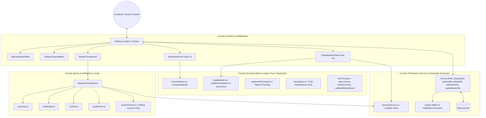

---

## 2. Le Modèle Épistémique et la Constitution

Tout énoncé, option, argument ou décision manipulé par Archinex obéit aux invariants de la Constitution (`openspec/constitution.md`) :

### Invariants Inviolables
1. **Énoncé à 5 facettes** : Contenu (triplet ontologique), Justification (antécédents), Autorité (auteur, rôle, mode de production), Maturité (niveau, confiance), Révisabilité.
2. **Règle Bloquante `verified × llm-derived`** : Aucun énoncé ni argument ne peut être promu au statut de confiance `verified` s'il est produit en mode `llm-derived`. La vérification et la décision requièrent formellement l'intervention humaine d'un architecte qualifié (`human-authored` ou `llm-proposed-human-approved`).
3. **Règle du Silence** : Une hypothèse, objection ou dilemme non contesté n'est **jamais** considéré comme approuvé tacitement. L'approbation doit résulter d'un acte formel d'arbitrage.
4. **Brouillon Télégraphique** : Style télégraphique dense, sans jargon creux ni verbiage IA non vérifié.

---

## 3. Le Cycle de Co-Conception en 6 Étapes

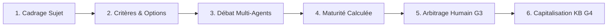

### Étape 1 : Cadrage du Sujet
Énonciation claire du `problemStatement` et référence de section. Le sujet démarre au niveau `L0_named` puis `L1_framed`.

### Étape 2 : Critères & Options Contrastées
Définition d'au moins 2 critères d'évaluation pondérés et formulation d'au moins 2 options d'architecture viables. Chaque option est notée (de -2 à +2) sur l'ensemble des critères avec justification obligatoire.

### Étape 3 : Débat Multi-Agents Borné
Un tour d'orchestration (3 tours maximum) enchaîne 4 agents spécialisés :
- **Proposer** : Défend les options et suggère des options complémentaires si nécessaire.
- **Challenger** : Émet au moins une objection argumentée par option (risques, coûts cachés, dépendances).
- **Verifier** : Contrôle la conformité avec la doctrine via `checkOption` et produit des arguments de vérification avec références KB strictes.
- **Synthesizer** : Résume les points de tension, les compromis et les questions clés pour l'arbitre humain.

Toute objection doit être résolue (`answered` ou `accepted_risk`) par un expert humain habilité avant l'arbitrage.

### Étape 4 : Calcul Dynamique de la Maturité (`computeMaturity`)
La maturité d'un sujet n'est plus fixée manuellement : elle est calculée par une fonction pure qui évalue 8 codes de blocage :
- `MISSING_PROBLEM_STATEMENT` : Problème non formulé.
- `MISSING_CRITERIA` : Moins de 2 critères définis.
- `INSUFFICIENT_OPTIONS` : Moins de 2 options formulées.
- `UNEVALUATED_OPTION` : Option non évaluée sur tous les critères.
- `OPEN_OBJECTION` : Objection ouverte non résolue dans le débat.
- `UNRESOLVED_VIOLATION` : Règle doctrinale violée sans dérogation justifiée.
- `OPEN_BLOCKING_QUESTION` : Question bloquante sans réponse.
- `COVERAGE_INCOMPLETE` : Référentiel réglementaire projet (`NIS2`, `SecNumCloud`...) non couvert.

### Étape 5 : Arbitrage Humain Opposable (Porte G3)
Seul un `lead_architect` ou un `domain_expert` habilité sur le domaine du sujet peut prononcer l'arbitrage :
- Sélection de l'option retenue ;
- Enregistrement des motifs d'écartement pour chaque alternative ;
- Évaluation de la réversibilité (`reversible`, `costly`, `irreversible`) ;
- Enregistrement des dérogations acceptées avec justification opposable ;
- Promotion formelle à `L3_decided` et transformation des énoncés dérivés en `llm-proposed-human-approved`.

### Étape 6 : Capitalisation Souveraine vers LLMOps (Porte G4)
Chaque arbitrage produit automatiquement des candidats à la Knowledge Base :
1. `new_asset` : Si l'option retenue constitue un nouveau pattern sans antécédent doctrinal.
2. `amendment` : Pour chaque dérogation acceptée, afin d'adapter la règle d'entreprise.
3. `rex` : Synthèse systématique du compromis architectural et des motifs du choix.

**Garanties Souveraines :**
- **Anonymisation stricte** : Nettoyage automatique des noms de projets, clients, sites, participants, adresses IP et volumes chiffrés.
- **Invariant III (Human-in-the-loop)** : L'architecte prévisualise et peut modifier chaque candidat avant envoi. Rien n'est expédié sans action humaine explicite.
- **Suivi des statuts** : Synchronisation avec la file LLMOps (`in_review`, `accepted`, `rejected`).

---

## 4. Pipeline de Validation et d'Assurance Qualité

La qualité et l'étanchéité du système sont garanties par le script unifié `node scripts/verify.mjs` validant 4 portes d'acceptation :
1. **Denylist Check** : 0 terme projet ou fournisseur interdit dans `src/`.
2. **Vitest Test Suites** : tests unitaires, contractuels et d'intégration (les tests « live » exigent un serveur LLMOps réel et sont ignorés sinon).
3. **Svelte Check** : 0 erreur, 0 avertissement de typage strict TypeScript / Svelte 5.
4. **Production Build** : Compilation complète des bundles client et serveur SSR.

---

## 5. Gouvernance Knowledge Hub & Comptes Experts (Lot A6)

Archinex gère les comptes utilisateurs locaux et assure la propagation stricte de l'identité des experts vers LLMOps, qui demeure l'autorité sur le registre des propriétaires (`owners`) et la recevabilité doctrinale.

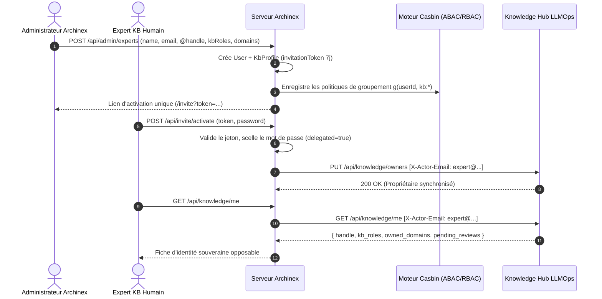

### Rôles KB Canoniques
- `kb:review` : Droit de voter, d'approuver ou de rejeter les candidats de doctrine et amendements.
- `kb:evaluate` : Droit d'exécuter et d'annoter les bancs d'évaluation et suites de tests.
- `kb:maintain` : Droit de modifier et de mettre à jour directement les règles de doctrine et templates de prompt.
- `kb:admin` : Droit de superviser les propriétaires, publier des releases doctrinales et administrer la gouvernance.

### Propagation d'Identité Souveraine (`X-Actor-Email`)
Tout appel expert émis vers LLMOps (`/api/knowledge/me`, `/api/knowledge/owners`, `/api/knowledge/candidates`...) propage l'entête HTTP `X-Actor-Email: <user_email>`. Aucun secret de service (`LLMOPS_AUTH_TOKEN`) n'est jamais exposé au navigateur client.

---

## 6. Boîte de Revue Experte, Actions d'Examen et Notifications (Lot A7 - Porte G5)

Archinex implémente la boîte de réception des revues et l'espace de décision expert pour statuer sur les candidats de doctrine soumis par les projets ou les architectes.

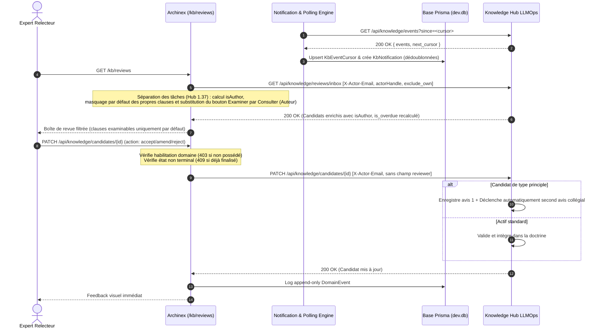

### Invariants & Règles de Gouvernance Clés (Porte G5)
1. **Les 7 Contrôles Automatiques LLMOps** : Chaque candidat reçu affiche les résultats de 7 contrôles préalables formels (`schema_validity`, `clarity_score`, `testability`, `non_duplication`, `sovereign_compliance`, `domain_alignment`, `architectural_impact`).
2. **Double-Avis Obligatoire pour les Principes** : Tout candidat de type `principle` accepté par un expert déclenche automatiquement une tâche de second avis collégial auprès d'un pair avant intégration définitive.
3. **Contrôle d'Autorisation par Domaine (403 Forbidden)** : Un expert ne peut statuer que sur les candidats appartenant à ses domaines déclarés (`ownedDomains`). Tout écart est refusé avec une notification explicite.
4. **Interdiction du Rejet Sans Motif** : Rejeter un candidat exige un motif obligatoire circonstancié (règle constitutionnelle IV).
5. **Idempotence Absolue du Moteur d'Événements** : Le curseur persistant `KbEventCursor` et le suivi des identifiants d'événements garantissent zéro doublon de notification, même en cas de pollings multiples concurrents.
6. **Résilience et Dégradation Gracieuse** : En cas de code 503 du service de gouvernance LLMOps, l'interface bascule en lecture dégradée sans planter.

---

## 7. Atelier de Doctrine, Templates d'Actifs et Simulation de Clauses (Lot A8 - Issue #3)

L'Atelier de Doctrine (`/kb/workshop`) est l'environnement d'ingénierie doctrinale souveraine permettant aux architectes et experts de concevoir, valider et simuler des clauses de doctrine avant leur soumission formelle.

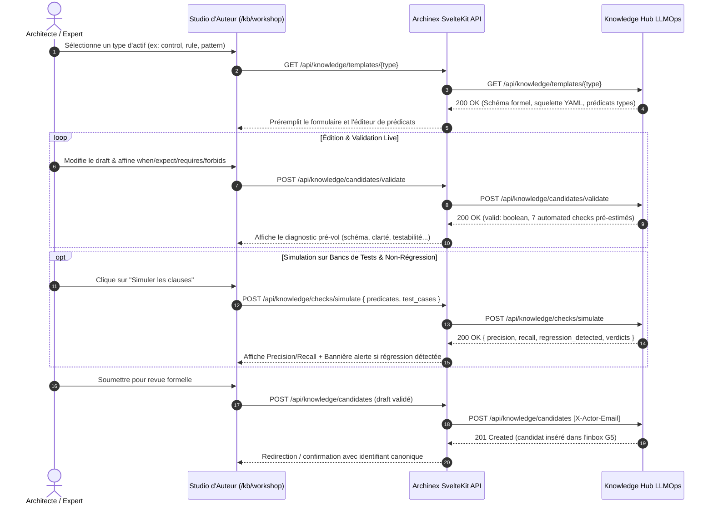

### Invariants & Règles de Conception (Lot A8)
1. **Templates Canoniques Déclaratifs** : 7 types d'actifs normés (`principle`, `pattern`, `decision`, `control`, `glossary`, `rule`, `amendment`) disposant chacun de règles de validation strictes et d'exemples de prédicats testables.
2. **Prédicats Formels Opérables** : Chaque règle ou clause de contrôle articule ses conditions autour de quatre axes unifiés : `when` (champ d'application/déclencheur), `expect` (condition d'admissibilité), `requires` (dépendances obligatoires) et `forbids` (anti-patrons proscrits).
3. **Pré-vol Live (Zero Bad Submission)** : Le point d'entrée `POST /api/knowledge/candidates/validate` anticipe la notation des 7 contrôles automatiques LLMOps, alertant l'auteur sur les manques de clarté, de testabilité ou de complétude avant toute publication.
4. **Moteur de Simulation & Alerte de Régression** : La simulation sur cas de test historiques évalue la Précision et le Rappel de la clause. Si une nouvelle version de clause casse des cas conformes existants (`regression_detected: true`), une bannière d'alerte rouge bloque la soumission non surveillée.
5. **Circuit Ouvert vers la Boîte de Revue (Porte G5)** : Une clause rédigée et validée est directement enregistrée comme candidat `DRAFT` ou `SUBMITTED`, garantissant la continuité immédiate avec la boîte d'examen experte (`/kb/reviews`).

---

## 8. Ingestion des Référentiels Réglementaires et Déclaration de Couverture (Lot A10 - Issue #5)

L'espace Référentiels Réglementaires (`/kb/frameworks`) dote Archinex de la capacité d'ingérer des référentiels externes multi-formats, d'instruire chaque exigence ligne par ligne et d'émettre des attestations formelles de conformité opposables.

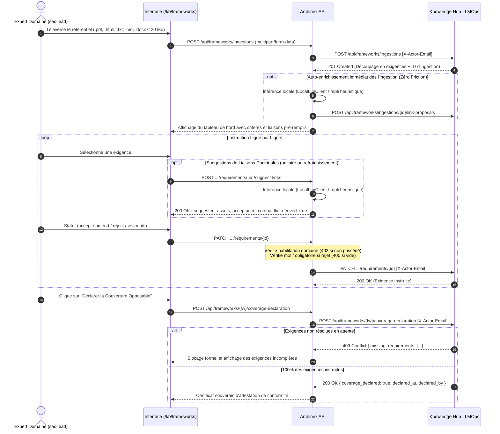

### Invariants & Règles de Gouvernance Clés (Lot A10)
1. **Téléversement Multi-Format Sécurisé** : Prise en charge des formats `.pdf`, `.html`, `.txt`, `.md`, `.docx` avec contrôle strict de taille plafonné à 20 Mo (HTTP 413).
2. **Découpage & Indexation d'Exigences** : Chaque clause réglementaire devient une entité atomique inspectable, traçable et rattachée à un domaine d'architecture.
3. **Assistance IA Étiquetée (`llm-derived`)** : Les correspondances sémantiques proposées par le LLM local ne constituent que des suggestions d'aide à la décision ; elles nécessitent obligatoirement un acte de validation explicite par l'expert humain (Invariant II).
4. **Cloisonnement d'Habilitation par Domaine (403 Forbidden)** : Un relecteur ne peut accepter, amender ou rejeter une exigence que s'il est formellement propriétaire du domaine correspondant (`ownedDomains`).
5. **Interdiction Absolue du Rejet Arbitraire (400 Bad Request)** : Tout rejet d'exigence réglementaire impose un motif textuel circonstancié expliquant l'inapplicabilité (Règle constitutionnelle IV).
6. **Scellement Opposable & Détection de Conflit (409 Conflict)** : La déclaration de couverture est conditionnée à la résolution exhaustive de 100% des exigences du référentiel. Toute lacune déclenche un blocage 409 mentionnant nominativement les exigences manquantes.

---

## 9. Moteur d'Évaluation Doctrinale, Porte G6 et Boucle de Rétroaction des Débats (Lot A9)

Le sous-système d'évaluation garantit la rigueur et l'exactitude de la doctrine architecturale en mesurant empiriquement le taux de rappel et de précision sur le banc de référence `check_option_v1`, tout en permettant l'amélioration continue via le signalement des désaccords depuis les délibérations en direct.

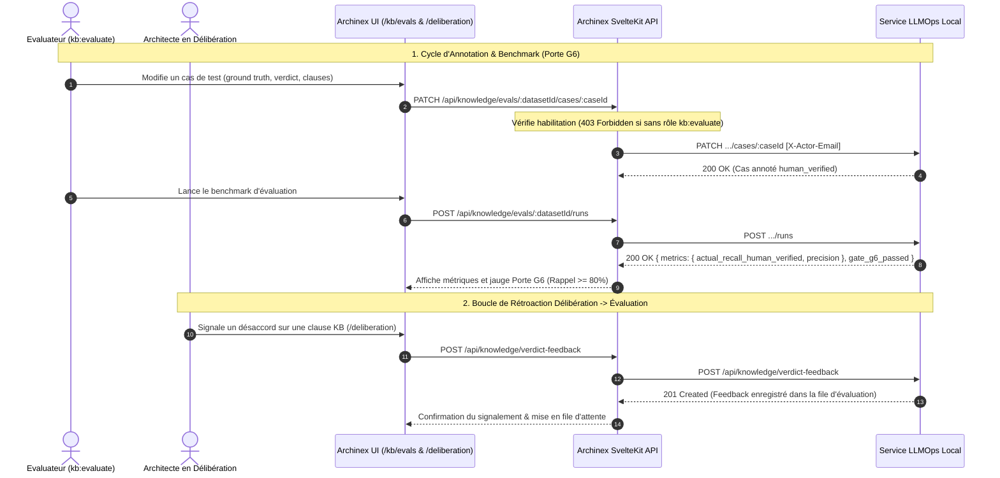

### Invariants & Règles de Gouvernance Clés (Lot A9)
1. **Contrôle d'Accès d'Évaluation RBAC (403 Forbidden)** : Seuls les experts dotés explicitement du rôle `kb:evaluate` sont autorisés à annoter les cas de test ou à modifier la vérité terrain du jeu de test. Les relecteurs standards (`kb:review`) ne disposent que d'un accès en lecture seule.
2. **Calcul Strict du Rappel Réel sur les Cas Vérifiés par l'Humain** :
   $$\text{Rappel}_{\text{humain}} = \frac{\text{Vrais Positifs sur cas vérifiés}}{\text{Total des cas vérifiés conformes}}$$
   Le calcul de rappel pour la validation de la Porte G6 exclut les cas non révisés ou purement synthétiques, interdisant toute surestimation artificielle de la complétude doctrinale.
3. **Seuil de Porte Qualité G6 ($\ge 80\%$)** : Pour déclarer la Porte G6 franchie (*Atelier & Evals Validés*), le rappel réel doit être supérieur ou égal à 0.80 et le nombre de régressions inexpliquées doit être strictement nul.
4. **Continuité Opérationnelle & Traçabilité des Feedbacks** : Tout désaccord signalé lors d'un arbitrage ou d'un débat en séance est historisé avec son horodatage, l'auteur (`X-Actor-Email`), la raison (`false_positive`, `false_negative`, `ambiguity`, `outdated_doctrine`), la règle alternative proposée et la référence de délibération.

---

## 10. Tableau de Bord de Santé KB, Scellement Cryptographique et Porte G7 (Lot A11)

Le sous-système de publication et de pilotage centralise les indicateurs de maturité de la doctrine d'entreprise, impose le respect des portes de qualité amont (Portes G5 et G6), et scelle les instantanés officiels sous empreinte cryptographique SHA-256 opposable.

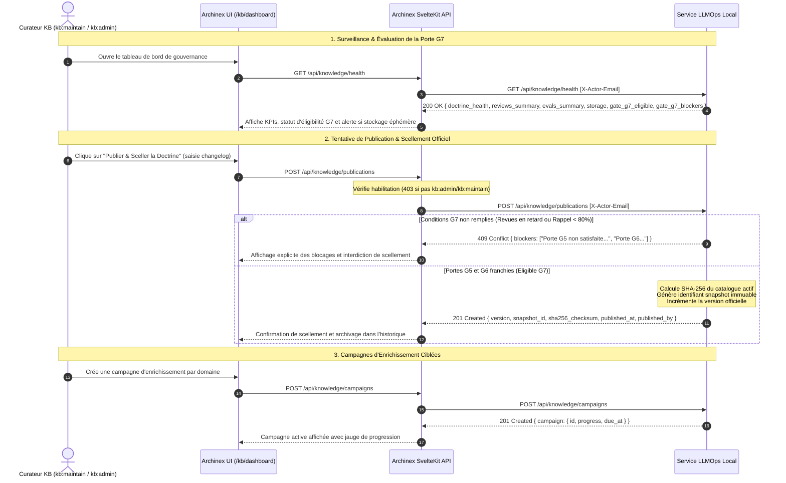

### Invariants & Règles de Gouvernance Clés (Lot A11)
1. **Contrôle d'Habilitation de Publication (403 Forbidden)** : Seuls les profils d'experts détenteurs du rôle `kb:admin` ou `kb:maintain` (ou administrateurs système) sont habilités à déclencher une publication officielle de doctrine.
2. **Scellement Conditionné par la Porte G7 (409 Conflict)** : L'émission d'un instantané officiel exige impérativement que :
   - Zéro revue critique ne soit en retard dans la boîte de réception des experts (Porte G5 respectée).
   - Le rappel réel sur le jeu de test vérifié par l'humain atteigne ou dépasse 80% (Porte G6 validée).
   Toute anomalie ou dette non traitée déclenche un rejet 409 bloquant mentionnant nominativement les critères défaillants.
3. **Scellement Cryptographique Immuable (SHA-256)** : Chaque publication produit une empreinte SHA-256 calculée sur l'instantané, le changelog et l'horodatage, rendant toute altération ultérieure immédiatement détectable.
4. **Détection Obligatoire de Stockage Éphémère (Mode Démo)** : L'interface avertit obligatoirement par un bandeau d'alerte visible dès lors que le moteur LLMOps sous-jacent tourne en mémoire non persistante (`storage.mode = "demo"`), empêchant toute fausse assurance de pérennité.
5. **Pilotage Proactif par Campagnes** : Les curateurs peuvent initier des campagnes d'enrichissement ciblées par domaine d'architecture (`security`, `cloud`, `resilience`) avec jauge de progression et date d'échéance.

---

## 11. Architecture de Performance & Fluidité de Navigation (Dashboard & Mini-Apps)

Pour éliminer toute latence lors du clic sur le Dashboard (`/`) ou lors du basculement entre les mini-applications (`/workspaces`, `/deliberation`, `/knowledge`), Archinex met en œuvre une optimisation multicouche :

### 1. Cache Mémoire en Lecture & Singleflight (`src/lib/server/llmops/client.ts`)
- **Singleflight Promise Deduplication** : regroupe les requêtes GET concurrentes vers le service LLMOps (`/api/compliance/frameworks`, `/api/knowledge/health`, `/api/knowledge/checks`, etc.) en une promesse unique afin d'éviter tout engorgement backend.
- **TTL Mémoire Adaptatif** : mise en cache mémoire de 30 secondes pour les lectures chaudes (réduit à 2 secondes sur statut d'erreur ou indisponibilité pour permettre un rétablissement rapide, désactivé par défaut en environnement de test Vitest).
- **Invalidation Automatique sur Mutation** : tout appel modifiant l'état (promotion de candidat, décision sur clause, soumission, ingestion, changement d'URL de base) purge immédiatement les entrées de cache associées.

### 2. Allégement des Payloads de Données (`engagementsDb.ts`, `+page.server.ts`, `deliberationStore.svelte.ts`)
- **Élagage Sélectif des Clauses de Documents (`includeKeyClauses: false`)** : sur les vues de synthèse (Dashboard, listes d'engagements), les 1 500+ clauses textuelles brutes de chaque document RFP sont omises du transfert initial tout en conservant le compteur d'exigences (`extractedClausesCount`), réduisant la charge utile de 2,9 Mo à moins de 100 Ko (> 97 % de réduction). Les clauses complètes sont réservées à la consultation unitaire d'un document ou d'un sujet.
- **Délestage des Propositions Mortes (`stripSubjectProposals: true`)** : purge des données temporaires de factorisation dans les listes globales d'espaces.
- **Suppression du Double-Fetch Client (`deliberationStore`)** : différé via `queueMicrotask` pour éviter le rechargement réseau de `/api/engagements` dès lors que le store est déjà hydraté par le SSR (`initFromDb`).

### 3. Résolution Granulaire des Icônes (`vite.config.ts`)
- **Plugin de Transformation `lucideOptimizePlugin`** : réécrit à la compilation les imports barils `import { A, B } from 'lucide-svelte'` en imports directs `import A from 'lucide-svelte/icons/a'`, empêchant le navigateur de télécharger et compiler les 1 929 modules d'icônes et d'alias en mode développement (baisse de 3 788 requêtes à quelques dizaines par vue).

---

## 12. Paquet de Décision Exécutable (EDP) & Oracles OPA/Rego (Expérimental)

Dans le cadre de l'initiative expérimentale (`ARCHINEX_EXPERIMENTAL_EDP=1`), Archinex associe à chaque décision d'architecture arbitrée un **Paquet de Décision Exécutable** (EDP) assurant l'opposabilité et la vérifiabilité continue du HLD face aux instanciations LLD réelles ou simulées :

1. **Séparation Stricte Intension (HLD) vs Extension (LLD)** :
   - Le contexte de décision (`decision_context`) exprime des règles pures sur l'ontologie d'entreprise sans aucune valeur d'instanciation. Le module `intentionPurity.ts` filtre rigoureusement toute adresse IPv4, IPv6, CIDR, adresse MAC ou nom d'hôte physique ou logique avec une liste blanche stricte de standards et versions autorisées (Invariant X).
2. **Contrats Formels & Prévention de la Vacuité (`edp.schema.json`, `refined_input.schema.json`)** :
   - L'EDP formalise ses attentes d'extension via `expected_inputs`. Lors de l'évaluation, `validateRefinedInput.ts` exige la présence de chaque source et une provenance certifiée (`tool`, `version`, `command`, `sha256`, `generated_at`). Toute entrée partielle ou vide reçoit le verdict bloquant `insufficient_input` pour éliminer les faux positifs par vacuité (Invariant I & IV).
3. **Moteur d'Oracles OPA & Convention Normative à 4 Verdicts** :
   - Exécution déterministe via le binaire officiel OPA (v1.21.4 épinglé avec contrôle SHA-256) encapsulé dans `opaRunner.ts`. En cas d'indisponibilité du binaire, le résultat `unavailable` n'est jamais confondu avec un succès.
   - Bibliothèque Rego partagée (`policies/lib/edp_common.rego`) avec gestion des 4 états :
     - `compliant` : conformité totale aux politiques sans dérogation ni vacuité.
     - `violated` : non-conformité avérée avec détails et chemins précis des violations.
     - `not_applicable` : critères d'applicabilité hors périmètre.
     - `insufficient_input` : source attendue absente, vide ou non prouvée.
4. **Garde de Mutation Déterministe (`scripts/edp-mutation-gate.ts`)** :
   - Analyseur de résilience des oracles appliquant l'opérateur de mutation par neutralisation inerte de règles (`drop_rule`). Exigence absolue de tuer 100 % des mutants injectés avant toute acceptation d'oracle.
5. **Ontologie, Projections & Persistance Souveraine** :
   - Client de lecture d'ontologie déconnecté (`ontologyClient.ts`) avec contrôle strict des révisions (`stale_binding` si dérive).
   - Compilateur de projections (`projectionCompiler.ts`) produisant `data.ontology` avec empreinte canonique SHA-256 et détection de duplication littérale.
   - Modèle Prisma `ExecutableDecisionPackage` avec application directe de l'Invariant II (interdiction absolue de valider automatiquement un EDP produit par LLM sans validation humaine tracée et signée) et Invariant VI (rétractation vers `stale` lors de la caducité d'un antécédent).
6. **Service d'Évaluation `edp verify` & Adaptateurs LLD** :
   - Moteur central `edpVerify.ts` émettant un lot de preuves cryptographique (`EvidenceBundle`) avec codes de sortie standardisés (0, 1, 2, 3).
   - Adaptateur Helm Sylva/CAPI (`sylvaAdapter.ts`) avec sanitization automatique des secrets.
   - Adaptateur Nautobot Planned (`nautobotAdapter.ts`) normalisant les équipements physiques et interfaces.
7. **Chaîne de Rédaction Assistée LLM & Composant IHM Workbench** :
   - Pipeline de garde `edpDrafting.ts` filtrant les propositions d'IA par l'ensemble des contrôles déterministes avant toute présentation humaine.
   - Composant UI `EdpCard.svelte` sous drapeau `ARCHINEX_EXPERIMENTAL_EDP`, permettant aux architectes habilités de visualiser les verdicts, scores de mutation et de valider ou contester formellement l'EDP.
8. **Paquets de Référence & Promotion** :
   - Deux références complètes : `adr012-baremetal` (infrastructure Telco Cloud) et `adr015-security-zones` (cloisonnement de zones NIS2), atteignant chacune 100 % de score de mutation.
   - Document de promotion formel : [ADR-016](docs/adr/ADR-016-promotion-edp-experimental.md).

---

## 13. Architecture Logicielle de la Phase 4 : Raffinement Ontologique Multi-Axes, Hydratation Exhaustive & Réconciliation (`Phase4RefinementHub`)

Pour éviter l'écueil classique des architectures où le document de spécification (HLD) et l'ingénierie d'exécution (LLD / CMDB / GitOps) divergent sitôt l'arbitrage rendu, Archinex structure le cycle de vie d'un sujet d'architecture en **4 phases continues** et ajoute en Phase 4 un moteur formel de **raffinement piloté par l'ontologie**, d'**hydratation multi-objets** et de **réconciliation inter-domaines**.

### 13.1 Vue Globale du Pipeline en 4 Phases (De l'Appropriation à l'Hydratation SSoT & Sylva)

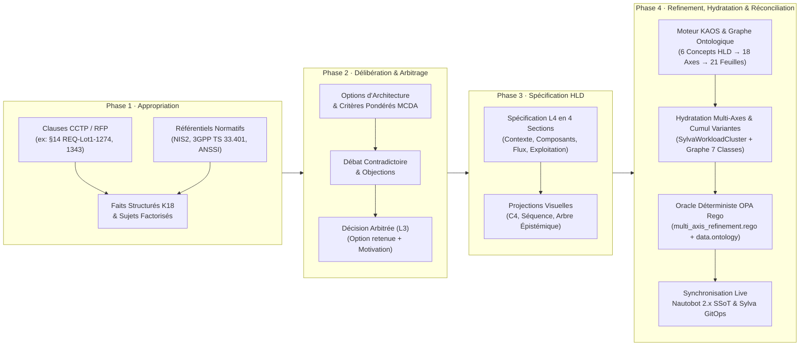

### 13.2 Découpage Modulaire Serveur & IHM de la Phase 4

| Module / Fichier | Responsabilité Architecturale |
| :--- | :--- |
| [`tests/fixtures/edp/ontology_export.json`](tests/fixtures/edp/ontology_export.json) | **Socle Ontologique SI & Telco** : définit les **6 Concepts HLD** (`telco_cloud_platform`, `interconnection_gateway`, `storage_data_persistence`, `iam_security_zerotrust`, `observability_noc_soc`, `resilience_drp_continuity`), leurs **18 Axes de Raffinement obligatoires** (`kind: "axis"`), les **21 Feuilles d'Implémentation** (`kind: "leaf"`, incluant leurs `projections` pour `data.ontology`, leurs `oracle_rules` et leur `hydration_template`) ainsi que les triplets relationnels (`requires_aspect`, `implemented_by`, `depends_on`, `constrains`, `conflicts_with`). |
| [`src/lib/server/edp/ontologyClient.ts`](src/lib/server/edp/ontologyClient.ts) | **Moteur de Requêtage & Édition de Triplets `{ Sujet, Verbe, Complément }`** : expose `queryOntologyTriplets`, `addOntologyTriplet` et `removeOntologyTriplet` avec persistance dans une surcouche runtime (`data/ontology_runtime_overlay.json`), permettant d'étendre les axes de couverture sans toucher au code. |
| [`src/lib/server/edp/refinementCoverage.ts`](src/lib/server/edp/refinementCoverage.ts) | **Moteur KAOS de Couverture, Composition & Hydratation Multi-Axes** : <br/>• `resolveSubjectConcepts` : sélectionne les concepts HLD pertinents par propagation ascendante sur le graphe.<br/>• `computeRefinementCoverage` : calcule la matrice de complétude KAOS (`covered_executable` 🟢, `covered_no_oracle` 🟡, `missing_refinement` 🔴), auto-lie les feuilles standards par défaut (`is_default_standard`) et supporte le **cumul de variantes (OU inclusif)** sur un même axe.<br/>• `composeMultiAxisHydration` : synthétise l'inventaire LLD multi-axes (`nautobot_planned_devices`, `sylva_workload_cluster_values`, `k8s_manifests`, `security_zones`, `environments`, `power_feeds`) et le **Graphe de Réconciliation à 7 classes d'objets (`reconciliation_graph`)**.<br/>• `evaluateMultiAxisOracle` : invoque le binaire OPA sur `edp/policies/multi_axis_refinement.rego`. |
| [`src/lib/server/edp/projectionCompiler.ts`](src/lib/server/edp/projectionCompiler.ts) | **Compilateur de Projections `data.ontology`** : compile les `projections` des feuilles liées en un document JSON déterministe injecté dans OPA (`--data`), calcule son empreinte canonique SHA-256 et vérifie l'absence de littéraux métier dupliqués en dur dans les règles Rego (`detectDuplicateLiterals`). |
| [`edp/policies/multi_axis_refinement.rego`](edp/policies/multi_axis_refinement.rego) | **Oracle Rego v1 Multi-Axes Sans Littéral Codé en Dur** : évalue conjointement le substrat compute, le réseau OOB Redfish, le zonage de sécurité NIS2, la parité Iso-Prod des environnements, la résilience électrique 2N, le chiffrement IPsec ESP, la chaîne de médiation S6a (`SecGW-Lot1` $\rightarrow$ `DEA-Lot1` $\rightarrow$ `HSS-Lot1`) et la réconciliation inter-domaines (`tenant_ref`). |
| [`src/lib/server/edp/nautobotSync.ts`](src/lib/server/edp/nautobotSync.ts) | **Synchroniseur SSoT Temps Réel vers Nautobot 2.x** : pousse de manière idempotente via l'API REST Nautobot les Tenants (`tenancy.Tenant`), Fournisseurs & Circuits (`circuits.Circuit` + `CircuitTermination` A/Z), VLANs (`ipam.VLAN`), Préfixes IP (`ipam.Prefix`) et les Équipements DCIM (`dcim.Device` : serveurs Bare-Metal Sylva, objets externes 3GPP Shadow et nœuds de médiation Cœur Lot 1). |
| [`src/lib/components/deliberation/Phase4RefinementHub.svelte`](src/lib/components/deliberation/Phase4RefinementHub.svelte) | **Atelier IHM Plein Écran Phase 4** : affiche les filtres des 6 Concepts HLD, la matrice de couverture KAOS avec boutons `+ Cumuler` / `⇄ Remplacer` / `✕ Retirer`, le Graphe de Réconciliation à 7 classes d'objets, les raccourcis directs vers Nautobot (`Circuits`, `Tenants`, `Devices`) et le **Simulateur de Dérive CMDB (7 scénarios de Drift)**. |
| [`src/lib/components/knowledge/OntologyTripletEditorView.svelte`](src/lib/components/knowledge/OntologyTripletEditorView.svelte) | **Visualiseur & Éditeur Graphique de Triplets Ontologiques** dans `/knowledge?view=ontology` : permet de parcourir l'arbre `Concept HLD → Axes Requis → Feuilles & Règles Rego` et d'éditer les triplets `{ Sujet, Verbe, Complément }`. |

---

## 14. Fondements Scientifiques & Standards Industriels de Référence

La conception de la Phase 4 d'Archinex s'appuie sur **4 travaux académiques fondateurs** en ingénierie des exigences et modélisation ontologique, combinés à **5 standards industriels Télécom / Cloud-Native**.

### 14.1 Papiers Scientifiques de Référence (Fondements Théoriques)

| Référence Scientifique | Concept Théorique | Traduction Concrète dans Archinex |
| :--- | :--- | :--- |
| **1. Axel van Lamsweerde (2001, 2009)**<br/>*Goal-Oriented Requirements Engineering: A Guided Tour* (IEEE RE'01) & *Requirements Engineering: From System Goals to UML Models to Software Specifications* (Wiley, 2009) | **Raffinement de Buts KAOS (`AND-Refinement` vs `OR-Refinement`) & Opérationnalisation** :<br/>Un objectif de haut niveau est *incomplet* tant que tous ses sous-buts conjonctifs (`AND`) ne sont pas raffinés jusqu'à des feuilles opérationnalisables munies de contraintes formelles vérifiables par machine. | • **AND-Refinement** : représenté par les triplets `(Concept_HLD, requires_aspect, Axe_Obligatoire)`. Un sujet rattaché à un concept HLD hérite de tous ses sous-axes obligatoires.<br/>• **OR-Refinement (exclusif ou inclusif)** : représenté par les triplets `(Axe_Obligatoire, implemented_by, Feuille)`. Supporte le remplacement (`replace`) ainsi que le **cumul inclusif (`add`)** lorsque deux variantes coexistent (ex: Pool Sylva CNF SR-IOV/DPDK + Pool Sylva Standard NIS2).<br/>• **Distinction des 3 états de complétude** : `missing_refinement` (🔴), `covered_no_oracle` (🟡 feuille liée mais sans règle Rego), `covered_executable` (🟢 feuille liée avec oracle Rego actif). |
| **2. Don Batory (2004)**<br/>*Feature-Oriented Software Development (FOSD) & AHEAD Algebraic Hierarchical Equations for Application Design* (IEEE TSE, vol. 30, no. 5, 2004) | **Composition Algébrique Multi-Axes ($\text{Artefact} = f_n \circ \dots \circ f_1(\text{Base})$)** :<br/>Au lieu de dupliquer $N \times M \times P$ templates monolithiques, chaque caractéristique (*feature*) est une fonction de transformation modulaire qui enrichit un modèle de base commun. | • Dans [`composeMultiAxisHydration`](src/lib/server/edp/refinementCoverage.ts), chaque feuille d'ontologie liée porte un fragment `hydration_template` et `projections`.<br/>• L'inventaire LLD final est le produit de la composition algébrique de toutes les feuilles liées : l'axe Compute crée les nœuds Sylva, l'axe OOB y injecte les interfaces BMC Redfish, l'axe Sécurité y attache les zones `ZONE-OAM`/`ZONE-UPF-USER`, et l'axe Énergie y raccorde les adductions `PDU-A` + `PDU-B`. |
| **3. C. Maria Keet & Alessandro Artale (2008)**<br/>*Representing and Reasoning over a Taxonomy of Part-Whole Relations* (Applied Ontology, IOS Press, 2008) & **Guarino / Welty (OntoClean)** | **Relations Méronomiques Obligatoires & Dépendances Ontologiques Transverses** :<br/>Distingue la sous-classification taxonomique (`is_a`) des relations structurelles obligatoires (`requires_aspect`) et des contraintes d'intégrité inter-branches (`depends_on`, `constrains`, `conflicts_with`). | • Le moteur [`computeRefinementCoverage`](src/lib/server/edp/refinementCoverage.ts) parcourt les triplets `depends_on` et `conflicts_with` sur l'ensemble des feuilles liées.<br/>• Exemple : si la feuille Bare-Metal (`urn:archinex:ontology:infrastructure:server:baremetal`) est liée sans la feuille Réseau OOB (`urn:archinex:ontology:telecom:network:oob`), une alerte formelle `CrossAxisDependencyIssue` est levée et bloque la complétude KAOS. |
| **4. Krzysztof Czarnecki, Simon Helsen & Ulrich Eisenecker (2005)**<br/>*Staged Configuration through Specialization and Multi-Level Configuration of Feature Models* (Software Process: Improvement and Practice, 2005) | **Spécialisation par Étapes (*Staged Configuration*) Intension $\rightarrow$ Extension** :<br/>Sépare la configuration de l'espace de décision (liaison de variantes abstraites et bornes de conformité) de l'instanciation des paramètres physiques (IP, noms d'hôtes, ports). | • **Étape 1 (Intension HLD/Ontologie)** : les `projections` de l'ontologie fixent les invariants abstraits (`cipher_suite: "AES-256-GCM"`, `min_power_supplies: 2`, `required_mediation_hops: ["secgw-lot1-01", "dea-lot1-01"]`).<br/>• **Étape 2 (Extension LLD)** : l'hydratation génère les instances concrètes vérifiées par OPA contre `data.ontology`, sans aucun littéral métier codé en dur dans Rego. |

### 14.2 Standards Industriels de Référence (Télécom, Cloud-Native & CMDB)

1. **LF Europe Sylva (`sylva-projects/sylva-core` & `sylva-units`)** :
   - Cadre de référence européen Telco Cloud (fondé par Orange, Deutsche Telekom, Telefónica, Vodafone, Telecom Italia, SUSE, Red Hat, Nokia, Ericsson).
   - Fournit le CRD **`SylvaWorkloadCluster` (`workloadcluster.sylva.org/v1alpha1`)** et le chart Helm **`sylva-units`** orchestrant Cluster API (`capm3` Metal3 Bare-Metal + `cabpr` RKE2 sur SLE Micro) et les briques réseau Telco (`cilium`, `multus`, `sriov`, `metallb`, `vault`, `kyverno`, `monitoring`).
2. **FluxCD & Kustomize GitOps (`workload-clusters/` & Overlays Multi-DC)** :
   - Compilation directe par Archinex des descripteurs déclaratifs (`values.yaml` Sylva et manifestes Kustomize `base/` + `overlays/dc1`, `overlays/dc2`) soumis au contrôle déterministe OPA/Batfish avant ouverture de PR/MR GitOps, **sans serveur intermédiaire Nephio / Porch**.
3. **3GPP TS 28.620 (Umbrella NRM) & TS 28.541 (5G NRM)** :
   - Standardise la modélisation des équipements tiers hors périmètre d'administration via la classe **`ExternalFunction`** (`ExternalMMEFunction`, `ExternalENodeBFunction`) et des points de référence inter-opérateurs (`EP_RP`, `EP_S6a`).
4. **TM Forum ODA / SID (GB922 — *Shared Information & Data Model*)** :
   - Définit le chaînage canonique entre les domaines **Party** (`PartnerOrganization` / `tenant_ref`), **Resource** (Liens IP, Tunnels IPsec, Serveurs), **Service** (Flux médiatisé S6a) et **SLA / Monitoring** (`ServiceLevelAgreement`, `ResourceMonitorProbe`).
5. **Nautobot 2.x SSoT (*Single Source of Truth*) & `DiffSync`** :
   - Référentiel CMDB orienté source de vérité unique unifiant `tenancy.Tenant`, `circuits.Circuit`, `ipam.Prefix`, `ipam.VLAN` et `dcim.Device`, et permettant la détection de dérive (*Drift*) entre l'état planifié (`Planned`) et l'état observé.

---

## 15. Vues d'Intégration Détaillées (Sylva, FluxCD GitOps, Nautobot 2.x SSoT & 3GPP/TMF)

### 15.1 Principe Directeur vis-à-vis de Sylva : Ne Jamais Réinventer `sylva-core` / `sylva-units` ni Introduire de Couche Intermédiaire Nephio

> [!IMPORTANT]
> **Règle d'Architecture d'Intégration Sylva & GitOps Direct (Sans Nephio) :**
> **Sylva** possède déjà son propre opérateur (`workload-cluster-operator`) et son chart maître (`sylva-units`) qui traduisent un descripteur de cluster en ressources Cluster API (`Cluster`, `RKE2ControlPlane`, `MachineDeployment`, `Metal3DataTemplate`, `BareMetalHost` `metal3.io/v1alpha1`) et déploient les unités logicielles (`sriov`, `multus`, `cilium`, `vault`).
> **Archinex n'intègre pas Nephio / Porch et ne réinvente jamais `sylva-units`** : Archinex agit directement comme **compilateur d'intention déterministe** en amont de FluxCD et Nautobot pour produire :
> 1. Le descripteur d'entrée natif **`SylvaWorkloadCluster` (`workloadcluster.sylva.org/v1alpha1`)** et ses valeurs `sylva-units` (`capi_providers`, `baremetal_hosts`, `machine_deployments`, `units`).
> 2. L'inventaire SSoT **Nautobot 2.x** correspondant (`Tenants`, `Circuits`, `VLAN`, `Prefixes`, `Devices`).
> 3. La preuve formelle **OPA Rego** que l'inventaire Nautobot et le descripteur Sylva sont mutuellement cohérents et respectent les décisions HLD.

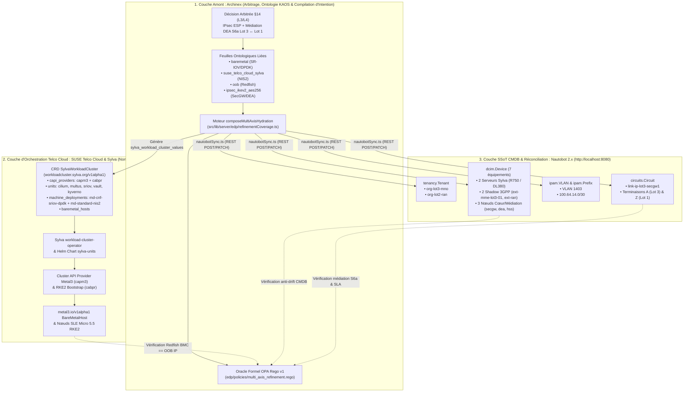

### 15.2 Structure du Descripteur Natif `SylvaWorkloadCluster` Généré par Archinex

Lorsqu'un sujet cumule sur l'axe `compute_substrate` la variante **CNF Cœur de Réseau (`sylva-cnf-sriov-dpdk`)** et la variante **Standard Isolée (`sylva-standard-nis2`)**, [`composeMultiAxisHydration`](src/lib/server/edp/refinementCoverage.ts) produit directement l'objet `sylva_workload_cluster_values` attendu par `sylva-units` :

```json
{
  "apiVersion": "workloadcluster.sylva.org/v1alpha1",
  "kind": "SylvaWorkloadCluster",
  "metadata": {
    "name": "wc--proposes-89",
    "namespace": "sylva-workload-clusters",
    "annotations": {
      "archinex.io/gitops-target": "workload-clusters/wc--proposes-89",
      "archinex.io/source-subject": "sub_lulu-avec-options-et-criteres-proposes_89"
    }
  },
  "spec": {
    "capi_providers": {
      "infra_provider": "capm3",
      "bootstrap_provider": "cabpr"
    },
    "k8s_version": "v1.28.11+rke2r1",
    "os_image_selector": {
      "os": "sle-micro",
      "release": "5.5",
      "hardened": true
    },
    "units": {
      "cilium": { "enabled": true },
      "multus": { "enabled": true },
      "sriov": { "enabled": true },
      "sriov-resources": { "enabled": true },
      "metallb": { "enabled": true },
      "vault": { "enabled": true },
      "kyverno": { "enabled": true },
      "monitoring": { "enabled": true }
    },
    "baremetal_hosts": {
      "srv--proposes-89-01": {
        "bmh_metadata": { "labels": { "host-group": "sylva-standard-nis2", "device-type": "HPE-ProLiant-DL380" } },
        "bmh_spec": { "bmc": { "address": "redfish+http://192.0.2.10/redfish/v1/Systems/1" }, "bootMACAddress": "52:54:00:12:34:56" }
      },
      "srv--proposes-89-02": {
        "bmh_metadata": { "labels": { "host-group": "sylva-cnf-sriov-dpdk", "device-type": "Dell-PowerEdge-R750" } },
        "bmh_spec": { "bmc": { "address": "redfish+http://192.0.2.11/redfish/v1/Systems/1" }, "bootMACAddress": "52:54:00:12:34:57" }
      }
    },
    "machine_deployments": {
      "md-sylva-standard-nis2": {
        "infra_provider": "capm3",
        "replicas": 1,
        "rke2": { "nodeLabels": { "sylva.org/pool": "sylva-standard-nis2", "sylva.org/dataplane": "cilium-nis2" } }
      },
      "md-sylva-cnf-sriov-dpdk": {
        "infra_provider": "capm3",
        "replicas": 1,
        "rke2": {
          "nodeLabels": { "sylva.org/pool": "sylva-cnf-sriov-dpdk", "sylva.org/dataplane": "sriov-dpdk-numa" },
          "kubeletExtraArgs": ["--cpu-manager-policy=static", "--topology-manager-policy=single-numa-node"]
        },
        "network_interfaces": {
          "bond0": { "type": "bond", "interfaces": ["eno1", "eno2"], "vlans": [{ "id": 1403 }] },
          "sriov0": { "type": "sriov", "num_vfs": 16, "mtu": 9000 }
        }
      }
    }
  }
}
```

### 15.3 Vue de Réconciliation Multi-Objets autour du Pivot `tenant_ref = "org-lot3-mno"` (§14)

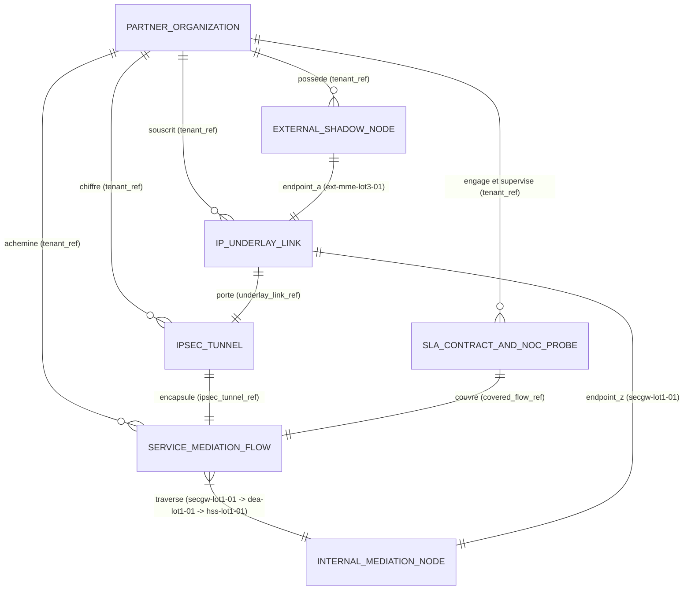

### 15.4 Démonstration Complète du Parcours et Composition Algébrique de Batory sur le Cas §14

Cette section illustre pas à pas le parcours complet depuis l'expression du besoin initial jusqu'à l'hydratation vivante dans Nautobot et le descripteur Sylva, en démontrant mathématiquement et techniquement le principe de **composition algébrique** :
$$\text{Descripteur Cible} = (f_{\text{Énergie 2N}} \circ f_{\text{OOB}} \circ f_{\text{NIS2}} \circ f_{\text{SR-IOV}} \circ f_{\text{IPsec-Mediation}})(\text{Base Cluster})$$

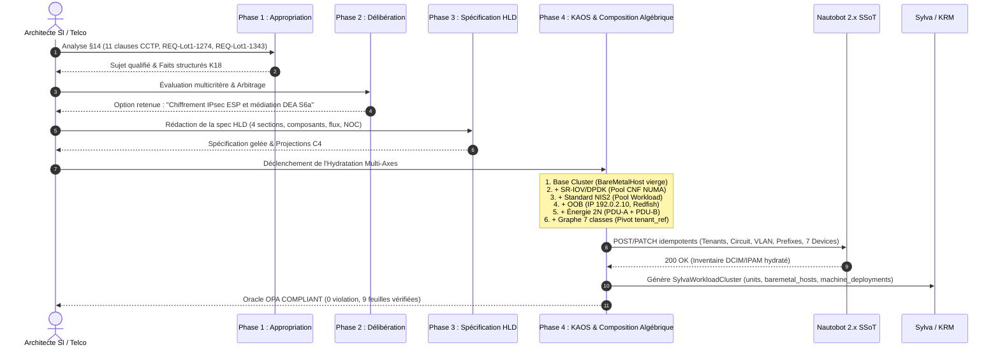

#### Étape 1 · Phase 1 (Appropriation) : Découpage et Ancrage des Exigences
- **Entrée** : 11 clauses contractuelles du CCTP Lulu Lot 1 (`REQ-Lot1-557`, `701`, `711`, `1270`, `1274`, `1275`, `1276`, `1277`, `1278`, `1279`, `1343`).
- **Analyse d'impact** :
  - `REQ-Lot1-1274` : obligation d'inhiber les fausses alarmes NOC générées par les cellules mobiles et RAN tiers intermittents du Lot 2.
  - `REQ-Lot1-1343` : démarcation stricte de la responsabilité d'hébergement électrique et réseau au niveau du répartiteur Lot 1 (MMR).
- **Résultat** : sujet qualifié `sub_lulu-avec-options-et-criteres-proposes_89` (*§14 · Hébergement Lots 2/3, RAN tiers et cellules mobiles : sécurité contre souplesse*).

#### Étape 2 · Phase 2 (Délibération & Arbitrage) : Décision Formelle
- **Option retenue** : *Obligation de chiffrement IPsec ESP et médiation DEA pour les flux S6a Lot 3 ↔ Lot 1* (`opt-1793311130542-wmhxr`).
- **Motivation** : *« c'est la bonne »* (garantie de non-répudiation, étanchéité protocolaire et conformité 3GPP TS 33.210 NDS/IP).
- **Statut** : `reversibility: reversible`, `regulatoryStatus: Compliant`.

#### Étape 3 · Phase 3 (Spécification HLD L4) : Spécification en 4 Sections
La décision est décomposée selon la structure canonique en 4 sections :
1. **Contexte & Choix Validé** : choix de l'isolation forte avec passerelle de médiation dédiée.
2. **Décomposition des Composants** :
   - Terminaison du tunnel IPsec ESP obligatoirement sur `secgw-lot1-01`.
   - Inspection et masquage topologique obligatoires sur `dea-lot1-01`.
   - Interdiction formelle de tout flux non chiffré ou non médiatisé vers `hss-lot1-01`.
3. **Interfaces, Protocoles & Matrice de Flux** : suites fortes `AES-256-GCM` / `ECDSA-P384` / `IKEv2`, démarcation des zones réseau (`ZONE-PARTNER-LOT3-UNTRUSTED`, `ZONE-DMZ-INTERCO-LOT1`, `ZONE-MEDIATION-SIGNALING-LOT1`, `ZONE-CORE-HSS-RESTRICTED`).
4. **Exploitation, Supervision & Points de Vigilance** : télémétrie temps réel NOC avec neutralisation des alarmes intermittentes et haute disponibilité 2N.

#### Étape 4 · Phase 4 : Application du Modèle Algébrique de Batory (FOSD)

Dans [`composeMultiAxisHydration`](src/lib/server/edp/refinementCoverage.ts), le descripteur final n'est pas un template statique préexistant, mais le résultat de transformations successives composées sur un objet vierge :

```typescript
// 1. Base Cluster vierge
let cluster = {
  name: "srv-proposes-89",
  devices: [],
  k8s_manifests: [],
  security_zones: [],
  environments: [],
  power_feeds: []
};

// 2. Transformation f_SRIOV (Axe Compute Substrate - Pool CNF)
cluster = applyLeaf_SRIOV(cluster);
// => Ajoute srv--proposes-89-02 (Dell R750) avec pool sylva-cnf-sriov-dpdk
// => Ajoute md-sylva-cnf-sriov-dpdk avec pinning NUMA, HugePages 1Gi et VF SR-IOV

// 3. Transformation f_NIS2 (Axe Compute Substrate - Pool Standard)
cluster = applyLeaf_StandardNIS2(cluster);
// => Ajoute srv--proposes-89-01 (HPE DL380) avec pool sylva-standard-nis2
// => Ajoute md-sylva-standard-nis2 avec CNI Cilium

// 4. Transformation f_OOB (Axe OOB Management)
cluster = applyLeaf_OOB(cluster);
// => Injecte les interfaces oob0 (192.0.2.10/24 et 192.0.2.11/24)
// => Configure spec.bmc.address = "redfish+http://192.0.2.10/redfish/v1/Systems/1"

// 5. Transformation f_Zones (Axe Security Zoning)
cluster = applyLeaf_SecurityZones(cluster);
// => Injecte ZONE-OAM (isolation: strict, proxy: true) et ZONE-UPF-USER
// => Active les units kyverno et vault dans SylvaWorkloadCluster

// 6. Transformation f_Energie (Axe Power Resilience 2N)
cluster = applyLeaf_DualFeed2N(cluster);
// => Injecte power_feeds: ["PDU-A", "PDU-B"] sur tous les serveurs

// 7. Transformation f_IPsec_Mediation (Graphe 7 Classes avec pivot tenant_ref="org-lot3-mno")
cluster = applyReconciliationGraph(cluster);
// => Injecte les 7 classes d'objets interconnectées
```

#### Étape 5 · Résultat de l'Hydratation Réelle dans Nautobot 2.x SSoT (`nautobotSync.ts`)

L'exécution de `npm run seed:demo` ou l'appui sur le bouton **« Hydrater Nautobot & Sylva »** pousse immédiatement dans l'instance Nautobot active :
1. **Tenants** : `org-lot3-mno` (Opérateur Tiers Lot 3) et `org-lot2-ran` (RAN & Cellules Mobiles Lot 2).
2. **Circuit** : `link-ip-lot3-secgw1` (Provider `Provider-Lot3-MNO-Interco`, Type `Interco-WAN-IPsec-ESP-S6a`, statut `Planned`, 1 Gbps) reliant :
   - **Terminaison A** : `ext-mme-lot3-01` (`ExternalMMEFunction`).
   - **Terminaison Z** : `secgw-lot1-01` (`SecurityGatewayFunction` sur `pop-valmondois`).
3. **IPAM** : VLAN `1403` et préfixe `100.64.14.0/30` rattachés au tenant `org-lot3-mno`.
4. **DCIM Devices** :
   - `srv--proposes-89-01` (`HPE ProLiant DL380`, Pool `sylva-standard-nis2`).
   - `srv--proposes-89-02` (`Dell PowerEdge R750`, Pool `sylva-cnf-sriov-dpdk`).
   - `ext-mme-lot3-01` (Shadow 3GPP `ExternalMMEFunction`, non managé Lot 1).
   - `ext-ran-cell-mobile-01` (Shadow 3GPP `ExternalENodeBFunction`, intermittent).
   - `secgw-lot1-01` (Passerelle IPsec ESP Lot 1).
   - `dea-lot1-01` (Passerelle de médiation Diameter S6a Lot 1).
   - `hss-lot1-01` (Serveur abonnés cœur Lot 1).
5. **Vérification OPA Rego** : les règles `deny_unmediated_s6a_direct_flow` et `deny_unreconciled_partner_objects` retournent le verdict **`COMPLIANT`** (0 violation sur 9 feuilles évaluées).

---

## 16. Feuille de Route (Roadmap) Archinex : De l'Hydratation SSoT à l'Orchestration en Boucle Fermée

La feuille de route ci-dessous détaille les prochaines étapes d'évolution d'Archinex pour industrialiser la chaîne **Décision HLD $\rightarrow$ Ontologie KAOS $\rightarrow$ SSoT Nautobot & Clusters Sylva** sans jamais dupliquer les briques existantes de l'écosystème.

### Horizon 1 — Court Terme (Implémenté — Épique #241) : GitOps Sylva Natif & Synchronisation Bidirectionnelle `DiffSync`
1. **Export GitOps Direct vers un Dépôt `sylva-core` (`workload-clusters/`) — #238 (`src/lib/server/edp/sylvaGitopsExport.ts`)** :
   - Permet depuis la Phase 4 (`action: 'export_sylva_gitops'`) de sérialiser le fichier `workload-clusters/<cluster-name>/values.yaml` (assaini de tout secret via `sanitizeManifests()`) et d'ouvrir automatiquement une Merge Request (GitLab API v4) ou Pull Request (GitHub REST API) vers un dépôt `sylva-core`, consommable par FluxCD dans un cluster de management Sylva. L'export est formellement bloqué (`HTTP 409`) si le verdict de l'Oracle OPA est `violated`.
2. **Collecte Temps Réel (Pull / Webhook) depuis Nautobot 2.x vers l'Oracle OPA — #239 (`pullLiveInventoryFromNautobot` & `POST /api/webhooks/nautobot`)** :
   - Lors du clic sur **« Exécuter l'Oracle OPA »** (`action: 'verify'`), Archinex interroge directement l'état courant des objets dans Nautobot (`GET /api/dcim/devices/`, `/api/circuits/circuits/`, `/api/tenancy/tenants/`, `/api/vpn/ipsec-proposals/`, `/api/vpn/vpn-tunnels/`). Toute modification manuelle effectuée par un opérateur dans l'interface web de Nautobot (`http://localhost:8080`) ou reçue sur `POST /api/webhooks/nautobot` déclenche immédiatement le verdict `VIOLATED` dans Archinex.
3. **Modélisation Native des Tunnels IPsec dans le Module VPN de Nautobot 2.2+ — #240 (`syncHydratedInventoryToNautobot`)** :
   - En complément du `circuits.Circuit` (`link-ip-lot3-secgw1`), l'hydratation instancie de manière idempotente via `/api/vpn/` les objets `vpn.IKEProposal` (`ike-prop-lot3-aes256gcm-dh20`), `vpn.IPSecProposal` (`ipsec-prop-lot3-esp-aes256gcm`), `vpn.VPNProfile` (`vpn-prof-interco-lot3-s6a`) et `vpn.VPNTunnel` (`tun-ipsec-esp-lot3-secgw1`).

### Horizon 2 — Moyen Terme : Compilation GitOps des Workloads CNF Multi-DC (Overlays Kustomize) & Preuve Formelle du Plan de Routage par Batfish
*(Là où l'Horizon 1 livre le substrat cluster `SylvaWorkloadCluster` (`workload-clusters/`) et vérifie la conformité déclarative SSoT dans Nautobot, l'Horizon 2 compile directement — **sans brique intermédiaire Nephio** — les charges utiles CNF multi-sites et prouve mathématiquement l'étanchéité des tables de routage et de filtrage effectives avant tout merge GitOps).*

4. **Compilation GitOps Directe des Workloads CNF 3GPP & CNI Secondaires (`workloads/cnfs/base` & `overlays/dc1`, `overlays/dc2`)** :
   - Sans dupliquer l'opérateur `sylva-units` (qui provisionne déjà les politiques SR-IOV des nœuds en Horizon 1) et sans dépendre de Nephio, Archinex agit comme compilateur GitOps pour les 2 DC à partir de `service_mediation_flows` et `ip_underlay_links` :
     - Génération des CRD `NetworkAttachmentDefinition` (`k8s.cni.cncf.io`) spécifiques aux réseaux secondaires des fonctions réseau (mappings précis du VLAN `1403`, des plages CIDR et des pools de Virtual Functions SR-IOV `intel.com/sriov_vf_lot1` alloués dans Nautobot IPAM).
     - Génération des patches Kustomize / `values.yaml` des pods CNF (`SecGW-Lot1`, `DEA-Lot1`, `HSS-Lot1` / `UPF`) injectant les annotations d'interfaces secondaires (`k8s.v1.cni.cncf.io/networks`) avec les adresses IP statiques résolues (`100.64.14.0/30`), produisant une arborescence FluxCD complète (`base/`, `overlays/dc1`, `overlays/dc2`).
5. **Preuve Formelle du Plan de Routage & Filtrage par Couplage Batfish (`http://localhost:9997`) → Verrou OPA (§14)** :
   - En complément de la vérification topologique sur le graphe déclaratif (Horizon 1), soumettre les configurations réseau générées (tables de routage BGP/OSPF, VRF, ACLs, règles pare-feu des passerelles) au moteur d'analyse symbolique Batfish avant d'autoriser le push GitOps :
     - **Preuve d'inaccessibilité directe (`Reachability Query`)** : vérification mathématique dans Batfish qu'aucun paquet `SCTP/3868` (Diameter S6a) émis depuis `ZONE-PARTNER-LOT3-UNTRUSTED` (`172.16.30.0/24`) ne peut atteindre `hss-lot1-01` en direct.
     - **Preuve de transit obligatoire (`Service Chaining / Waypointing Invariant`)** : validation formelle que 100 % des chemins admissibles dans la RIB/FIB traversent séquentiellement l'équipement d'inspection amont `secgw-lot1-01`, puis le mandataire de signalisation `dea-lot1-01` avant d'atteindre `hss-lot1-01`.
     - **Alimentation du Verrou OPA (`Policy Gate`)** : injection du rapport d'assertion Batfish (`input.batfish_verification`) dans `multi_axis_refinement.rego` afin que le garde-fou GitOps bloque net la génération du paquet de livraison si une route ou une ACL permet un contournement.

### Horizon 3 — Long Terme : Gouvernance Vivante en Boucle Fermée (NOC / SOC $\rightarrow$ Réévaluation d'Architecture) & Cas d'Ouverture Edge Hétérogène à Grande Échelle (Nephio)
6. **Génération Automatique des Règles Prometheus `PrometheusRule` & Alertmanager (`REQ-Lot1-1274` & `REQ-Lot1-1343`)** :
   - Compiler les objets `sla_and_monitoring_contracts` (`probe-noc-s6a-lot3`, `sla-lot3-hosting-s6a`) en manifestes `PrometheusRule` (calcul de burn-rate SLO par `tenant_ref="org-lot3-mno"` et règle d'inhibition Alertmanager pour les cellules mobiles intermittentes du Lot 2).
7. **Rétroaction Continue Observabilité $\rightarrow$ Statut Épistémique de la Décision** :
   - En cas de violation répétée d'un SLO ou de dérive persistante détectée en production sur un axe ontologique, marquer automatiquement le Paquet de Décision Exécutable comme `stale` (Invariant VI) et notifier l'architecte responsable dans le fil de délibération du sujet.
8. **Cas d'Usage Pertinent pour l'Introduction Optionnelle de Nephio (`PackageVariantSet` / Porch) : Déploiement & Mise à Jour à l'Échelle d'une Flotte Edge / Far-Edge Hétérogène** :
   - **Pourquoi Nephio est superflu sur le Cœur 2-DC (Horizons 1 & 2)** : Pour 2 datacenters Cœur (`dc1`, `dc2`) relativement homogènes, la compilation GitOps directe par Archinex vers **FluxCD / Kustomize** (`base/` + `overlays/dc1`, `overlays/dc2`) et **Sylva** est plus simple, déterministe et évite d'opérer un plan de contrôle Kubernetes intermédiaire supplémentaire (Porch + contrôleurs KRM).
   - **Quand Nephio devient pertinent (Flotte Edge / Cellules Mobiles / RAN distribué à $N \ge 50\text{–}1000$ sites hétérogènes)** :
     - Si le périmètre s'étend au déploiement et au maintien en condition opérationnelle (MCO / Day-2) d'une **flotte massive de nœuds Edge / Far-Edge hétérogènes** (ex. cellules mobiles tactiques, sites radio déportés, micro-DC régionaux combinant architectures `x86_64` et `ARM64`, cartes d'accélération NIC/FEC différentes selon les fournisseurs, topologies réseau locales variables et connectivité intermittente) :
     - Maintenir statiquement $N$ répertoires `overlays/site-001` … `overlays/site-500` devient ingérable lors des montées de version globales.
     - Dans ce scénario, Archinex conserve son rôle de **gouvernance amont et d'oracle formel (KAOS + OPA)** mais publie un **Package KRM amont unique (*Blueprint*)** accompagné d'un descripteur **`PackageVariantSet` Nephio**.
     - Les contrôleurs Nephio / Porch prennent alors le relais pour le **fan-out dynamique par sélecteurs de labels** (instanciation et spécialisation automatique de chaque variante site par site selon les capacités matérielles locales déclarées dans l'inventaire Nautobot, injection des IP/VLAN locaux et déploiement progressif par vagues *Canary / Ring Deployment*).
