# Archinex · Software Architecture Documentation

> **Document d'Architecture Système du Moteur de Co-Conception et Délibération Archinex.**
> Conforme aux standards de modélisation système, à la constitution épistémique et aux spécifications *LLMOps*.

---

## 1. Vue Globale du Système

Archinex est le **seul propriétaire de l'état des projets et du déroulé de co-conception**, orchestré selon une architecture SvelteKit 2 / Prisma :
1. **Socle d'Administration & Sécurité** : Authentification JWT, contrôle d'accès basé sur les attributs (Casbin ABAC/RBAC) et persistance relationnelle Prisma ORM (SQLite en développement, PostgreSQL en production).
2. **Moteur de Délibération Architecturale** : Chaîne de co-conception opposable en 6 étapes :
   - Extraction des sujets et cadrage télégraphique ;
   - Critères multi-facettes, options contrastées et compromis ;
   - Débat contradictoire multi-agents borné (Proposer, Challenger, Verifier, Synthesizer) ;
   - Évaluation automatisée de la maturité calculée (`computeMaturity`) ;
   - Arbitrage humain opposable (Porte G3, passage à `L3_decided`) ;
   - Capitalisation souveraine vers le Knowledge Hub LLMOps (Porte G4).

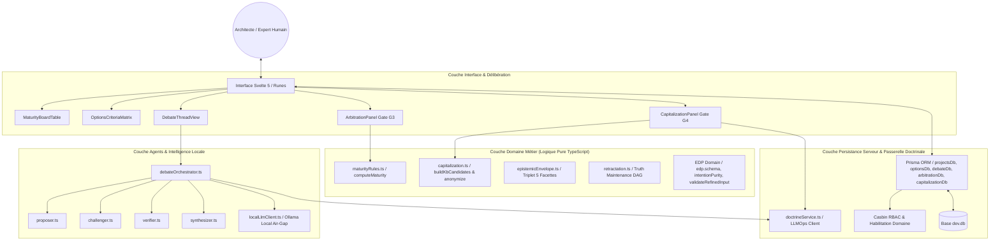

---

## 2. Le Modèle Épistémique et la Constitution

Tout énoncé, option, argument ou décision manipulé par Archinex obéit aux invariants de la Constitution (`openspec/constitution.md`) :

### Invariants Inviolables
1. **Énoncé à 5 facettes** : Contenu (triplet ontologique), Justification (antécédents), Autorité (auteur, rôle, mode de production), Maturité (niveau, confiance), Révisabilité.
2. **Règle Bloquante `verified × llm-derived` (énoncés et arguments)** : Cet invariant constitutionnel couvre **à la fois les énoncés (`Statement`) et les arguments de débat (`Argument`)**. Aucun énoncé ni aucun argument produit en mode `llm-derived` ne peut être promu ou stocké au statut de confiance `verified` sans validation humaine préalable (`human-authored` ou `llm-proposed-human-approved`).
   - **Énoncés** : rejetés au portier d'enveloppe (`src/lib/validation/epistemicEnvelope.ts`) et en persistance (`src/lib/server/projects/projectsDb.ts`).
   - **Arguments** : confiance plafonnée à `designed` avec avertissement journalisé dans `createArgument` (`src/lib/server/projects/debateDb.ts`), combinaison rejetée dans `validateArgument` (`src/lib/domain/debate.ts`), et verrouillée en base par le garde-fou Prisma (`src/lib/server/prismaFactory.ts`) sur tous les chemins d'écriture (`create`, `createMany`, `update`, `updateMany`, `upsert`).
3. **Règle du Silence** : Une hypothèse, objection ou dilemme non contesté n'est **jamais** considéré comme approuvé tacitement. L'approbation doit résulter d'un acte formel d'arbitrage.
4. **Brouillon Télégraphique** : Style télégraphique dense, sans jargon creux ni verbiage IA non vérifié.

---

## 3. Le Cycle de Co-Conception en 6 Étapes

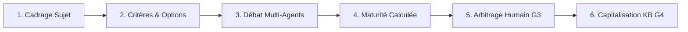

### Étape 1 : Cadrage du Sujet
Énonciation claire du `problemStatement` et référence de section. Le sujet démarre au niveau `L0_named` puis `L1_framed`.

### Étape 2 : Critères & Options Contrastées
Définition d'au moins 2 critères d'évaluation pondérés et formulation d'au moins 2 options d'architecture viables. Chaque option est notée (de -2 à +2) sur l'ensemble des critères avec justification obligatoire.

### Étape 3 : Débat Multi-Agents Borné
Un tour d'orchestration (3 tours maximum) enchaîne 4 agents spécialisés :
- **Proposer** : Défend les options et suggère des options complémentaires si nécessaire.
- **Challenger** : Émet au moins une objection argumentée par option (risques, coûts cachés, dépendances).
- **Verifier** : Contrôle la conformité avec la doctrine via `checkOption` et produit des arguments de vérification avec références KB strictes.
- **Synthesizer** : Résume les points de tension, les compromis et les questions clés pour l'arbitre humain.

Toute objection doit être résolue (`answered` ou `accepted_risk`) par un expert humain habilité avant l'arbitrage.

### Étape 4 : Calcul Dynamique de la Maturité (`computeMaturity`)
La maturité d'un sujet n'est plus fixée manuellement : elle est calculée par une fonction pure qui distingue **codes bloquants à l'arbitrage** et **alertes / réserves tracées** :
- **Codes bloquants (`blockers`)** :
  - `MISSING_PROBLEM_STATEMENT` : Problème non formulé.
  - `MISSING_CRITERIA` : Moins de 2 critères définis (1 suffit si option unique justifiée).
  - `INSUFFICIENT_OPTIONS` : Moins de 2 options formulées (sauf option unique justifiée).
  - `UNEVALUATED_OPTION` : Option non évaluée sur tous les critères.
  - `OPEN_OBJECTION` : Objection ouverte non résolue dans le débat.
  - `UNRESOLVED_VIOLATION` : Règle doctrinale violée (`verdict: 'violates'` ou `checkOption` validé) sans dérogation justifiée.
  - `OPEN_BLOCKING_QUESTION` : Question bloquante sans réponse.
- **Alertes non bloquantes à l'arbitrage (`warnings`), opposables au scellement** :
  - `COVERAGE_INCOMPLETE` : Référentiel réglementaire projet (`NIS2`, `SecNumCloud`...) en statut `partial`, `missing` ou `unknown`. Non bloquant à l'arbitrage (la maintenance KB relève de LLMOps), mais enregistré en **réserve de couverture** (`coverageReserves`) sur la décision, reporté dans le HLD/bundle et la RTM, et **bloquant au scellement** (`freezeExport` et `generateArchitectureLockManifest`) pour les statuts `missing`/`unknown` sans acceptation explicite tracée.
  - `VERIFICATION_VERDICT_UNKNOWN` : Verdict de vérification `unknown` ou non structuré (ne vaut jamais « conforme »).

### Étape 5 : Arbitrage Humain Opposable (Porte G3)
Seul un `lead_architect` ou un `domain_expert` habilité sur le domaine du sujet peut prononcer l'arbitrage :
- Sélection de l'option retenue ;
- Enregistrement des motifs d'écartement pour chaque alternative ;
- Évaluation de la réversibilité (`reversible`, `costly`, `irreversible`) ;
- Enregistrement des dérogations acceptées avec justification opposable ;
- **Vérification réglementaire KB en échec fermé (*fail-closed*)** : chaque arbitrage persiste un bloc opposable `complianceCheck` (`checked` | `partial` | `not_checked`, `hubRevision`, `checkedAt`, `unassessedRuleIds[]`, `frameworks[]`). Si le Hub KB est injoignable (`not_checked`) ou laisse des règles non évaluées (`partial`), la décision est refusée sauf dérogation explicite motivée (« décision sans vérification KB complète »), tracée dans le bundle (`compliance_check` + lacune dédiée) et classée `Provisional` dans la matrice de conformité ;
- Promotion formelle à `L3_decided` et transformation des énoncés dérivés en `llm-proposed-human-approved`.

### Étape 6 : Capitalisation Souveraine vers LLMOps (Porte G4)
Chaque arbitrage produit automatiquement des candidats à la Knowledge Base :
1. `new_asset` : Si l'option retenue constitue un nouveau pattern sans antécédent doctrinal.
2. `amendment` : Pour chaque dérogation acceptée, afin d'adapter la règle d'entreprise.
3. `rex` : Synthèse systématique du compromis architectural et des motifs du choix.

**Garanties Souveraines :**
- **Anonymisation stricte** : Nettoyage automatique des noms de projets, clients, sites, participants, adresses IP et volumes chiffrés.
- **Invariant III (Human-in-the-loop)** : L'architecte prévisualise et peut modifier chaque candidat avant envoi. Rien n'est expédié sans action humaine explicite.
- **Suivi des statuts** : Synchronisation avec la file LLMOps (`in_review`, `accepted`, `rejected`).

---

## 4. Pipeline de Validation et d'Assurance Qualité

La qualité et l'étanchéité du système sont garanties par le script unifié `node scripts/verify.mjs` validant 4 portes d'acceptation :
1. **Denylist Check** : 0 terme projet ou fournisseur interdit dans `src/`.
2. **Vitest Test Suites** : tests unitaires, contractuels et d'intégration (les tests « live » exigent un serveur LLMOps réel et sont ignorés sinon).
3. **Svelte Check** : 0 erreur, 0 avertissement de typage strict TypeScript / Svelte 5.
4. **Production Build** : Compilation complète des bundles client et serveur SSR.

---

## 5. Gouvernance Knowledge Hub & Comptes Experts (Lot A6)

Archinex gère les comptes utilisateurs locaux et assure la propagation stricte de l'identité des experts vers LLMOps, qui demeure l'autorité sur le registre des propriétaires (`owners`) et la recevabilité doctrinale.

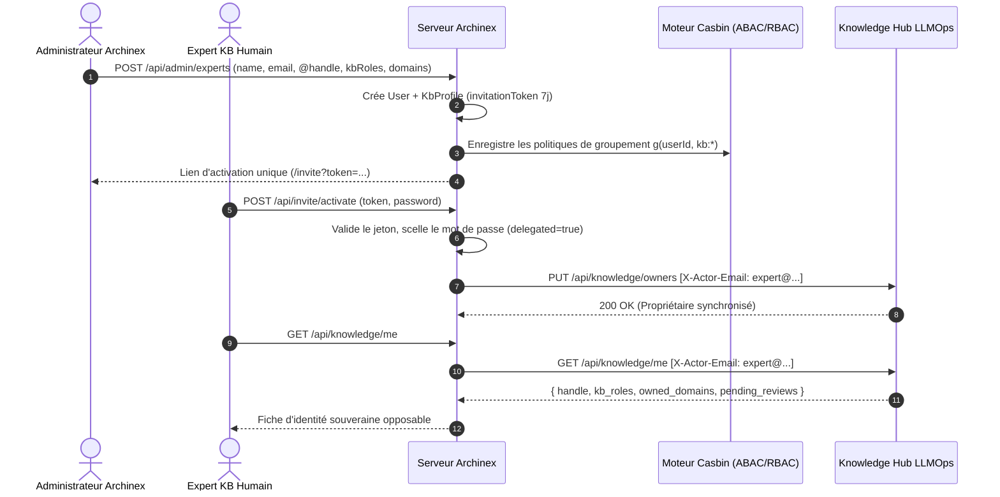

### Rôles KB Canoniques
- `kb:review` : Droit de voter, d'approuver ou de rejeter les candidats de doctrine et amendements.
- `kb:evaluate` : Droit d'exécuter et d'annoter les bancs d'évaluation et suites de tests.
- `kb:maintain` : Droit de modifier et de mettre à jour directement les règles de doctrine et templates de prompt.
- `kb:admin` : Droit de superviser les propriétaires, publier des releases doctrinales et administrer la gouvernance.

### Propagation d'Identité Souveraine (`X-Actor-Email`)
Tout appel expert émis vers LLMOps (`/api/knowledge/me`, `/api/knowledge/owners`, `/api/knowledge/candidates`...) propage l'entête HTTP `X-Actor-Email: <user_email>`. Aucun secret de service (`LLMOPS_AUTH_TOKEN`) n'est jamais exposé au navigateur client.

---

## 6. Boîte de Revue Experte, Actions d'Examen et Notifications (Lot A7 - Porte G5)

Archinex implémente la boîte de réception des revues et l'espace de décision expert pour statuer sur les candidats de doctrine soumis par les projets ou les architectes.

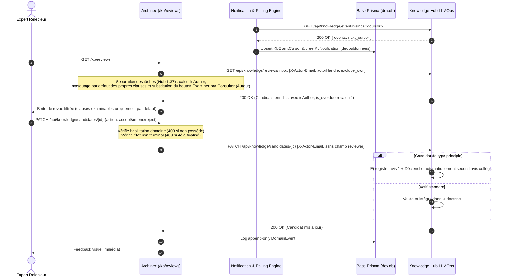

### Invariants & Règles de Gouvernance Clés (Porte G5)
1. **Les 7 Contrôles Automatiques LLMOps** : Chaque candidat reçu affiche les résultats de 7 contrôles préalables formels (`schema_validity`, `clarity_score`, `testability`, `non_duplication`, `sovereign_compliance`, `domain_alignment`, `architectural_impact`).
2. **Double-Avis Obligatoire pour les Principes** : Tout candidat de type `principle` accepté par un expert déclenche automatiquement une tâche de second avis collégial auprès d'un pair avant intégration définitive.
3. **Contrôle d'Autorisation par Domaine (403 Forbidden)** : Un expert ne peut statuer que sur les candidats appartenant à ses domaines déclarés (`ownedDomains`). Tout écart est refusé avec une notification explicite.
4. **Interdiction du Rejet Sans Motif** : Rejeter un candidat exige un motif obligatoire circonstancié (règle constitutionnelle IV).
5. **Idempotence Absolue du Moteur d'Événements** : Le curseur persistant `KbEventCursor` et le suivi des identifiants d'événements garantissent zéro doublon de notification, même en cas de pollings multiples concurrents.
6. **Résilience et Dégradation Gracieuse** : En cas de code 503 du service de gouvernance LLMOps, l'interface bascule en lecture dégradée sans planter.

---

## 7. Atelier de Doctrine, Templates d'Actifs et Simulation de Clauses (Lot A8 - Issue #3)

L'Atelier de Doctrine (`/kb/workshop`) est l'environnement d'ingénierie doctrinale souveraine permettant aux architectes et experts de concevoir, valider et simuler des clauses de doctrine avant leur soumission formelle.

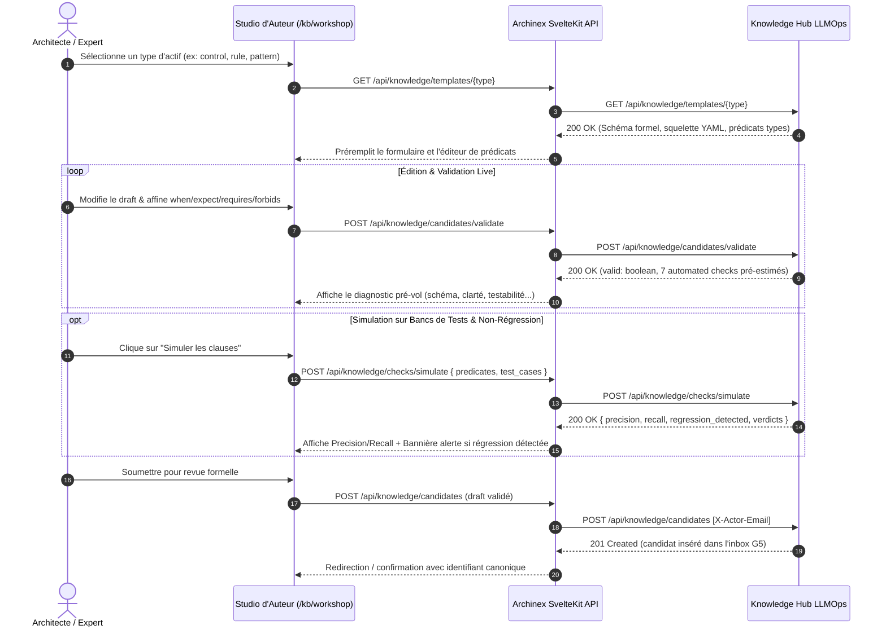

### Invariants & Règles de Conception (Lot A8)
1. **Templates Canoniques Déclaratifs** : 7 types d'actifs normés (`principle`, `pattern`, `decision`, `control`, `glossary`, `rule`, `amendment`) disposant chacun de règles de validation strictes et d'exemples de prédicats testables.
2. **Prédicats Formels Opérables** : Chaque règle ou clause de contrôle articule ses conditions autour de quatre axes unifiés : `when` (champ d'application/déclencheur), `expect` (condition d'admissibilité), `requires` (dépendances obligatoires) et `forbids` (anti-patrons proscrits).
3. **Pré-vol Live (Zero Bad Submission)** : Le point d'entrée `POST /api/knowledge/candidates/validate` anticipe la notation des 7 contrôles automatiques LLMOps, alertant l'auteur sur les manques de clarté, de testabilité ou de complétude avant toute publication.
4. **Moteur de Simulation & Alerte de Régression** : La simulation sur cas de test historiques évalue la Précision et le Rappel de la clause. Si une nouvelle version de clause casse des cas conformes existants (`regression_detected: true`), une bannière d'alerte rouge bloque la soumission non surveillée.
5. **Circuit Ouvert vers la Boîte de Revue (Porte G5)** : Une clause rédigée et validée est directement enregistrée comme candidat `DRAFT` ou `SUBMITTED`, garantissant la continuité immédiate avec la boîte d'examen experte (`/kb/reviews`).

---

## 8. Ingestion des Référentiels Réglementaires et Déclaration de Couverture (Lot A10 - Issue #5)

L'espace Référentiels Réglementaires (`/kb/frameworks`) dote Archinex de la capacité d'ingérer des référentiels externes multi-formats, d'instruire chaque exigence ligne par ligne et d'émettre des attestations formelles de conformité opposables.

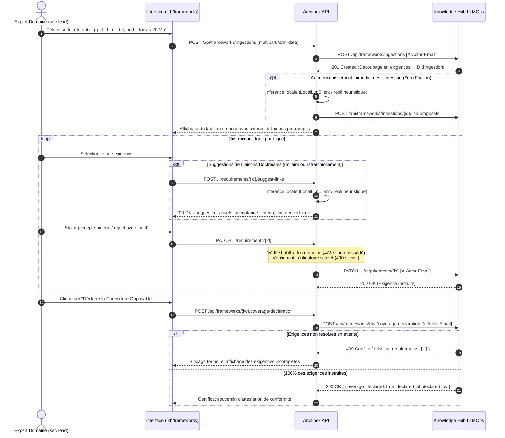

### Invariants & Règles de Gouvernance Clés (Lot A10)
1. **Téléversement Multi-Format Sécurisé** : Prise en charge des formats `.pdf`, `.html`, `.txt`, `.md`, `.docx` avec contrôle strict de taille plafonné à 20 Mo (HTTP 413).
2. **Découpage & Indexation d'Exigences** : Chaque clause réglementaire devient une entité atomique inspectable, traçable et rattachée à un domaine d'architecture.
3. **Assistance IA Étiquetée (`llm-derived`)** : Les correspondances sémantiques proposées par le LLM local ne constituent que des suggestions d'aide à la décision ; elles nécessitent obligatoirement un acte de validation explicite par l'expert humain (Invariant II).
4. **Cloisonnement d'Habilitation par Domaine (403 Forbidden)** : Un relecteur ne peut accepter, amender ou rejeter une exigence que s'il est formellement propriétaire du domaine correspondant (`ownedDomains`).
5. **Interdiction Absolue du Rejet Arbitraire (400 Bad Request)** : Tout rejet d'exigence réglementaire impose un motif textuel circonstancié expliquant l'inapplicabilité (Règle constitutionnelle IV).
6. **Scellement Opposable & Détection de Conflit (409 Conflict)** : La déclaration de couverture est conditionnée à la résolution exhaustive de 100% des exigences du référentiel. Toute lacune déclenche un blocage 409 mentionnant nominativement les exigences manquantes.

---

## 9. Moteur d'Évaluation Doctrinale, Porte G6 et Boucle de Rétroaction des Débats (Lot A9)

Le sous-système d'évaluation garantit la rigueur et l'exactitude de la doctrine architecturale en mesurant empiriquement le taux de rappel et de précision sur le banc de référence `check_option_v1`, tout en permettant l'amélioration continue via le signalement des désaccords depuis les délibérations en direct.

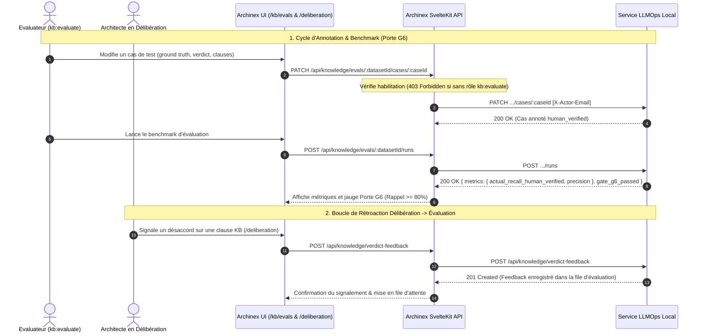

### Invariants & Règles de Gouvernance Clés (Lot A9)
1. **Contrôle d'Accès d'Évaluation RBAC (403 Forbidden)** : Seuls les experts dotés explicitement du rôle `kb:evaluate` sont autorisés à annoter les cas de test ou à modifier la vérité terrain du jeu de test. Les relecteurs standards (`kb:review`) ne disposent que d'un accès en lecture seule.
2. **Calcul Strict du Rappel Réel sur les Cas Vérifiés par l'Humain** :
   $$\text{Rappel}_{\text{humain}} = \frac{\text{Vrais Positifs sur cas vérifiés}}{\text{Total des cas vérifiés conformes}}$$
   Le calcul de rappel pour la validation de la Porte G6 exclut les cas non révisés ou purement synthétiques, interdisant toute surestimation artificielle de la complétude doctrinale.
3. **Seuil de Porte Qualité G6 ($\ge 80\%$)** : Pour déclarer la Porte G6 franchie (*Atelier & Evals Validés*), le rappel réel doit être supérieur ou égal à 0.80 et le nombre de régressions inexpliquées doit être strictement nul.
4. **Continuité Opérationnelle & Traçabilité des Feedbacks** : Tout désaccord signalé lors d'un arbitrage ou d'un débat en séance est historisé avec son horodatage, l'auteur (`X-Actor-Email`), la raison (`false_positive`, `false_negative`, `ambiguity`, `outdated_doctrine`), la règle alternative proposée et la référence de délibération.

---

## 10. Tableau de Bord de Santé KB, Scellement Cryptographique et Porte G7 (Lot A11)

Le sous-système de publication et de pilotage centralise les indicateurs de maturité de la doctrine d'entreprise, impose le respect des portes de qualité amont (Portes G5 et G6), et scelle les instantanés officiels sous empreinte cryptographique SHA-256 opposable.

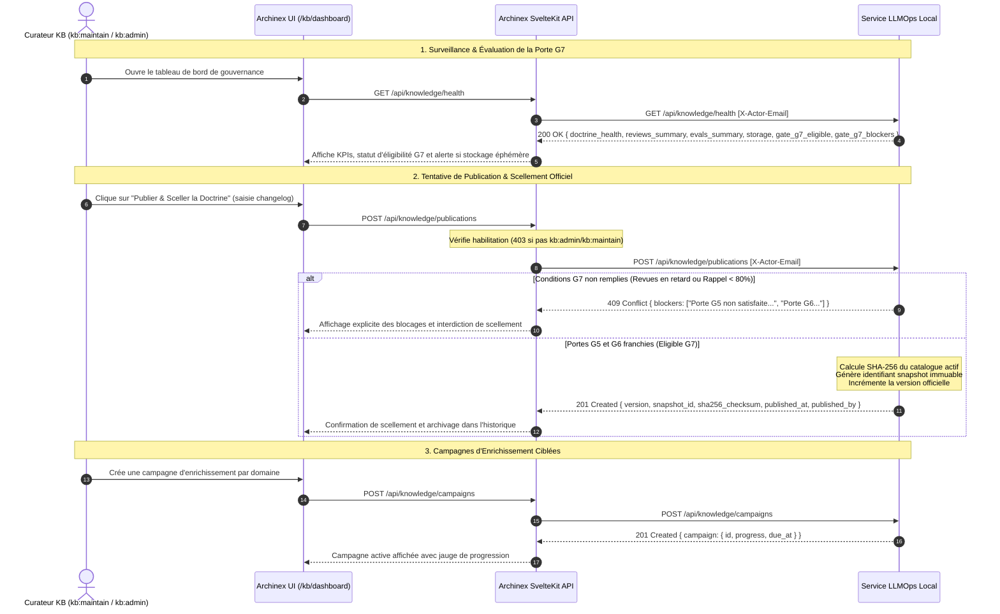

### Invariants & Règles de Gouvernance Clés (Lot A11)
1. **Contrôle d'Habilitation de Publication (403 Forbidden)** : Seuls les profils d'experts détenteurs du rôle `kb:admin` ou `kb:maintain` (ou administrateurs système) sont habilités à déclencher une publication officielle de doctrine.
2. **Scellement Conditionné par la Porte G7 (409 Conflict)** : L'émission d'un instantané officiel exige impérativement que :
   - Zéro revue critique ne soit en retard dans la boîte de réception des experts (Porte G5 respectée).
   - Le rappel réel sur le jeu de test vérifié par l'humain atteigne ou dépasse 80% (Porte G6 validée).
   Toute anomalie ou dette non traitée déclenche un rejet 409 bloquant mentionnant nominativement les critères défaillants.
3. **Scellement Cryptographique Immuable (SHA-256)** : Chaque publication produit une empreinte SHA-256 calculée sur l'instantané, le changelog et l'horodatage, rendant toute altération ultérieure immédiatement détectable.
4. **Détection Obligatoire de Stockage Éphémère (Mode Démo)** : L'interface avertit obligatoirement par un bandeau d'alerte visible dès lors que le moteur LLMOps sous-jacent tourne en mémoire non persistante (`storage.mode = "demo"`), empêchant toute fausse assurance de pérennité.
5. **Pilotage Proactif par Campagnes** : Les curateurs peuvent initier des campagnes d'enrichissement ciblées par domaine d'architecture (`security`, `cloud`, `resilience`) avec jauge de progression et date d'échéance.

---

## 11. Architecture de Performance & Fluidité de Navigation (Dashboard & Mini-Apps)

Pour éliminer toute latence lors du clic sur le Dashboard (`/`) ou lors du basculement entre les mini-applications (`/workspaces`, `/deliberation`, `/knowledge`), Archinex met en œuvre une optimisation multicouche :

### 1. Cache Mémoire en Lecture & Singleflight (`src/lib/server/llmops/client.ts`)
- **Singleflight Promise Deduplication** : regroupe les requêtes GET concurrentes vers le service LLMOps (`/api/compliance/frameworks`, `/api/knowledge/health`, `/api/knowledge/checks`, etc.) en une promesse unique afin d'éviter tout engorgement backend.
- **TTL Mémoire Adaptatif** : mise en cache mémoire de 30 secondes pour les lectures chaudes (réduit à 2 secondes sur statut d'erreur ou indisponibilité pour permettre un rétablissement rapide, désactivé par défaut en environnement de test Vitest).
- **Invalidation Automatique sur Mutation** : tout appel modifiant l'état (promotion de candidat, décision sur clause, soumission, ingestion, changement d'URL de base) purge immédiatement les entrées de cache associées.

### 2. Allégement des Payloads de Données (`engagementsDb.ts`, `+page.server.ts`, `deliberationStore.svelte.ts`)
- **Élagage Sélectif des Clauses de Documents (`includeKeyClauses: false`)** : sur les vues de synthèse (Dashboard, listes d'engagements), les 1 500+ clauses textuelles brutes de chaque document RFP sont omises du transfert initial tout en conservant le compteur d'exigences (`extractedClausesCount`), réduisant la charge utile de 2,9 Mo à moins de 100 Ko (> 97 % de réduction). Les clauses complètes sont réservées à la consultation unitaire d'un document ou d'un sujet.
- **Délestage des Propositions Mortes (`stripSubjectProposals: true`)** : purge des données temporaires de factorisation dans les listes globales d'espaces.
- **Suppression du Double-Fetch Client (`deliberationStore`)** : différé via `queueMicrotask` pour éviter le rechargement réseau de `/api/engagements` dès lors que le store est déjà hydraté par le SSR (`initFromDb`).

### 3. Résolution Granulaire des Icônes (`vite.config.ts`)
- **Plugin de Transformation `lucideOptimizePlugin`** : réécrit à la compilation les imports barils `import { A, B } from 'lucide-svelte'` en imports directs `import A from 'lucide-svelte/icons/a'`, empêchant le navigateur de télécharger et compiler les 1 929 modules d'icônes et d'alias en mode développement (baisse de 3 788 requêtes à quelques dizaines par vue).

### 4. Fluidité du Changement de Sujet en Délibération (`DeliberationWorkbench`, `SubjectThreadView`, `OptionsMatrix`, `workbench`)
- **Montage Unique (`DeliberationWorkbench.svelte`)** : détection responsive via `matchMedia('(min-width: 1024px)')` afin de ne jamais monter simultanément les instances mobile et desktop de `SubjectThreadView` (division par 2 du trafic réseau au basculement).
- **Endpoint Agrégé SQLite (`GET /api/projects/[projectId]/subjects/[subjectId]/workbench`)** : regroupe en un seul aller-retour local (`arguments`, `options`, `criteria`, `evaluations`, `tradeOffs`, `decision`, `criteriaReport`, métadonnées `subject`) sans dépendance bloquante sur LLMOps, tout en partageant la logique métier (`parseSubjectDecision` dans `arbitrationDb.ts` et `computeSubjectMaturityReport` dans `maturityCriteriaService.ts`).
- **Chargement Non-Bloquant, Annulation & Cache Client SWR (`SubjectThreadView.svelte`, `OptionsMatrix.svelte`)** :
  - Découplage des appels secondaires (`cascade`, `doctrine-context`, `compliance`) hors du chemin critique du fil et de la matrice.
  - Annulation systématique des requêtes obsolètes par `AbortController` + garde de séquence lors des basculements rapides, et cache mémoire client (*stale-while-revalidate*) pour un affichage instantané des sujets déjà visités.
  - Mise en cache (`cachedFetch`) et parallélisation (`Promise.all` dans `checkSubjectCompliance`) des lectures LLMOps `getDoctrineContext`, `checkOption` et `getFrameworkCoverage`, sans invalidation globale du cache lors d'une lecture.

---

## 11 bis. Projections Multi-Modèles & Pont d'Architecture « Petites Briques »

Dans l'onglet de délibération et de rendu (`ArtifactRegenerationHub.svelte`), Archinex transforme instantanément toute décision d'architecture arbitrée (Niveau L3) en projections formelles synchronisées, sans aucune dérive documentaire (*Zero-Drift*) :
1. **Diagrammes d'Architecture Hi-Fi (Mermaid)** :
   - Modélisation de motifs canoniques : Actif/Actif Géoredondant Bi-Site (Dual-DC avec Quorum et DCI synchrone), Survie Edge Tactique (Mode Îlotage), Découplage de services critiques 3GPP (SIP Core, App Servers, Common Services) et Passerelle Hybride LMR/IWF.
   - Chaîne de déploiement progressive Zero-Downtime adaptée à la topologie retenue.
2. **Modèle C4 — C4X (`.c4x` / Markdown ```` ```c4x ````) & Structurizr DSL (`.dsl`)** : Hiérarchie logicielle Person / Boundary / System / Container générée en TypeScript pur sans dépendance externe (`c4xDsl.ts` et `structurizrDsl.ts`, licence MIT), avec annotations de métadonnées épistémiques (`%% @meta`) et aperçu visuel via `MermaidViewer`.
3. **Modélisation SysML v2 (BDD)** : Définition des blocs et contraintes d'ingénierie système.
4. **Configuration JSON Technique** : Paramétrage opérationnel opposable scellé.
5. **Pont d'Export Canvas « Petites Briques » (`petitesBriquesBridge.ts`)** :
   - Traduction des exigences architecturales en canevas déclaratifs compatibles avec le moteur Petites Briques (Sites `on-prem`, `managed-self`, briques physiques/logiques empilées selon les règles *Poka-Yoke*, zones fonctionnelles et flux d'interconnexion normalisés).
   - Export immédiat aux formats YAML (`petitesbriques_canvas.yaml`) et JSON.

---

## 12. Paquet de Décision Exécutable (EDP) & Oracles OPA/Rego

> **Orientation (ADR-017)** : toute écriture vers un outil d'implémentation passe par Nautobot, seul point de réconciliation bidirectionnel d'Archinex ; les connecteurs sont derrière Nautobot. Voir [`docs/adr/ADR-017-nautobot-point-unique-reconciliation.md`](docs/adr/ADR-017-nautobot-point-unique-reconciliation.md).

Archinex associe à chaque décision d'architecture arbitrée un **Paquet de Décision Exécutable** (EDP) assurant l'opposabilité et la vérifiabilité continue du HLD face aux instanciations LLD réelles ou simulées :

1. **Séparation Stricte Intension (HLD) vs Extension (LLD)** :
   - Le contexte de décision (`decision_context`) exprime des règles pures sur l'ontologie d'entreprise sans aucune valeur d'instanciation. Le module `intentionPurity.ts` filtre rigoureusement toute adresse IPv4, IPv6, CIDR, adresse MAC ou nom d'hôte physique ou logique avec une liste blanche stricte de standards et versions autorisées (Invariant X).
2. **Contrats Formels & Prévention de la Vacuité (`edp.schema.json`, `refined_input.schema.json`)** :
   - L'EDP formalise ses attentes d'extension via `expected_inputs`. Lors de l'évaluation, `validateRefinedInput.ts` exige la présence de chaque source et une provenance certifiée (`tool`, `version`, `command`, `sha256`, `generated_at`). Toute entrée partielle ou vide reçoit le verdict bloquant `insufficient_input` pour éliminer les faux positifs par vacuité (Invariant I & IV).
3. **Moteur d'Oracles OPA & Convention Normative à 4 Verdicts** :
   - Exécution déterministe via le binaire officiel OPA (v1.21.4 épinglé avec contrôle SHA-256) encapsulé dans `opaRunner.ts`. En cas d'indisponibilité du binaire, le résultat `unavailable` n'est jamais confondu avec un succès.
   - Bibliothèque Rego partagée (`policies/lib/edp_common.rego`) avec gestion des 4 états :
     - `compliant` : conformité totale aux politiques sans dérogation ni vacuité.
     - `violated` : non-conformité avérée avec détails et chemins précis des violations.
     - `not_applicable` : critères d'applicabilité hors périmètre.
     - `insufficient_input` : source attendue absente, vide ou non prouvée.
4. **Garde de Mutation Déterministe (`scripts/edp-mutation-gate.ts`)** :
   - Analyseur de résilience des oracles appliquant l'opérateur de mutation par neutralisation inerte de règles (`drop_rule`). Exigence absolue de tuer 100 % des mutants injectés avant toute acceptation d'oracle.
5. **Ontologie, Projections & Persistance Souveraine** :
   - Client de lecture d'ontologie déconnecté (`ontologyClient.ts`) avec contrôle strict des révisions (`stale_binding` si dérive).
   - Compilateur de projections (`projectionCompiler.ts`) produisant `data.ontology` avec empreinte canonique SHA-256 et détection de duplication littérale.
   - Modèle Prisma `ExecutableDecisionPackage` avec application directe de l'Invariant II (interdiction absolue de valider automatiquement un EDP produit par LLM sans validation humaine tracée et signée) et Invariant VI (rétractation vers `stale` lors de la caducité d'un antécédent).
6. **Service d'Évaluation `edp verify` & Adaptateurs LLD** :
   - Moteur central `edpVerify.ts` émettant un lot de preuves cryptographique (`EvidenceBundle`) avec codes de sortie standardisés (0, 1, 2, 3).
   - Adaptateur Helm Sylva/CAPI (`sylvaAdapter.ts`) avec sanitization automatique des secrets.
   - Adaptateur Nautobot Planned (`nautobotAdapter.ts`) normalisant les équipements physiques et interfaces.
7. **Chaîne de Rédaction Assistée LLM & Composant IHM Workbench** :
   - Pipeline de garde `edpDrafting.ts` filtrant les propositions d'IA par l'ensemble des contrôles déterministes avant toute présentation humaine.
   - Composant UI `EdpCard.svelte`, permettant aux architectes habilités de visualiser les verdicts, scores de mutation et de valider ou contester formellement l'EDP.
8. **Paquets de Référence & Promotion** :
   - Deux références complètes : `adr012-baremetal` (infrastructure Telco Cloud) et `adr015-security-zones` (cloisonnement de zones NIS2), atteignant chacune 100 % de score de mutation.
   - Document de promotion formel : [ADR-016](docs/adr/ADR-016-promotion-edp-experimental.md).

---

## 13. Architecture Logicielle de la Phase 4 : Raffinement Ontologique Multi-Axes, Hydratation Exhaustive & Réconciliation (`Phase4RefinementHub`)

> **Orientation (ADR-017)** : toute écriture vers un outil d'implémentation passe par Nautobot, seul point de réconciliation bidirectionnel d'Archinex ; les connecteurs sont derrière Nautobot. Voir [`docs/adr/ADR-017-nautobot-point-unique-reconciliation.md`](docs/adr/ADR-017-nautobot-point-unique-reconciliation.md).

Pour éviter l'écueil classique des architectures où le document de spécification (HLD) et l'ingénierie d'exécution (LLD / CMDB / GitOps) divergent sitôt l'arbitrage rendu, Archinex structure le cycle de vie d'un sujet d'architecture en **4 phases continues** et ajoute en Phase 4 un moteur formel de **raffinement piloté par l'ontologie**, d'**hydratation multi-objets** et de **réconciliation inter-domaines**.

### 13.1 Vue Globale du Pipeline en 4 Phases (De l'Appropriation à l'Hydratation SSoT & Sylva)

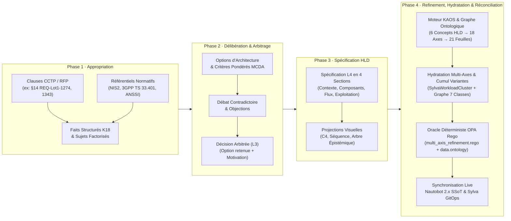

### 13.2 Découpage Modulaire Serveur & IHM de la Phase 4

| Module / Fichier | Responsabilité Architecturale |
| :--- | :--- |
| [`tests/fixtures/edp/ontology_export.json`](tests/fixtures/edp/ontology_export.json) | **Socle Ontologique SI & Telco** (copie générée de l'export du Knowledge Hub, jamais retouchée à la main : [`docs/edp/ontology-source.md`](docs/edp/ontology-source.md)) : définit les **6 Concepts HLD** (`telco_cloud_platform`, `interconnection_gateway`, `storage_data_persistence`, `iam_security_zerotrust`, `observability_noc_soc`, `resilience_drp_continuity`), leurs **18 Axes de Raffinement obligatoires** (`kind: "axis"`), les **21 Feuilles d'Implémentation** (`kind: "leaf"`, incluant leurs `projections` pour `data.ontology`, leurs `oracle_rules` et leur `hydration_template`) ainsi que les triplets relationnels (`requires_aspect`, `implemented_by`, `depends_on`, `constrains`, `conflicts_with`). |
| [`src/lib/server/edp/ontologyClient.ts`](src/lib/server/edp/ontologyClient.ts) | **Moteur de Requêtage & Édition de Triplets `{ Sujet, Verbe, Complément }`** : expose `queryOntologyTriplets`, `addOntologyTriplet` et `removeOntologyTriplet` avec persistance dans une surcouche runtime (`data/ontology_runtime_overlay.json`), permettant d'étendre les axes de couverture sans toucher au code. |
| [`src/lib/server/edp/refinementCoverage.ts`](src/lib/server/edp/refinementCoverage.ts) | **Moteur KAOS de Couverture, Composition & Hydratation Multi-Axes** : <br/>• `resolveSubjectConcepts` : sélectionne les concepts HLD pertinents par propagation ascendante sur le graphe.<br/>• `computeRefinementCoverage` : calcule la matrice de complétude KAOS (`covered_executable` 🟢, `covered_no_oracle` 🟡, `missing_refinement` 🔴), auto-lie les feuilles standards par défaut (`is_default_standard`) et supporte le **cumul de variantes (OU inclusif)** sur un même axe.<br/>• `composeMultiAxisHydration` : synthétise l'inventaire LLD multi-axes (`nautobot_planned_devices`, `sylva_workload_cluster_values`, `k8s_manifests`, `security_zones`, `environments`, `power_feeds`) et le **Graphe de Réconciliation à 7 classes d'objets (`reconciliation_graph`)**.<br/>• `evaluateMultiAxisOracle` : invoque le binaire OPA sur `edp/policies/multi_axis_refinement.rego`. |
| [`src/lib/server/edp/projectionCompiler.ts`](src/lib/server/edp/projectionCompiler.ts) | **Compilateur de Projections `data.ontology`** : compile les `projections` des feuilles liées en un document JSON déterministe injecté dans OPA (`--data`), calcule son empreinte canonique SHA-256 et vérifie l'absence de littéraux métier dupliqués en dur dans les règles Rego (`detectDuplicateLiterals`). |
| [`edp/policies/multi_axis_refinement.rego`](edp/policies/multi_axis_refinement.rego) | **Oracle Rego v1 Multi-Axes Sans Littéral Codé en Dur** : évalue conjointement le substrat compute, le réseau OOB Redfish, le zonage de sécurité NIS2, la parité Iso-Prod des environnements, la résilience électrique 2N, le chiffrement IPsec ESP, la chaîne de médiation S6a (`SecGW-Lot1` $\rightarrow$ `DEA-Lot1` $\rightarrow$ `HSS-Lot1`) et la réconciliation inter-domaines (`tenant_ref`). |
| [`src/lib/server/edp/nautobotSync.ts`](src/lib/server/edp/nautobotSync.ts) | **Synchroniseur SSoT Temps Réel vers Nautobot 2.x** : pousse de manière idempotente via l'API REST Nautobot les Tenants (`tenancy.Tenant`), Fournisseurs & Circuits (`circuits.Circuit` + `CircuitTermination` A/Z), VLANs (`ipam.VLAN`), Préfixes IP (`ipam.Prefix`) et les Équipements DCIM (`dcim.Device` : serveurs Bare-Metal Sylva, objets externes 3GPP Shadow et nœuds de médiation Cœur Lot 1). Supporte la configuration par projet (`ProjectStrategy.nautobot`) et l'isolation logique multi-projets (`projectScope` : `Namespace` IPAM, `VLANGroup`, tag `project-<scope>`, et préfixage réversible au push/pull). |
| [`src/lib/components/deliberation/Phase4RefinementHub.svelte`](src/lib/components/deliberation/Phase4RefinementHub.svelte) | **Atelier IHM Plein Écran Phase 4** : affiche les filtres des 6 Concepts HLD, la matrice de couverture KAOS avec boutons `+ Cumuler` / `⇄ Remplacer` / `✕ Retirer`, le Graphe de Réconciliation à 7 classes d'objets, les raccourcis directs vers Nautobot (`Circuits`, `Tenants`, `Devices`) et le **Simulateur de Dérive CMDB (7 scénarios de Drift)**. |
| [`src/lib/components/knowledge/OntologyTripletEditorView.svelte`](src/lib/components/knowledge/OntologyTripletEditorView.svelte) | **Visualiseur & Éditeur Graphique de Triplets Ontologiques** dans `/knowledge?view=ontology` : permet de parcourir l'arbre `Concept HLD → Axes Requis → Feuilles & Règles Rego` et d'éditer les triplets `{ Sujet, Verbe, Complément }`. |

---

## 14. Fondements Scientifiques & Standards Industriels de Référence

La conception de la Phase 4 d'Archinex s'appuie sur **4 travaux académiques fondateurs** en ingénierie des exigences et modélisation ontologique, combinés à **5 standards industriels Télécom / Cloud-Native**.

### 14.1 Papiers Scientifiques de Référence (Fondements Théoriques)

| Référence Scientifique | Concept Théorique | Traduction Concrète dans Archinex |
| :--- | :--- | :--- |
| **1. Axel van Lamsweerde (2001, 2009)**<br/>*Goal-Oriented Requirements Engineering: A Guided Tour* (IEEE RE'01) & *Requirements Engineering: From System Goals to UML Models to Software Specifications* (Wiley, 2009) | **Raffinement de Buts KAOS (`AND-Refinement` vs `OR-Refinement`) & Opérationnalisation** :<br/>Un objectif de haut niveau est *incomplet* tant que tous ses sous-buts conjonctifs (`AND`) ne sont pas raffinés jusqu'à des feuilles opérationnalisables munies de contraintes formelles vérifiables par machine. | • **AND-Refinement** : représenté par les triplets `(Concept_HLD, requires_aspect, Axe_Obligatoire)`. Un sujet rattaché à un concept HLD hérite de tous ses sous-axes obligatoires.<br/>• **OR-Refinement (exclusif ou inclusif)** : représenté par les triplets `(Axe_Obligatoire, implemented_by, Feuille)`. Supporte le remplacement (`replace`) ainsi que le **cumul inclusif (`add`)** lorsque deux variantes coexistent (ex: Pool Sylva CNF SR-IOV/DPDK + Pool Sylva Standard NIS2).<br/>• **Distinction des 3 états de complétude** : `missing_refinement` (🔴), `covered_no_oracle` (🟡 feuille liée mais sans règle Rego), `covered_executable` (🟢 feuille liée avec oracle Rego actif). |
| **2. Don Batory (2004)**<br/>*Feature-Oriented Software Development (FOSD) & AHEAD Algebraic Hierarchical Equations for Application Design* (IEEE TSE, vol. 30, no. 5, 2004) | **Composition Algébrique Multi-Axes ($\text{Artefact} = f_n \circ \dots \circ f_1(\text{Base})$)** :<br/>Au lieu de dupliquer $N \times M \times P$ templates monolithiques, chaque caractéristique (*feature*) est une fonction de transformation modulaire qui enrichit un modèle de base commun. | • Dans [`composeMultiAxisHydration`](src/lib/server/edp/refinementCoverage.ts), chaque feuille d'ontologie liée porte un fragment `hydration_template` et `projections`.<br/>• L'inventaire LLD final est le produit de la composition algébrique de toutes les feuilles liées : l'axe Compute crée les nœuds Sylva, l'axe OOB y injecte les interfaces BMC Redfish, l'axe Sécurité y attache les zones `ZONE-OAM`/`ZONE-UPF-USER`, et l'axe Énergie y raccorde les adductions `PDU-A` + `PDU-B`. |
| **3. C. Maria Keet & Alessandro Artale (2008)**<br/>*Representing and Reasoning over a Taxonomy of Part-Whole Relations* (Applied Ontology, IOS Press, 2008) & **Guarino / Welty (OntoClean)** | **Relations Méronomiques Obligatoires & Dépendances Ontologiques Transverses** :<br/>Distingue la sous-classification taxonomique (`is_a`) des relations structurelles obligatoires (`requires_aspect`) et des contraintes d'intégrité inter-branches (`depends_on`, `constrains`, `conflicts_with`). | • Le moteur [`computeRefinementCoverage`](src/lib/server/edp/refinementCoverage.ts) parcourt les triplets `depends_on` et `conflicts_with` sur l'ensemble des feuilles liées.<br/>• Exemple : si la feuille Bare-Metal (`urn:archinex:ontology:infrastructure:server:baremetal`) est liée sans la feuille Réseau OOB (`urn:archinex:ontology:telecom:network:oob`), une alerte formelle `CrossAxisDependencyIssue` est levée et bloque la complétude KAOS. |
| **4. Krzysztof Czarnecki, Simon Helsen & Ulrich Eisenecker (2005)**<br/>*Staged Configuration through Specialization and Multi-Level Configuration of Feature Models* (Software Process: Improvement and Practice, 2005) | **Spécialisation par Étapes (*Staged Configuration*) Intension $\rightarrow$ Extension** :<br/>Sépare la configuration de l'espace de décision (liaison de variantes abstraites et bornes de conformité) de l'instanciation des paramètres physiques (IP, noms d'hôtes, ports). | • **Étape 1 (Intension HLD/Ontologie)** : les `projections` de l'ontologie fixent les invariants abstraits (`cipher_suite: "AES-256-GCM"`, `min_power_supplies: 2`, `required_mediation_hops: ["secgw-lot1-01", "dea-lot1-01"]`).<br/>• **Étape 2 (Extension LLD)** : l'hydratation génère les instances concrètes vérifiées par OPA contre `data.ontology`, sans aucun littéral métier codé en dur dans Rego. |

### 14.2 Standards Industriels de Référence (Télécom, Cloud-Native & CMDB)

1. **LF Europe Sylva (`sylva-projects/sylva-core` & `sylva-elements`)** :
   - Cadre de référence européen Telco Cloud (fondé par Orange, Deutsche Telekom, Telefónica, Vodafone, Telecom Italia, SUSE, Red Hat, Nokia, Ericsson).
   - Fournit le CRD officiel **`SylvaWorkloadCluster` (`workloadclusteroperator.sylva/v1alpha1`)** via `workload-cluster-operator`, le chart Helm **`sylva-units`** et `sylva-units-operator` orchestrant Cluster API (`capm3` Metal3 Bare-Metal + `cabpr` RKE2 sur SLE Micro) et les briques réseau Telco (`cilium`, `multus`, `sriov`, `metallb`, `vault`, `kyverno`, `monitoring`).
2. **FluxCD & Kustomize GitOps (`workload-clusters/` & Overlays Multi-DC)** :
   - Compilation directe par Archinex des descripteurs déclaratifs (`values.yaml` Sylva et manifestes Kustomize `base/` + `overlays/dc1`, `overlays/dc2`) soumis au contrôle déterministe OPA/Batfish avant ouverture de PR/MR GitOps, **sans serveur intermédiaire Nephio / Porch**.
3. **3GPP TS 28.620 (Umbrella NRM) & TS 28.541 (5G NRM)** :
   - Standardise la modélisation des équipements tiers hors périmètre d'administration via la classe **`ExternalFunction`** (`ExternalMMEFunction`, `ExternalENodeBFunction`) et des points de référence inter-opérateurs (`EP_RP`, `EP_S6a`).
4. **TM Forum ODA / SID (GB922 — *Shared Information & Data Model*)** :
   - Définit le chaînage canonique entre les domaines **Party** (`PartnerOrganization` / `tenant_ref`), **Resource** (Liens IP, Tunnels IPsec, Serveurs), **Service** (Flux médiatisé S6a) et **SLA / Monitoring** (`ServiceLevelAgreement`, `ResourceMonitorProbe`).
5. **Nautobot 2.x SSoT (*Single Source of Truth*) & `DiffSync`** :
   - Référentiel CMDB orienté source de vérité unique unifiant `tenancy.Tenant`, `circuits.Circuit`, `ipam.Prefix`, `ipam.VLAN` et `dcim.Device`, et permettant la détection de dérive (*Drift*) entre l'état planifié (`Planned`) et l'état observé.

---

## 15. Vues d'Intégration Détaillées (Sylva, FluxCD GitOps, Nautobot 2.x SSoT & 3GPP/TMF)

> **Orientation (ADR-017)** : toute écriture vers un outil d'implémentation passe par Nautobot, seul point de réconciliation bidirectionnel d'Archinex ; les connecteurs sont derrière Nautobot. Voir [`docs/adr/ADR-017-nautobot-point-unique-reconciliation.md`](docs/adr/ADR-017-nautobot-point-unique-reconciliation.md).

### 15.1 Principe Directeur vis-à-vis de Sylva : Ne Jamais Réinventer `sylva-core` / `sylva-units` ni Introduire de Couche Intermédiaire Nephio

> [!IMPORTANT]
> **Règle d'Architecture d'Intégration Sylva & GitOps Direct (Sans Nephio) :**
> **Sylva** possède déjà son propre opérateur (`workload-cluster-operator`) et son chart maître (`sylva-units`) qui traduisent un descripteur de cluster en ressources Cluster API (`Cluster`, `RKE2ControlPlane`, `MachineDeployment`, `Metal3DataTemplate`, `BareMetalHost` `metal3.io/v1alpha1`) et déploient les unités logicielles (`sriov`, `multus`, `cilium`, `vault`).
> **Archinex n'intègre pas Nephio / Porch et ne réinvente jamais `sylva-units`** : Archinex agit directement comme **compilateur d'intention déterministe** en amont de FluxCD et Nautobot pour produire :
> 1. Le descripteur d'entrée natif **`SylvaWorkloadCluster` (`workloadclusteroperator.sylva/v1alpha1`)** et ses valeurs `sylva-units` (`capi_providers`, `baremetal_hosts`, `machine_deployments`, `units`).
> 2. L'inventaire SSoT **Nautobot 2.x** correspondant (`Tenants`, `Circuits`, `VLAN`, `Prefixes`, `Devices`).
> 3. La vérification déterministe **OPA Rego** que l'inventaire Nautobot et le descripteur Sylva sont mutuellement cohérents et respectent les décisions HLD.

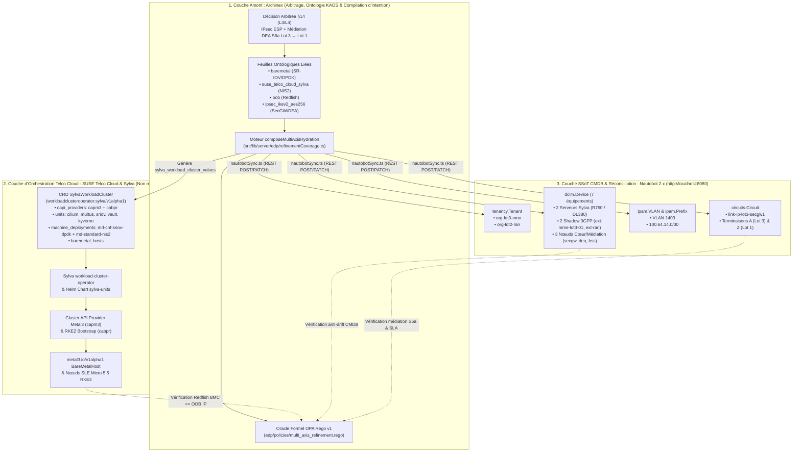

### 15.2 Structure du Descripteur Natif `SylvaWorkloadCluster` Généré par Archinex

Lorsqu'un sujet cumule sur l'axe `compute_substrate` la variante **CNF Cœur de Réseau (`sylva-cnf-sriov-dpdk`)** et la variante **Standard Isolée (`sylva-standard-nis2`)**, [`composeMultiAxisHydration`](src/lib/server/edp/refinementCoverage.ts) produit directement l'objet `sylva_workload_cluster_values` attendu par `sylva-units` :

```json
{
  "apiVersion": "workloadclusteroperator.sylva/v1alpha1",
  "kind": "SylvaWorkloadCluster",
  "metadata": {
    "name": "wc--proposes-89",
    "namespace": "sylva-workload-clusters",
    "annotations": {
      "archinex.io/gitops-target": "workload-clusters/wc--proposes-89",
      "archinex.io/source-subject": "sub_lulu-avec-options-et-criteres-proposes_89"
    }
  },
  "spec": {
    "capi_providers": {
      "infra_provider": "capm3",
      "bootstrap_provider": "cabpr"
    },
    "k8s_version": "v1.28.11+rke2r1",
    "os_image_selector": {
      "os": "sle-micro",
      "release": "5.5",
      "hardened": true
    },
    "units": {
      "cilium": { "enabled": true },
      "multus": { "enabled": true },
      "sriov": { "enabled": true },
      "sriov-resources": { "enabled": true },
      "metallb": { "enabled": true },
      "vault": { "enabled": true },
      "kyverno": { "enabled": true },
      "monitoring": { "enabled": true }
    },
    "baremetal_hosts": {
      "srv--proposes-89-01": {
        "bmh_metadata": { "labels": { "host-group": "sylva-standard-nis2", "device-type": "HPE-ProLiant-DL380" } },
        "bmh_spec": { "bmc": { "address": "redfish+http://192.0.2.10/redfish/v1/Systems/1" }, "bootMACAddress": "52:54:00:12:34:56" }
      },
      "srv--proposes-89-02": {
        "bmh_metadata": { "labels": { "host-group": "sylva-cnf-sriov-dpdk", "device-type": "Dell-PowerEdge-R750" } },
        "bmh_spec": { "bmc": { "address": "redfish+http://192.0.2.11/redfish/v1/Systems/1" }, "bootMACAddress": "52:54:00:12:34:57" }
      }
    },
    "machine_deployments": {
      "md-sylva-standard-nis2": {
        "infra_provider": "capm3",
        "replicas": 1,
        "rke2": { "nodeLabels": { "sylva.org/pool": "sylva-standard-nis2", "sylva.org/dataplane": "cilium-nis2" } }
      },
      "md-sylva-cnf-sriov-dpdk": {
        "infra_provider": "capm3",
        "replicas": 1,
        "rke2": {
          "nodeLabels": { "sylva.org/pool": "sylva-cnf-sriov-dpdk", "sylva.org/dataplane": "sriov-dpdk-numa" },
          "kubeletExtraArgs": ["--cpu-manager-policy=static", "--topology-manager-policy=single-numa-node"]
        },
        "network_interfaces": {
          "bond0": { "type": "bond", "interfaces": ["eno1", "eno2"], "vlans": [{ "id": 1403 }] },
          "sriov0": { "type": "sriov", "num_vfs": 16, "mtu": 9000 }
        }
      }
    }
  }
}
```

### 15.3 Vue de Réconciliation Multi-Objets autour du Pivot `tenant_ref = "org-lot3-mno"` (§14)

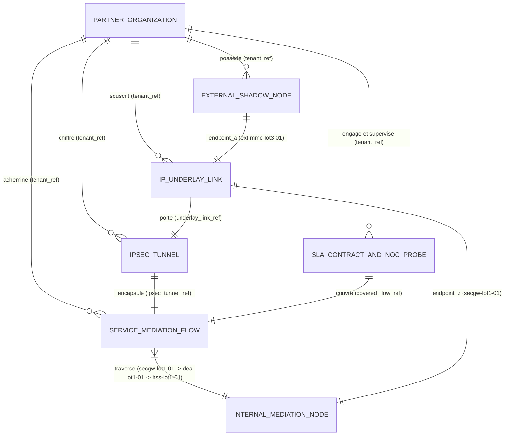

### 15.4 Démonstration Complète du Parcours et Composition Algébrique de Batory sur le Cas §14

Cette section illustre pas à pas le parcours complet depuis l'expression du besoin initial jusqu'à l'hydratation vivante dans Nautobot et le descripteur Sylva, en démontrant mathématiquement et techniquement le principe de **composition algébrique** :
$$\text{Descripteur Cible} = (f_{\text{Énergie 2N}} \circ f_{\text{OOB}} \circ f_{\text{NIS2}} \circ f_{\text{SR-IOV}} \circ f_{\text{IPsec-Mediation}})(\text{Base Cluster})$$

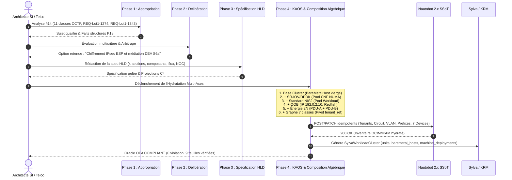

#### Étape 1 · Phase 1 (Appropriation) : Découpage et Ancrage des Exigences
- **Entrée** : 11 clauses contractuelles du CCTP Lulu Lot 1 (`REQ-Lot1-557`, `701`, `711`, `1270`, `1274`, `1275`, `1276`, `1277`, `1278`, `1279`, `1343`).
- **Analyse d'impact** :
  - `REQ-Lot1-1274` : obligation d'inhiber les fausses alarmes NOC générées par les cellules mobiles et RAN tiers intermittents du Lot 2.
  - `REQ-Lot1-1343` : démarcation stricte de la responsabilité d'hébergement électrique et réseau au niveau du répartiteur Lot 1 (MMR).
- **Résultat** : sujet qualifié `sub_lulu-avec-options-et-criteres-proposes_89` (*§14 · Hébergement Lots 2/3, RAN tiers et cellules mobiles : sécurité contre souplesse*).

#### Étape 2 · Phase 2 (Délibération & Arbitrage) : Décision Formelle
- **Option retenue** : *Obligation de chiffrement IPsec ESP et médiation DEA pour les flux S6a Lot 3 ↔ Lot 1* (`opt-1793311130542-wmhxr`).
- **Motivation** : *« c'est la bonne »* (garantie de non-répudiation, étanchéité protocolaire et conformité 3GPP TS 33.210 NDS/IP).
- **Statut** : `reversibility: reversible`, `regulatoryStatus: Compliant`.

#### Étape 3 · Phase 3 (Spécification HLD L4) : Spécification en 4 Sections
La décision est décomposée selon la structure canonique en 4 sections :
1. **Contexte & Choix Validé** : choix de l'isolation forte avec passerelle de médiation dédiée.
2. **Décomposition des Composants** :
   - Terminaison du tunnel IPsec ESP obligatoirement sur `secgw-lot1-01`.
   - Inspection et masquage topologique obligatoires sur `dea-lot1-01`.
   - Interdiction formelle de tout flux non chiffré ou non médiatisé vers `hss-lot1-01`.
3. **Interfaces, Protocoles & Matrice de Flux** : suites fortes `AES-256-GCM` / `ECDSA-P384` / `IKEv2`, démarcation des zones réseau (`ZONE-PARTNER-LOT3-UNTRUSTED`, `ZONE-DMZ-INTERCO-LOT1`, `ZONE-MEDIATION-SIGNALING-LOT1`, `ZONE-CORE-HSS-RESTRICTED`).
4. **Exploitation, Supervision & Points de Vigilance** : télémétrie temps réel NOC avec neutralisation des alarmes intermittentes et haute disponibilité 2N.

#### Étape 4 · Phase 4 : Application du Modèle Algébrique de Batory (FOSD)

Dans [`composeMultiAxisHydration`](src/lib/server/edp/refinementCoverage.ts), le descripteur final n'est pas un template statique préexistant, mais le résultat de transformations successives composées sur un objet vierge :

```typescript
// 1. Base Cluster vierge
let cluster = {
  name: "srv-proposes-89",
  devices: [],
  k8s_manifests: [],
  security_zones: [],
  environments: [],
  power_feeds: []
};

// 2. Transformation f_SRIOV (Axe Compute Substrate - Pool CNF)
cluster = applyLeaf_SRIOV(cluster);
// => Ajoute srv--proposes-89-02 (Dell R750) avec pool sylva-cnf-sriov-dpdk
// => Ajoute md-sylva-cnf-sriov-dpdk avec pinning NUMA, HugePages 1Gi et VF SR-IOV

// 3. Transformation f_NIS2 (Axe Compute Substrate - Pool Standard)
cluster = applyLeaf_StandardNIS2(cluster);
// => Ajoute srv--proposes-89-01 (HPE DL380) avec pool sylva-standard-nis2
// => Ajoute md-sylva-standard-nis2 avec CNI Cilium

// 4. Transformation f_OOB (Axe OOB Management)
cluster = applyLeaf_OOB(cluster);
// => Injecte les interfaces oob0 (192.0.2.10/24 et 192.0.2.11/24)
// => Configure spec.bmc.address = "redfish+http://192.0.2.10/redfish/v1/Systems/1"

// 5. Transformation f_Zones (Axe Security Zoning)
cluster = applyLeaf_SecurityZones(cluster);
// => Injecte ZONE-OAM (isolation: strict, proxy: true) et ZONE-UPF-USER
// => Active les units kyverno et vault dans SylvaWorkloadCluster

// 6. Transformation f_Energie (Axe Power Resilience 2N)
cluster = applyLeaf_DualFeed2N(cluster);
// => Injecte power_feeds: ["PDU-A", "PDU-B"] sur tous les serveurs

// 7. Transformation f_IPsec_Mediation (Graphe 7 Classes avec pivot tenant_ref="org-lot3-mno")
cluster = applyReconciliationGraph(cluster);
// => Injecte les 7 classes d'objets interconnectées
```

#### Étape 5 · Résultat de l'Hydratation Réelle dans Nautobot 2.x SSoT (`nautobotSync.ts`)

L'exécution de `npm run seed:demo` ou l'appui sur le bouton **« Hydrater Nautobot & Sylva »** pousse immédiatement dans l'instance Nautobot active :
1. **Tenants** : `org-lot3-mno` (Opérateur Tiers Lot 3) et `org-lot2-ran` (RAN & Cellules Mobiles Lot 2).
2. **Circuit** : `link-ip-lot3-secgw1` (Provider `Provider-Lot3-MNO-Interco`, Type `Interco-WAN-IPsec-ESP-S6a`, statut `Planned`, 1 Gbps) reliant :
   - **Terminaison A** : `ext-mme-lot3-01` (`ExternalMMEFunction`).
   - **Terminaison Z** : `secgw-lot1-01` (`SecurityGatewayFunction` sur `pop-valmondois`).
3. **IPAM** : VLAN `1403` et préfixe `100.64.14.0/30` rattachés au tenant `org-lot3-mno`.
4. **DCIM Devices** :
   - `srv--proposes-89-01` (`HPE ProLiant DL380`, Pool `sylva-standard-nis2`).
   - `srv--proposes-89-02` (`Dell PowerEdge R750`, Pool `sylva-cnf-sriov-dpdk`).
   - `ext-mme-lot3-01` (Shadow 3GPP `ExternalMMEFunction`, non managé Lot 1).
   - `ext-ran-cell-mobile-01` (Shadow 3GPP `ExternalENodeBFunction`, intermittent).
   - `secgw-lot1-01` (Passerelle IPsec ESP Lot 1).
   - `dea-lot1-01` (Passerelle de médiation Diameter S6a Lot 1).
   - `hss-lot1-01` (Serveur abonnés cœur Lot 1).
5. **Vérification OPA Rego** : les règles `deny_unmediated_s6a_direct_flow` et `deny_unreconciled_partner_objects` retournent le verdict **`COMPLIANT`** (0 violation sur 9 feuilles évaluées).

### 15.5 Suite de Validation d'Intégration Sylva & 15 Règles d'Or OPA (Bouchon & Enforcement Local)

Pour garantir en local sur le poste de développement et en CI que l'hydratation d'Archinex aboutira sans rupture dans un environnement Sylva réel sans nécessiter de cluster bare-metal lourd, Archinex intègre une suite de validation « Smart-Light » en deux barrières étanches :

1. **Validation de Schéma KRM & CRD (`tests/fixtures/sylva/sylva-workload-cluster.schema.json`)** :
   - Valide formellement l'objet `SylvaWorkloadCluster` (`workloadclusteroperator.sylva/v1alpha1`) via Ajv et les spécifications OpenAPI/JSON Schema de la communauté Sylva.
   - Contrôle la structure CAPI (`capi_providers: capm3 + cabpr`), les images durcies, les unités `sylva-units` et la conformité des `machine_deployments`.

2. **Évaluation des 15 Règles d'Or d'Enforcement Sylva (`edp/policies/sylva_golden_rules.rego`)** :
   - Évalue via Open Policy Agent (OPA) les 15 invariants de production télécom :
     - *Règle 1* : CNI Cilium mandataire (`spec.units.cilium.enabled = true`).
     - *Règle 2* : Fournisseurs CAPI conformes (`capm3` Baremetal + `cabpr` RKE2).
     - *Règle 3* : Image OS hôte durcie (`spec.os_image_selector.hardened = true`).
     - *Règle 4* : Admission Controller Kyverno activé pour la gouvernance de sécurité runtime.
     - *Règle 5* : Pile de monitoring & observabilité telco active.
     - *Règle 6* : Load-balancer MetalLB actif pour router les VIP de contrôle.
     - *Règle 7* : HashiCorp Vault actif dès lors qu'un pool NIS2 est déployé.
     - *Règle 8* : Méta-CNI Multus actif en présence de dataplane SR-IOV/DPDK.
     - *Règle 9* : Opérateurs `sriov` et `sriov-resources` actifs en présence de SR-IOV.
     - *Règle 10* : Sélecteur de groupe d'hôtes `hostSelector.matchLabels["host-group"]` défini sur chaque MachineDeployment.
     - *Règle 11* : Labels de pools RKE2 `sylva.org/pool` et `sylva.org/dataplane` renseignés.
     - *Règle 12* : Kubelet CPU Manager statique (`--cpu-manager-policy=static`) pour les pools DPDK.
     - *Règle 13* : Topology Manager Single-NUMA Node (`--topology-manager-policy=single-numa-node`) pour l'alignement PCIe/CPU.
     - *Règle 14* : Adresses BMC Redfish virtuelles conformes sur tous les hôtes bare-metal.
     - *Règle 15* : Adresses MAC de boot (`bootMACAddress`) présentes et valides.

3. **Intégration CI & Commande Rapide** :
   - `npm run check:sylva` (`scripts/check-sylva-golden-rules.ts`) : exécute en local en < 100ms la validation complète.
   - `tests/contract/edp-sylva-integration-schema-and-rules.test.ts` : valide le cas démo nominal et détecte les dérives de production.
   - Intégration dans la porte qualité unique `verify.yml` (`npm run verify`).

4. **Lien Fort Clause <-> Feuille d'Ontologie & Rétro-traçabilité (Issue #262)** :
   - **Ancrage déterministe** : dans `src/lib/server/edp/refinementCoverage.ts`, la décomposition des intentions KAOS exploite le champ `governed_by_clauses?: string[]` sur les entités feuilles et les triplets avec prédicat `satisfies_clause`. L'association est déterministe et prioritaire avant tout repli heuristique.
   - **Rétro-traçabilité OPA** : `multi_axis_refinement.rego` et `sylva_golden_rules.rego` retournent `violated_clause_urn` et `violated_requirement_id` sur chaque violation, permettant à l'IHM (`Phase4RefinementHub.svelte`) d'afficher le lien direct cliquable vers la clause violée.
   - **Annotations KRM Sylva & Nautobot 2.x** : `composeMultiAxisHydration()` injecte `archinex.io/satisfied-clauses` et `archinex.io/evaluated-triplets` dans les annotations de `SylvaWorkloadCluster`, et `syncHydratedInventoryToNautobot()` propage ces identifiants dans les Custom Fields et Tags Nautobot.

### 15.6 Jumeau Numérique Pré-Déploiement de Sylva (`sylvaTwin.ts`, `sushy-tools` & `twin_resilience.rego` — Issues #292, #293, #294)

Pour dépasser le simple comptage multiplicatif What-If (« 2 vs 3 DCs »), Archinex branche directement en sortie de `composeMultiAxisHydration` un **Jumeau Numérique pré-déploiement de Sylva** (ciblant **Sylva `LATEST`**) :

1. **Modèle Topologique à 3 Profils (Baseline = 3 DCs par défaut)** :
   - **`3dc-active` (Gold — Défaut)** : 3 Datacenters (`dc1`, `dc2`, `dc3`), control-plane RKE2 / `etcd` réparti `1+1+1`, stockage Longhorn/Ceph `RF=3` (`1+1+1`), management cluster étiré. Survit sans coupure (`RTO = 0s`) à la perte complète d'un DC.
   - **`2dc-witness` (Silver — 2 DCs + Site Témoin / Arbiter)** : 2 DCs porteurs de charges (`dc1`, `dc2`) + 1 site témoin léger (`dc3-witness`) hébergeant uniquement le 3e membre de quorum `etcd` et l'arbitre stockage (`sylva-witness-quorum`). Maintient le quorum automatique (`2/3`) en cas de chute de `dc1` ou `dc2`.
   - **`2dc-split` (Bronze — 2 DCs secs sans témoin)** : répartition asymétrique `2+1` sur `dc1` et `dc2` ; la chute de `dc1` entraîne la perte du quorum `etcd` (`1/3 < 2`) et du quorum d'écriture stockage.
2. **Double Mode d'Arbitrage (`TwinArbitrationMode`)** :
   - **Mode Proposition (`proposal`)** : à la main de l'équipe d'architecture ; compare les 3 profils sous 5 scénarios d'injection de pannes (`dc_loss_primary`, `dc_loss_secondary`, `host_loss_sriov`, `power_feed_loss_pdu_a`, `inter_dc_link_partition`) et formule la recommandation argumentée.
   - **Mode Fixé par le Client (`client-mandated`)** : confronte la topologie imposée par le client aux exigences de survie et détecte formellement les exigences contradictoires via l'oracle OPA `edp/policies/twin_resilience.rego` (`sources.twin_report`).
3. **Bouchonnage Bare-Metal `sushy-tools` & `KWOK` pour la CI (Palier 1 & Palier 2)** :
   - `generateSushyEmulatorConfig()` produit la configuration `sushy-emulator.conf` (*fake driver in-memory*) appariée aux `BareMetalHost` CAPI `capm3` (adresses BMC Redfish, UUID, MAC, CPU/RAM) et montée dans le service `sushy-emulator` de `deploy/integrator-tools/compose.yml`.
   - `generateKwokNodeManifests()` et `generateKwokWorkloadManifests()` produisent les manifestes `Node` (`hugepages-1Gi`, `intel.com/sriov_netdevice`, taint témoin `NoSchedule`) et `Deployment` pour exécuter le vrai `kube-scheduler` sous `kwokctl` en CI (`.github/workflows/twin-ci.yml`).
   - `calibrateT1WithKwokResults()` (`scripts/calibrate-twin-t1-t2.ts`) confronte les prédictions analytiques T1 aux placements réels du `kube-scheduler` KWOK (T2) à l'état nominal et après injection de panne `dc_loss_primary`, tandis que `helm lint` / `helm template` valident le chart `edp/charts/sylva-workload-twin/` (Sylva `LATEST`).

---

## 16. Feuille de Route (Roadmap) & Gouvernance du Périmètre

> **Décision de cadrage ([ADR-017](docs/adr/ADR-017-nautobot-point-unique-reconciliation.md), issue #397)** : Archinex est une **couche d'assurance de décision** centrée sur la délibération, la complétude de la couverture des exigences et la justification visuelle. **Nautobot est l'unique point de réconciliation bidirectionnel** entre l'intention arbitrée dans Archinex et les systèmes réels ; les connecteurs d'implémentation vivent **derrière Nautobot**.

### 16.1 Ordre de réalisation

La feuille de route privilégie l'**amont de la décision** (sécurité, intégrité, fiabilité doctrinale) et la **boucle de dérive minimale** avant toute extension aval :

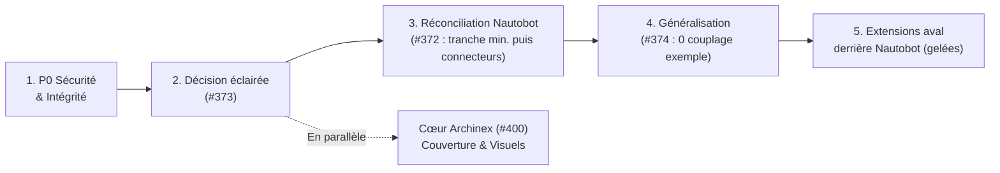

1. **Priorité 1 — Sécurité et intégrité (P0)** :
   - Durcissement du socle (authentification, autorisation Casbin par domaine/projet, étanchéité des secrets, signature HMAC des webhooks, application stricte des invariants constitutionnels `verified × llm-derived` en persistance).
2. **Priorité 2 — Épique « Décision éclairée » (#373)** :
   - Contraintes KB évaluées en **échec fermé (*fail-closed*)** lors de l'arbitrage (aucune décision réputée conforme si le Knowledge Hub est indisponible ou partiel).
   - Verdicts structurés (#384), gestion explicite des réserves au scellement (#385), source de vérité unique entre délibération et artefacts.
   - **Provenance explicite** sur chaque évaluation d'oracle (#380) : distinction obligatoire entre valeurs par **défaut** (`default`), issues du **catalogue** (`catalog`) ou observées dans le **réel** (`real`). Un verdict évalué sur des valeurs par défaut n'est jamais présenté comme opposable.
3. **Priorité 3 — Épique réconciliation Nautobot (#372)** :
   - **Phase 3a — Tranche minimale en production sur un projet réel** :
     - Périmètre strictement borné à 3 familles d'objets (**Tenant** ; **Device + statut** ; **Prefix / VLAN / IP**) et 4 types d'écart (`missing`, `unexpected`, `attribute_mismatch`, `status_regression`).
     - Statuts et propriété des champs intention / réalisé / opérationnel (#398, [`docs/edp/field-ownership.md`](docs/edp/field-ownership.md)).
     - Marquage de traçabilité `archinex_*` et push idempotent au statut *Planned* (#376, [`docs/edp/nautobot-trace-markers.md`](docs/edp/nautobot-trace-markers.md)).
     - Détection de dérive persistée (`DriftFinding`), webhook HMAC (#377), cycle de vie des écarts (#378) et réconciliation périodique (#379, [`docs/edp/reconciliation-and-drift.md`](docs/edp/reconciliation-and-drift.md)).
     - Règle d'honnêteté : Nautobot injoignable, connecteur muet ou donnée périmée produisent l'état **non vérifié**, jamais « conforme ».
   - **Phase 3b — Cadre des connecteurs derrière Nautobot** :
     - Contrat de *write-back* des connecteurs (preuve d'exécution) et kit de conformité (#399) : un objet n'est affiché « réalisé » que si une preuve écrite par un connecteur est présente ; une annotation `archinex.io/satisfied-clauses` déclare une traçabilité vérifiable, **elle ne constitue pas une preuve**.
     - Relocalisation hors cœur des adaptateurs existants dans `src/lib/server/edp/adapters/` (#411).
     - Cadre des connecteurs et connecteur de référence **Sylva GitOps** consommateur de Nautobot (#381), remplaçant l'ouverture directe de PR/MR depuis `sylvaGitopsExport.ts` (conservée derrière un drapeau de dépréciation jusqu'à parité).
4. **En parallèle — Cœur de valeur Archinex : couverture et justification visuelle (#400)** :
   - Délibération outillée, matrice de complétude de la couverture des exigences, fiches de décision opposables et schémas déterministes rendant chaque arbitrage auditable.
5. **Priorité 4 — Généralisation (#374)** :
   - Zéro couplage au scénario d'exemple dans `src/` : hydratation générique dérivée dynamiquement de l'ontologie active et du catalogue projet. Prérequis indispensable au push générique multi-projets vers Nautobot.
6. **Priorité 5 — Nouveaux outils et extensions aval (gelés)** :
   - Ouverture conditionnée à la mise en production de la tranche minimale Nautobot sur un projet réel et à la validation d'au moins un connecteur de référence conforme à #399.
   - Tous les outils aval (compilation GitOps multi-DC / Kustomize, analyse de routage Batfish, règles Prometheus/Alertmanager, orchestration Edge/Nephio, DNS/DDI, Vault/PKI, IdP, registre OCI/Trivy, ITSM) opèrent **derrière Nautobot** et remontent leurs verdicts via le contrat de *write-back*.

### 16.2 Politique de gel des connecteurs directs

Tant que la **tranche minimale Nautobot** (Tenant ; Device + statut ; Prefix / VLAN / IP) n'est pas en production sur un projet réel :

- **Gel des écritures directes** : aucun nouvel appel d'écriture d'Archinex vers un outil d'implémentation.
- **Gel des connecteurs directs** : aucun nouveau connecteur direct ajouté dans le cœur d'Archinex.
- **Gel des extensions hors tranche minimale** : les capacités déjà présentes (ex. synchronisation de circuits/tunnels VPN dans `nautobotSync.ts`, jumeau numérique Sylva hors ligne en CI) sont **conservées mais gelées** (non étendues).
- **Re-cadrage des issues #351–#358** : suivi par les mainteneurs selon [ADR-017 §8](docs/adr/ADR-017-nautobot-point-unique-reconciliation.md#8-sort-des-issues-de-connecteurs) (#375) :
  - `#352`–`#357` (adaptateurs livrés en PR #363) : relocalisation hors cœur et retrait des chemins d'écriture directe suivis dans `#411`.
  - `#351` (allocation IP) : re-cadrée sur l'IPAM natif de Nautobot.
  - `#358` : scindée entre connecteur ITSM (derrière Nautobot) et chiffrage FinOps (délibération, côté Archinex).

### 16.3 Revue trimestrielle du périmètre (liste fermée)

Le périmètre d'Archinex fait l'objet d'une **revue trimestrielle** par les mainteneurs autour d'une **liste fermée** « Dans le périmètre / Hors périmètre ». Aucune nouvelle brique n'entre dans le périmètre sans passage en revue trimestrielle et sans satisfaction du critère de sortie du gel (tranche minimale Nautobot en production sur un projet réel + au moins un connecteur de référence conforme à #399).

| Statut | Capacités |
| :--- | :--- |
| **Dans le périmètre (cœur Archinex)** | Appropriation RFP et couverture des exigences ; délibération contradictoire et arbitrage humain opposable (G3) ; vérification doctrinale KB en échec fermé et capitalisation (G4–G7) ; justification visuelle déterministe (diagrammes, fiches de décision, exports scellés) ; interface d'hydratation *Planned* vers Nautobot avec provenance explicite (`default` / `catalog` / `real`) ; détection et suivi de dérive (`DriftFinding`) depuis Nautobot ; oracles Rego de décision sur l'intention et les instantanés Nautobot. |
| **Hors périmètre (derrière Nautobot ou gelé)** | Écriture directe vers une forge Git, un cluster Kubernetes, un DDI/DNS, un coffre Vault/PKI, un IdP, un registre OCI ou un outil ITSM ; compilation GitOps CNF multi-DC / overlays Kustomize ; analyse de routage Batfish comme étape bloquante directe ; génération de règles Prometheus / Alertmanager ; orchestration de flotte Edge par Nephio / Porch ; extension des objets Nautobot hors tranche minimale (circuits, tunnels VPN, pare-feu) ; second registre d'état concurrent de Nautobot. |

### 16.4 Historique et devenir des anciens Horizons 1 à 3

Les éléments issus de l'ancienne feuille de route sont reclassés comme suit :

- **Déjà livrés et conservés dans le socle** : collecte live et webhook HMAC Nautobot, détection de dérive persistée `DriftFinding` (#239 / #377), synchronisation idempotente Nautobot (`nautobotSync.ts`, étendue uniquement sur la tranche minimale).
- **Livrés et gelés / en cours de migration** : export GitOps Sylva (`sylvaGitopsExport.ts`, #238 — mode `local_bundle` conservé, ouverture directe de PR/MR à déplacer derrière Nautobot via #381) ; modélisation des tunnels IPsec Nautobot (`#240`, conservée et gelée).
- **Anciens Horizons 2 et 3 (gelés et re-cadrés derrière Nautobot)** : compilation d'overlays Kustomize multi-DC, analyse symbolique du plan de routage par Batfish (vérification de joignabilité remontée via *write-back*, jamais vendue comme « preuve mathématique » globale de conformité), génération de règles `PrometheusRule` / Alertmanager et délégation *Blueprint* / `PackageVariantSet` vers Nephio pour les flottes Edge hétérogènes à grande échelle. Ces pistes ne seront réévaluées qu'en **Priorité 5**, lors d'une revue trimestrielle post-mise en production de la tranche minimale.


---

## 10. Frontière d'Architecture : Découplage Code Engine, État Runtime & Knowledge Hub (Lot A7 / Issue #252)

Afin d'éviter tout couplage anti-pattern entre le code source du moteur applicatif, la persistance vivante des données et le corpus de connaissances doctrinales d'entreprise, le système respecte une stricte séparation en trois tiers étanches :

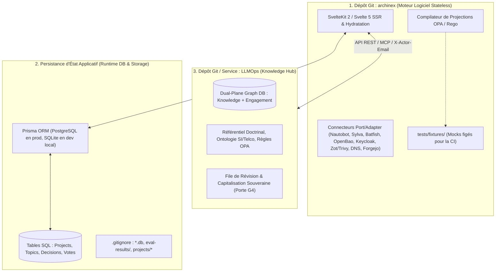

### 1. Dépôt Applicatif `archinex` (Stateless Engine)
- **Rôle** : Fournir le moteur d'exécution, l'IHM, les pipelines de délibération, les agents de débat et les compilateurs d'infrastructure.
- **Principe d'indifférence aux données de production** : Le code applicatif ne contient **aucun artefact d'exécution vivant**, aucun résultat d'évaluation récursive (`eval-results/`), aucun fichier binaire de base de données (`*.db`, `*.sqlite`), ni aucun projet utilisateur en dur.
- **Fixtures de test étanches** : Seules les fixtures statiques et anonymisées dans `tests/fixtures/` sont versionnées pour garantir l'autonomie totale de la suite de tests unitaires et de contrat (`vitest`, `playwright`).

### 2. Couche de Persistance Runtime (State DB)
- **Rôle** : Stocker l'état vivant des projets, sessions d'utilisateurs, étapes de délibération, votes du collège et jetons d'authentification.
- **Support** : Base PostgreSQL managée en production (ou base locale `dev.db` en développement).
- **Règle Git** : Strictement exclue du contrôle de version. Les tables relationnelles Prisma portent l'ensemble de la mémoire opérationnelle ; aucun commit Git n'est jamais émis pour persister l'état d'un projet utilisateur.

### 3. Knowledge Hub Souverain (`LLMOps`)
- **Rôle** : Autorité doctrinale souveraine et registre patrimonial de l'architecture d'entreprise.
- **Support** : Dépôt dédié [`MauriceIsrael/LLMOps`](https://github.com/MauriceIsrael/LLMOps) et service Knowledge Graph servi par MCP / API REST.
- **Consommation dynamique & Priorité souveraine (#253)** :
  - **Ontologie SI (`src/lib/server/edp/ontologyClient.ts`)** : Interroge en priorité absolue le service LLMOps via son API REST (`GET /api/knowledge/ontology/export`). En environnement hors-ligne ou de test déconnecté, bascule de manière transparente sur les fixtures scellées (`tests/fixtures/edp/ontology_export.json`, copie générée de l'export du Hub ; la donnée de projet s'ajoute par-dessus via une extension, voir `docs/edp/ontology-source.md`). En environnement de production (`NODE_ENV=production`), tout repli silencieux est strictement interdit afin de garantir l'authenticité des contrôles d'architecture.
  - **Doctrine & Règles de Conformité (`src/lib/server/doctrine/doctrineService.ts`)** : Interroge en priorité absolue le Knowledge Hub (`GET /api/knowledge/context`). En mode hors-ligne/test déconnecté, active un repli propre sur les fixtures doctrinales scellées (`llmops-sealed-snapshot.json`) en filtrant par domaines et sujets. En production, le statut hors-ligne (`offline: true`) est propagé sans aucune invention de règles.
  - **Porte G4 — Capitalisation Souveraine (`src/lib/server/projects/capitalizationDb.ts`)** : Les nouveaux patterns architecturaux (`new_asset`) et amendements/dérogations (`amendment`) sont transmis directement vers l'API du Knowledge Hub (`POST /api/knowledge/candidates`) par requêtes HTTP sécurisées avec propagation de l'identité d'acteur (`X-Actor-Email`). L'ensemble de la Porte G4 fonctionne de manière strictement *stateless*, sans aucune écriture ni lecture de fichiers locaux sur le système de fichiers.

---

## 17. Catalogue de Composants Logiques, Modèle Terrain (`Base × Overlay × DC`) & Export Sylva Tenant (#283–#287)

Pour combler l'écart entre la délibération d'architecture et le déploiement terrain tout en restant **Sylva-compliant first**, Archinex complète la Phase 4 avec un étage logique intermédiaire séparé de l'ontologie normative :

1. **Catalogue de Composants & Valeurs (`src/lib/domain/edp/componentCatalog.ts`, `src/lib/server/edp/componentCatalogRepository.ts`, `GET/POST /api/projects/[projectId]/catalog`)** :
   - Modélise la triade **`LogicalComponent` (`Component → Module → Instance`)**, le cloisonnement **`1 Component = 1 Tenant`**, l'axe **`FunctionalDomain / Editor`**, le Multi-NIC par classe (`admin`, `business`, `events`, `internal`, `storage`, `backup`, `oob`), le routage VRF ↔ DNS, l'adressage relatif (`offset`, `dhcp`, `reserved`), le stockage (`SVM + tiers hot/warm/cold`, S3 `objectStores`) et les statuts (`active | staged | inactive`).
   - Supporte les extensions **IMP V2 (Lot 1, #303)** : entité `OrganizationSpec` (`kind: Organization` + dérivation de bulle `deriveOrganizationBubble`), catalogues `qosClasses`, `vlanPools`, `vniPools`, `firewalls` (`interzone`/`external`/`operator-link`), `certificateProfiles` (validation RGS via `validateCertificateProfilesAndRgs`), `drivers` (`CapabilityMatrix` via `validateDriverCapabilities`), ainsi que les blocs `network.fabric`/`apns`/`tunnels`/`loadBalancers`, `compute.namespaces`/`hardware`, `exposure`, `observability`, `data.databases`, `supplyChain` et `lifecycle`.
   - Sépare strictement la **Base** (agnostique de l'environnement, vérifiée par `lintBaseComponentNoHardcodedEnv`) des **`EnvironmentOverlay`** (substitutions `param.*` et liste de `datacenters`), éditables dans `ComponentCatalogEditor.svelte`.
2. **Résolveur `ref()`, Graphe d'Impact & Flux Implicites (`src/lib/domain/edp/refResolver.ts`)** :
   - Projette `Base × EnvironmentOverlay × Datacenter` en instances résolues avec IPs calculées par `offset`, vérifie la continuité des segments de `LogicalInterfaces` (`S6a`, `Rx-N5`, `WMS-WFS`), génère les flux implicites (`auto-generated` : NFS, SIEM, PKI) avec priorité aux règles explicites, et permet la **simulation What-If (2 vs 3 DCs)**.
3. **Phase 5 · Consolidation Projet, Piliers Transverses & 3 Vues Synchronisées (`src/lib/domain/edp/logicalViews.ts`, `Phase5ConsolidationHub.svelte`)** :
   - Vue transversale au niveau Projet (`activePosture = 'consolidation'`, accessible depuis l'onglet **Phase 5 · Consolidation** positionné à droite de **Phase 4 · Raffinement** dans `ProjectEngagementHeader.svelte`), structurée autour des **4 piliers transverses** (**Socle / Architecture transverse**, **Sécurité**, **Gestion / Gouvernance**, **GitOps / Exploitation**) avec accès direct aux artefacts et statuts de verrouillage.
   - `composeProjectLogicalTopology()` consolide les composants de référence (`core-network`, `ptt-server`, `gis-server`, `eir-proxy`, `gsma-eir`) et génère 3 diagrammes Mermaid synchronisés : **Vue Logique**, **Vue Déploiement (DC → Pool Sylva → Tenant)** et **Vue Physique / CMDB**.
4. **Oracle OPA Étendu (`edp/policies/multi_axis_refinement.rego`) & Export GitOps Sylva Tenant (`src/lib/server/edp/sylvaGitopsExport.ts`)** :
   - L'Axe 7 vérifie l'alignement placement ↔ dataplane, la continuité des `LogicalInterfaces`, l'absence de `ref()` non résolues et les règles de lint Base.
   - `exportSylvaWorkloadClusterGitops()` émet, en plus de `workload-clusters/<cluster>/values.yaml`, les manifests natifs Sylva/FluxCD par composant dans `workloads/<functionalDomain>/<component>/<env>/` (`Namespace`, `CiliumNetworkPolicy`, `HelmRelease` avec gestion `staged`/`inactive`), assainis par `sanitizeManifests()`.

---

## 18. Taxonomie Unifiée TOGAF, Emplacements de Décision, Conscientisation & Hydratation de la Chaîne de Confiance

Pour éviter que les composants d'infrastructure critiques mais standardisés (HSM, hiérarchie PKI, coffre Vault/OpenBao, bastion PAM, proxy filtrant sortant/WAF, DNS/IPAM, synchronisation temporelle, registre OCI) ne restent invisibles entre l'évacuation des « commodités » en Phase 1 et la génération LLD, Archinex unifie le pipeline autour de quatre mécanismes :

1. **Taxonomie Canonique à 7 Domaines TOGAF (`src/lib/domain/edp/togafTaxonomy.ts`)** :
   - Unifie les catégories d'exigences, le Document Engine (`application`, `component`, `infrastructure`, `iaas`) et les domaines d'ontologie en 7 domaines : `application-business`, `security-trust`, `network-connectivity`, `platform-compute`, `data-persistence`, `operations-observability`, `facilities-sovereignty`.
   - Expose un catalogue de 29 briques de référence (`TOGAF_REFERENCE_BUILDING_BLOCKS`) et le détecteur d'angles morts `scanProjectArchitecturalBlindSpots()`.
2. **Routage des Clauses « Commodité » Sans Rétro-Injection en Débat (`src/lib/server/ingest/arckitRequirementsPipeline.ts`)** :
   - Les clauses qualifiées `commodity` restent évacuées du débat contradictoire multi-agents, mais sont classées par domaine TOGAF et rattachées à un emplacement de décision cible (`commoditySlotId`, `commodityAxisUrn`, résumé dans `ArcKitAuditReport.commoditySlots`).
3. **Conscientisation, Oracles Fantômes & Fermeture Transitive (`src/lib/server/edp/refinementCoverage.ts`)** :
   - **Proposition par défaut vs Décision ratifiée** : chaque axe et chaque emplacement de décision (`decisionSlots`) distingue l'origine de liaison (`explicit`, `strong_link`, `default_proposed`, `none`) et son statut (`open`, `default_proposed`, `bound_unverified`, `bound_verified`, `waived`). `conscientiousMetrics.isConscientiouslyComplete` reste faux tant qu'un défaut n'est pas explicitement ratifié (`ratifyDefaultDecisionSlots()`), qu'une feuille n'a pas d'oracle exécutable ou qu'un oracle fantôme subsiste.
   - **Détection d'oracles fantômes (`loadImplementedRegoRuleNames`)** : extrait les règles réellement encodées dans `edp/policies/multi_axis_refinement.rego` et sépare `executableOracleRules` de `phantomOracleRules`.
   - **Fermeture transitive (`computeTransitivePrerequisiteAxes`)** : propage les dépendances structurelles déclarées par `requires_prerequisite_axis` (par exemple IPsec IKEv2 → PKI 3GPP CMPv2 → Hiérarchie PKI → HSM, ou Zone OAM → Bastion PAM → IAM FIDO2, ou Chiffrement LUKS2 → Auto-Unseal Vault → HSM).
4. **Catalogue Traverse & Intégrité Référentielle (`src/lib/domain/edp/componentCatalog.ts`, `src/lib/domain/edp/refResolver.ts`)** :
   - Complète le catalogue logique de base par `TRANSVERSE_COMPONENT_CATALOG` (7 composants lint-conformes avec overlays `prod`, `preprod`, `lab` : `hsm-appliance`, `pki-ca`, `vault-cluster`, `iam-keycloak`, `admin-bastion`, `siem-soc`, `ingress-waf-proxy`), instanciés dynamiquement via `instantiateCatalogFromOntologyBindings()` à partir des triplets `instantiates_component`.
   - `verifyCatalogDanglingReferences()` contrôle l'existence effective des cibles `group:pki-ca-endpoints`, `group:siem-collectors`, `dependsOn` et des références `vault://*`, tandis que l'Axe 8 d'`edp/policies/multi_axis_refinement.rego` vérifie `input.trust_chain` (custody HSM du Root CA, auto-unseal Vault/OpenBao PKCS#11, enregistrement de session OAM et proxy sortant explicite).
5. **Registre Projet d'Emplacements, Ratification en Lot, Promotion Type 1 & Scellement `architecture.lock` (`src/lib/server/edp/decisionSlotRegistry.ts`, `/api/projects/[projectId]/decision-slots`)** :
   - `buildProjectCompletenessLedger()` consolide la matrice de couverture, les `commoditySlots` d'ingestion, la détection d'angles morts TOGAF, les composants transverses instanciés et distingue explicitement la file de délibération structurelle (Type 1) de la file de ratification rapide des commodités (Type 2).
   - `batchRatifyProjectType2Slots()` ratifie par lots (globaux ou filtrés par domaine TOGAF) sous contrôle strict des rôles architectes et persiste les composants logiques associés ; `promoteSlotToDeliberationSubject()` bascule n'importe quelle commodité vers un arbitrage Type 1 complet.
   - `generateArchitectureLockManifest()` exige zéro emplacement ouvert, zéro défaut non ratifié, zéro oracle fantôme, zéro dépendance pendante, un catalogue valide et un verdict OPA `compliant` (Invariant XI d'`openspec/constitution.md`) avant d'émettre un manifeste signé par empreinte `integritySha256`.
6. **Projection Document Engine & Zéro Oracle Fantôme sur l'Axe 9 (`src/lib/server/projects/documentEngineBridge.ts`, `edp/policies/multi_axis_refinement.rego`)** :
   - `buildDocumentEnginePayload()` et `compileDossierWithDocumentEngine()` acceptent `options.transverseEnrichment` (alimenté automatiquement par `GET /api/projects/[projectId]/hld-document-engine`) pour projeter les composants transverses actifs, les emplacements TOGAF ratifiés, la vue `view-socle-transverse` et la section `sec-socle-transverse-togaf` (incluant la synthèse `architecture.lock`) vers Document Engine sans rompre l'API historique.
   - `composeMultiAxisHydration()` hydrate `extended_domains` sur l'ensemble des sous-domaines (réseau EVPN, plan utilisateur, stockage CSI/S3, chiffrement LUKS2, WORM, IAM/MFA, mTLS, secrets Vault, télémétrie OpenTelemetry/SIEM/runbooks, DRP/GameDay et registre OCI Cosign), couvrant les 18 règles OPA de l'Axe 9 (`phantomOracleCount === 0` sur le catalogue scellé).
7. **Continuité Bout-en-Bout RFP → HLD → LLD Pré-Hydraté en Statut `"planned"` & Cohérence Inter-Objets (#344–#348)** :
   - **Phase 1 → Phase 2/5 sans perte** : `deriveProjectHydrationContextFromEntries()` et `loadProjectHydrationContextFromDb()` préservent les exigences évacuées (`disposition === 'evacuated'`) et détectent les capacités émergentes (`detectEmergentCapabilityNeed`). `CorpusAppropriationHub.svelte` et `deliberationStore.addMaturitySubject()` conservent l'intégralité des propositions d'options/critères (`proposal`), `problemStatement`, `nature` et graphe `dependsOn` ; `saveEngagementToDb` et `overlayServerSubjects` synchronisent bidirectionnellement la table relationnelle `prisma.statement`.
   - **Unification du statut `"planned"` et unicité IPv4** : `EntityLifecycleStatus` inclut `'planned'` ; `composeMultiAxisHydration()` alloue des adresses IPv4 distinctes par nœud Bare-Metal pré-hydraté, résout les composants sur l'ensemble des datacenters (`resolved_components_by_dc`) et propage les références d'exigences du sujet dans `satisfied_clauses` ; `nautobotSync.ts` synchronise VLANs, préfixes et adresses IP en statut `Planned` ; `createEmergentLogicalComponent()` dérive un offset IPv4 déterministe par nom de composant vérifié par `verifyResolvedIpUniqueness()`.
   - **Intégrité référentielle complète & Convergence HLD/Bundle** : `verifyCatalogDanglingReferences()` contrôle les groupes firewall, dépendances, SVMs, `ref(component:*)` et segments `LogicalInterfaces` ; `buildSylvaTenantWorkloadManifests()` projette `from`/`to` et `toEndpoints` dans les `CiliumNetworkPolicy` ; `loadHldFragment()` et `exportEngagementBundle()` intègrent les énoncés relationnels, emplacements de décision et composants logiques instanciés du projet.
