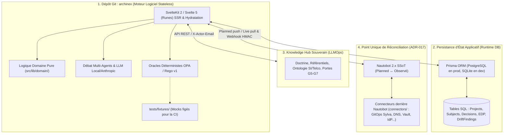

# Archinex · Documentation d'Architecture Système

> **Vue d'ensemble de l'architecture logicielle du moteur de délibération, de vérification doctrinale et de réconciliation Archinex.**
> - Parcours unifié (5 phases), modèles canoniques (#400), invariants et glossaire : [`docs/concepts.md`](docs/concepts.md)
> - Contrats détaillés par lot et sous-système : [`docs/architecture-contracts.md`](docs/architecture-contracts.md)
> - Décisions d'architecture (ADR) : [`docs/adr/README.md`](docs/adr/README.md)
> - Feuille de route & gouvernance du périmètre : [`docs/roadmap.md`](docs/roadmap.md)
> - Métriques générées (tests, règles OPA, ADR) : [`docs/metrics.md`](docs/metrics.md)

---

## 1. Vue Globale & Frontière en 3 Tiers

Archinex est le **seul propriétaire de l'état des projets et du déroulé de co-conception**. Afin d'éviter tout couplage entre code applicatif, données vivantes de projet et doctrine d'entreprise, le système respecte une séparation stricte en trois tiers étanches (formalisée dans l'[ADR-018](docs/adr/ADR-018-knowledge-hub-souverain-decouplage-3-tiers.md)) :

1. **Dépôt applicatif `archinex` (*Stateless Engine*)** : moteur d'exécution SvelteKit 2 / Svelte 5, domaine métier pur TypeScript, oracles OPA/Rego et fixtures anonymisées pour la CI (l'ontologie fixture est générée depuis le Hub, voir [`docs/edp/ontology-source.md`](docs/edp/ontology-source.md)). Aucun fichier `*.db`, `eval-results/` ni projet utilisateur n'est suivi dans Git.
2. **Couche de persistance runtime (Prisma ORM)** : stocke l'état vivant des projets, utilisateurs, habilitations Casbin ABAC/RBAC, délibérations, arbitrages, EDP et `DriftFinding`.
3. **Knowledge Hub souverain (`LLMOps`)** : dépôt et service dédiés (`MauriceIsrael/LLMOps`) portant la doctrine, les référentiels réglementaires et l'ontologie. Toute interaction experte propage `X-Actor-Email` ; aucun repli silencieux vers des fixtures n'est autorisé en production ([ADR-020](docs/adr/ADR-020-interdiction-repli-silencieux-production.md)).

---

## 2. Modèle de Parcours Unifié & Socle Épistémique

### 2.1 Parcours Unique en 5 Phases
Tout engagement suit le **modèle unique en 5 phases** défini dans [`docs/concepts.md`](docs/concepts.md) :
1. **Phase 1 · Corpus & Règles** *(Projet)* : ingestion CCTP/RFP, référentiels, triage 4 compartiments, vagues Q&R acheteur / errata CCTP avec propagation DAG `basedOn` et export Matrice de Conformité Contractuelle (`src/lib/domain/rfpErrata.ts`, #443), commodités et factorisation des sujets.
2. **Phase 2 · Délibération** *(Sujet, via Board)* : cycle interne en 6 temps (cadrage → critères/options → débat multi-agents borné avec qualification de sévérité des objections `blocking`/`advisory` et acquittement motivé en lot #445 → maturité calculée `computeMaturity` avec mode **Fast-Track G3** pour les décisions directes motivées #442 → arbitrage humain Porte G3 `L3_decided` avec `DecisionCard` → capitalisation Porte G4).
3. **Phase 3 · Rendu HLD** *(Sujet)* : spécification HLD, barrière d'homologation, co-signature des contrats d'interface inter-lots (`src/lib/domain/interLotCollaboration.ts`) et assembleur narratif du mémoire technique RFP (`src/lib/domain/rfpNarrativeAssembler.ts`, #448), gel SHA-256 et projections déterministes multi-modèles via `DecisionDiagramModel`.
4. **Phase 4 · Raffinement** *(Sujet)* : intention & planification (ontologie KAOS multi-axes, accompagnement Cold Start des briques émergentes avec 5 archétypes TOGAF et 6 garde-fous transverses `src/lib/domain/edp/emergentColdStart.ts` #444, valorisation BOM/BPU FinOps dynamique `src/lib/domain/edp/finopsBom.ts` #446, prévisualisation `dry-run` Nautobot avec distinction **`Planned-Capacity`** en avant-vente RFP vs **`Planned-Allocated`** en LLD #447, EDP, oracles OPA/Rego avec provenance explicite `default`/`catalog`/`real`).
5. **Phase 5 · Consolidation** *(Projet)* : réalisation & dérive Nautobot (`Planifié`, `Réalisé prouvé`, `Non vérifié`), 4 piliers transverses, registre d'emplacements TOGAF, catalogue logique `Base × Overlay × DC` et manifeste `architecture.lock`.

### 2.2 Invariants Épistémiques & Politique Fail-Closed
Tout énoncé (`Statement`) ou argument (`Argument`) obéit à [`openspec/constitution.md`](openspec/constitution.md) :
- **Énoncé à 5 facettes** : Contenu (triplet), Justification (`basedOn`), Autorité (auteur, rôle, mode), Maturité (`L0_named` → `L5_archived`, confiance), Révisabilité (DAG causal).
- **Interdiction absolue `verified × llm-derived`** : verrouillée à la validation (`src/lib/validation/epistemicEnvelope.ts`), dans le domaine (`src/lib/domain/debate.ts`) et en base Prisma (`src/lib/server/prismaFactory.ts`).
- **Règle du silence** : l'absence de contestation ne vaut jamais approbation.
- **Échec fermé (*fail-closed*)** : en production, l'indisponibilité du Knowledge Hub, d'OPA ou de Nautobot renvoie un état explicite (`not_checked`, `unavailable`, `non vérifié`), jamais un faux « conforme » ([ADR-020](docs/adr/ADR-020-interdiction-repli-silencieux-production.md)).
- **Réserves de couverture réglementaire (`COVERAGE_INCOMPLETE`)** : un référentiel réglementaire projet en statut `partial`, `missing` ou `unknown` est **Non bloquant à l'arbitrage** (Porte G3, enregistré en `coverageReserves` sur la décision et reporté dans le bundle HLD et la matrice RTM), mais **bloquant au scellement** (`freezeExport` et `generateArchitectureLockManifest`) pour les statuts `missing`/`unknown` sans acceptation explicite tracée.

---

## 3. Gouvernance Knowledge Hub (Lots A6 à A11)

Archinex interface les quatre espaces de gouvernance doctrinale adossés au Knowledge Hub LLMOps (contrats détaillés et diagrammes de séquence dans [`docs/architecture-contracts.md`](docs/architecture-contracts.md) §1 à §5) :

| Lot | Espace UI | Porte | Rôle Clé |
| :--- | :--- | :--- | :--- |
| **Lot A6** | `/admin`, `/invite` | — | Comptes locaux, habilitations Casbin (`kb:review`, `kb:evaluate`, `kb:maintain`, `kb:admin`), synchronisation `owners` et propagation `X-Actor-Email`. |
| **Lot A7** | `/kb/reviews` | **G5** | Boîte de revue experte, séparation auteur/relecteur, 7 contrôles automatiques, double-avis pour `principle`, curseur idempotent `KbEventCursor`. |
| **Lot A8** | `/kb/workshop` | — | Atelier de rédaction de clauses (7 templates canoniques, prédicats `when`/`expect`/`requires`/`forbids`, validation pré-vol et simulation non-régression). |
| **Lot A10** | `/kb/frameworks` | — | Ingestion de référentiels réglementaires (`.pdf`, `.html`, `.txt`, `.md`, `.docx` ≤ 20 Mo), instruction ligne par ligne et déclaration de couverture opposable (`409` si lacune). |
| **Lot A9** | `/kb/evals` | **G6** | Banc d'évaluation `check_option_v1`, rappel réel sur cas vérifiés par l'humain $\ge 80\,\%$ et boucle de rétroaction `verdict-feedback`. |
| **Lot A11** | `/kb/dashboard` | **G7** | Tableau de bord de santé KB, scellement cryptographique SHA-256 conditionné par G5 + G6, détection de stockage éphémère et campagnes d'enrichissement. |

---

## 4. EDP, Raffinement KAOS, Réconciliation Nautobot & Consolidation

Les contrats complets d'exécution (Phase 4 & Phase 5) sont détaillés dans [`docs/architecture-contracts.md`](docs/architecture-contracts.md) §6 à §11 :
- **Paquet de Décision Exécutable (EDP) & OPA/Rego** ([ADR-016](docs/adr/ADR-016-promotion-edp-experimental.md), [ADR-019](docs/adr/ADR-019-edp-oracles-opa-rego-deterministes.md)) : séparation intension/extension (`intentionPurity.ts`), prévention de la vacuité (`insufficient_input`), binaire OPA v1.21.4 épinglé SHA-256 (`opaRunner.ts`), projections `data.ontology` (`projectionCompiler.ts`), modules neutres `manifestSanitizer.ts` & `nautobotPlannedExtract.ts`, et garde de mutation 100 % (`scripts/edp-mutation-gate.ts`).
- **Raffinement Multi-Axes KAOS** (`src/lib/server/edp/refinementCoverage.ts`) : composition algébrique de Batory sur les concepts HLD, axes obligatoires et feuilles techniques, graphe de réconciliation projet ([`docs/edp/reconciliation-graph-contract.md`](docs/edp/reconciliation-graph-contract.md)), lien fort `governed_by_clauses` / `satisfies_clause` et rétro-traçabilité OPA.
- **Nautobot, Point Unique de Réconciliation** ([ADR-017](docs/adr/ADR-017-nautobot-point-unique-reconciliation.md)) : Archinex écrit les objets au statut *Planned* (`src/lib/server/edp/nautobotSync.ts`) et lit l'état réalisé pour persister les écarts (`src/lib/server/edp/driftService.ts`, `DriftFinding`, réconciliation périodique [`docs/edp/reconciliation-and-drift.md`](docs/edp/reconciliation-and-drift.md)). Les 6 adaptateurs Port/Adapter ont été relocalisés hors cœur vers `connectors/` ([`docs/edp/connectors-classification.md`](docs/edp/connectors-classification.md)).
- **Consolidation Projet & Taxonomie TOGAF (Phase 5)** : catalogue logique `Base × Overlay × DC` (`src/lib/domain/edp/componentCatalog.ts`, `src/lib/domain/edp/refResolver.ts`), 7 domaines TOGAF (`src/lib/domain/edp/togafTaxonomy.ts`), registre d'emplacements (`src/lib/server/edp/decisionSlotRegistry.ts`) et manifeste scellé `architecture.lock`.

---

## 5. Projections Déterministes & Architecture de Performance

### 5.1 Projections Multi-Modèles (*Zero-Drift*)
Depuis `src/lib/domain/decisionDiagramModel.ts`, `src/lib/components/deliberation/ArtifactRegenerationHub.svelte` et `src/lib/domain/artifactProjections.ts`, toute décision arbitrée (L3/L4) est projetée de façon **100 % déterministe sans LLM** vers :
- **Mermaid** (topologie, déploiement, vues éditoriales — voir [`docs/EDITORIAL_DIAGRAMS.md`](docs/EDITORIAL_DIAGRAMS.md)) ;
- **C4X** (`.c4x`, `src/lib/domain/c4xDsl.ts`) & **Structurizr DSL** (`.dsl`, `src/lib/domain/structurizrDsl.ts`) ;
- **SysML v2 (BDD)** et **JSON technique** (ex. profil PTP ITU-T G.8275.1) ;
- **Canvas « Petites Briques »** (`src/lib/domain/petitesBriquesBridge.ts`, YAML/JSON) ;
- **Document Engine** (`src/lib/server/projects/documentEngineBridge.ts`, enrichissement transverse TOGAF et `architecture.lock`).

### 5.2 Performance & Fluidité de Navigation
- **Cache mémoire *singleflight* (`src/lib/server/llmops/client.ts`)** : déduplication des GET concurrents vers LLMOps, TTL 30 s (2 s sur erreur, désactivé sous Vitest) et invalidation immédiate sur mutation.
- **Allégement des payloads (`includeKeyClauses: false`, `stripSubjectProposals: true`)** : réduction > 97 % de la charge utile initiale sur le Dashboard et les listes d'engagements.
- **Optimisation icônes (`vite.config.ts`)** : plugin `lucideOptimizePlugin` réécrivant les imports barils en imports granulaires.
- **Changement de sujet fluide (`DeliberationWorkbench.svelte`, `SubjectThreadView.svelte`)** : montage unique responsive (`matchMedia`), endpoint agrégé SQLite `/api/projects/[projectId]/subjects/[subjectId]/workbench`, annulation par `AbortController` et cache client SWR.
- **Modularisation des couches clés (#396)** : routes et actions EDP modulaires validées par Zod (`src/lib/server/edp/actions/`), client LLMOps découpé par domaine (`src/lib/server/llmops/domains/`, `transport.ts`, types générés `contract/generated-types.ts`) et sous-composants de délibération sujet (`src/lib/components/deliberation/thread/`).

---

## 6. Pipeline de Validation & Assurance Qualité

La porte qualité unique est exécutée en local et en CI (`.github/workflows/verify.yml`) via `npm run verify` (`scripts/verify.mjs`) :
1. **Denylist & Couplage Scénario** (`scripts/check-no-project-names.mjs`, `scripts/check-scenario-coupling.mjs`) : zéro nom de projet ou fournisseur interdit dans `src/`.
2. **Fragments Changelog** (`scripts/consolidate-changelog.mjs --check`) : conformité de `changelog.d/`.
3. **Vérification des Liens Documentation, Taille des Routes & Contrat Hub** (`scripts/check-doc-links.mjs`, `scripts/check-file-size.mjs`, `scripts/generate-llmops-types.mjs --check`) : zéro lien `file:///`, zéro lien relatif ou chemin source cassé, routes serveur ≤ 300 lignes sans chaîne `if (action === ...)` et types du contrat Hub synchronisés.
4. **Sylva CRD & Règles d'Or OPA** (`scripts/check-sylva-golden-rules.ts`) : validation Ajv + évaluation OPA Rego.
5. **Suites Vitest** (`npm run test`) : tests de contrat et d'intégration (voir les chiffres à jour dans [`docs/metrics.md`](docs/metrics.md)).
6. **Typage Strict Svelte 5 / TypeScript** (`npm run check`) : 0 erreur, 0 avertissement.
7. **Build de Production** (`npm run build`) : compilation complète des bundles client et serveur SSR.

---

## 7. Index de la Documentation d'Architecture

- [`docs/concepts.md`](docs/concepts.md) : modèle unique en 5 phases, modèles canoniques (#400), maturité, portes G3–G7, invariants et glossaire.
- [`docs/architecture-contracts.md`](docs/architecture-contracts.md) : contrats détaillés par lot (A6–A11, EDP, Phase 4 KAOS, Sylva/Nautobot, Jumeau Numérique, Phase 5, TOGAF).
- [`docs/adr/README.md`](docs/adr/README.md) : index des Architecture Decision Records (ADR-016 à ADR-020).
- [`docs/roadmap.md`](docs/roadmap.md) : feuille de route réordonnée (#397), gel des connecteurs directs et revue trimestrielle du périmètre.
- [`docs/metrics.md`](docs/metrics.md) : chiffres générés automatiquement (tests, règles OPA, ontologie, ADR).
- [`docs/edp/field-ownership.md`](docs/edp/field-ownership.md), [`docs/edp/nautobot-trace-markers.md`](docs/edp/nautobot-trace-markers.md), [`docs/edp/reconciliation-and-drift.md`](docs/edp/reconciliation-and-drift.md), [`docs/edp/connectors-classification.md`](docs/edp/connectors-classification.md), [`docs/edp/ontology-source.md`](docs/edp/ontology-source.md) : contrats d'intégration Nautobot, connecteurs et ontologie Hub.
