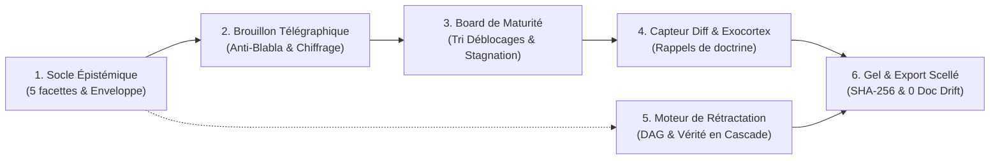
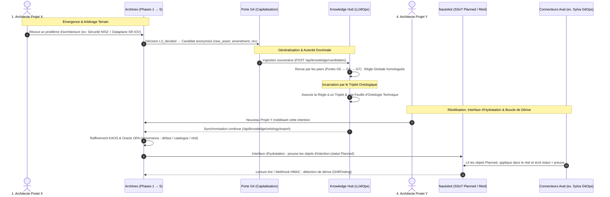

# Archinex · Deliberation Workbench

> **Plateforme d'arbitrage, de convergence dialectique et de gouvernance d'architecture adossée au Knowledge Hub LLMOps.**

## Positionnement

Archinex est une **couche d'assurance de décision** : il capture la délibération, vérifie les décisions contre une base de connaissances (réglementaire et doctrinale, en échec fermé), mesure la **complétude de la couverture des exigences** et rend les justifications **lisibles par des schémas déterministes**. Il ne pilote pas les outils d'implémentation.

Dans cette architecture, l'hydratation est une **interface** assortie de **garanties explicites sur la provenance** des données évaluées (**défaut** / **catalogue** / **réel**) : un verdict produit sur des valeurs par défaut n'est jamais présenté comme opposable, et une annotation déclarative (`archinex.io/satisfied-clauses`) offre une **traçabilité vérifiable**, pas une preuve d'exécution.

La dérive apparaît surtout **après** le HLD. Archinex boucle donc la boucle avec **un seul point de réconciliation bidirectionnel : Nautobot**. Archinex y crée les objets au statut *Planned* ; les connecteurs et l'enforcement dans les systèmes réels (derrière Nautobot) les font évoluer et y écrivent leur preuve ; Archinex lit cet état, détecte les écarts avec les décisions et les ramène en délibération. Tout nouveau connecteur direct est **gelé** tant que la tranche minimale Nautobot n'est pas en production sur un projet réel. Voir la feuille de route réordonnée et la revue trimestrielle du périmètre dans [`docs/roadmap.md`](docs/roadmap.md) et l'[ADR-017](docs/adr/ADR-017-nautobot-point-unique-reconciliation.md).

Archinex outille le *modèle de délibération* entre architectes experts et agents IA. Plutôt que de concurrencer les outils de modélisation système (Structurizr, SysML v2, Enterprise Architect, Mermaid), Archinex capture les controverses, maintient la cohérence de vérité logique par graphe causal, chasse le blabla par des brouillons-appâts percutants et projette de façon déterministe les énoncés arbitrés et traçables vers les outils cibles sans dérive documentaire.

---

## 🎯 Les 6 Piliers & Invariants Fondamentaux



### 1. Socle Épistémique à 5 Facettes & Enveloppe Scellée
- Tout énoncé d'architecture est qualifié selon 5 dimensions opposables :
  1. **Triplet formel** : Sujet, Prédicat, Valeur.
  2. **Justification** : Références causales directes (`basedOn`).
  3. **Autorité & Mode** : Auteur, rôle, et mode de production (`human-authored`, `llm-proposed-human-approved`, `llm-derived`).
  4. **Maturité** : Niveau de section (`L0_named` à `L5_archived`) et confiance (`verified`, `designed`, `assumed`, `contested`).
  5. **Révisabilité** : Antécédents conditionnant la validité logique de l'énoncé.
- **Règle bloquante inviolable** : Interdiction absolue de la combinaison `verified × llm-derived` (la vérification requiert toujours une validation humaine).

### 2. Brouillon-Appât Télégraphique (Anti-Blabla)
- Syntaxe stricte et percutante : `retenu`, `supposé`, `conflit`, `manque`, `variante B`.
- **Règle Anti-Blabla** : Rejet automatique de toute phrase passive, verbeuse (> 15 mots) ou complaisante (« il est recommandé »).
- **Chiffrage et conséquences matérielles** : Surcoûts CAPEX/OPEX mis en évidence en rouge (`+180 k€`) pour forcer l'arbitrage.

### 3. Board de Maturité Trié par Effet Multiplicateur (`unlocks_count`)
- Tri dynamique priorisant les sections débloquant le plus de dépendants en aval.
- Pastille visuelle d'alerte pour les sections en **stagnation (> 14 jours sans transition)**.
- File des questions ouvertes et relance des experts en 1 clic.

### 4. Capteur par le Diff, Règle du Silence & Rappel de Doctrine
- **Édition en place** : Toute modification textuelle de l'architecte génère un énoncé auditable `human-authored`.
- **Règle stricte du silence** : L'absence de réaction ou de contestation ne vaut jamais approbation.
- **Rappels proactifs de doctrine** : Émergence en temps réel des ADRs pertinents dès qu'un sujet tranché est évoqué.
- **Capitalisation (Porte G4)** : Chaque décision arbitrée produit des candidats anonymisés pour la base de connaissances LLMOps. Rien n'est transmis sans validation humaine explicite, et l'acceptation reste réservée aux experts du domaine.

### 5. Moteur de Rétractation Causale (Truth Maintenance System)
- Modélisation du graphe acyclique direct (DAG) des dépendances `basedOn`.
- **Invalidation logique en cascade** : La contestation d'un antécédent (ex: `S-0031`) rétrograde automatiquement tous ses descendants (ex: `S-0042`) au statut `assumed`.
- Rétrogradation automatique de la maturité des sujets concernés et réactivation du statut `provisoire`.

### 6. Barrière d'Homologation, Gel SHA-256 & Projections Déterministes (No Doc Drift)
- **Barrière de certification** : Interdiction formelle de geler une section si elle est sous L3, contient des conflits ouverts ou des hypothèses `assumed`.
- **Condensat d'homologation SHA-256** scellant l'ensemble du livrable et ses références externes immuables (`KH:AssetId@vVersion`).
- **Hub de régénération multi-système déterministe** :
  - Diagrammes d'architecture **Mermaid**.
  - Modèles de conteneurs **C4X** (`.c4x`) & **Structurizr DSL** (`.dsl`).
  - Définitions d'ingénierie système **SysML v2**.
  - Profils de configuration réseau **PTP ITU-T G.8275.1 (JSON)**.

---

## 🧭 Modèle Unique de Parcours : Les 5 Phases

Tout engagement dans Archinex suit un **modèle unique en 5 phases**, non linéaire et asynchrone par sujet (détaillé avec les modèles canoniques de couverture, la Carte de décision, les niveaux de maturité, les portes G3–G7, les invariants et le glossaire dans **[`docs/concepts.md`](docs/concepts.md)**) :

1. **Phase 1 · Corpus & Règles** *(Projet)* : ingestion CCTP/RFP, référentiels réglementaires, triage en 4 compartiments et factorisation des sujets.
2. **Phase 2 · Délibération** *(Sujet, via Board)* : cadrage, critères/options, débat multi-agents borné, maturité calculée, arbitrage humain opposable (**Porte G3 → `L3_decided`**) et capitalisation vers le Knowledge Hub (**Porte G4**).
3. **Phase 3 · Rendu HLD** *(Sujet)* : spécification HLD, barrière d'homologation, scellement SHA-256 et projections déterministes (Mermaid, C4X, Structurizr DSL, SysML v2, JSON, Petites Briques, Document Engine).
4. **Phase 4 · Raffinement** *(Sujet)* : intention & planification (ontologie KAOS multi-axes, prévisualisation `dry-run` Nautobot *Planned*, EDP, oracles OPA/Rego).
5. **Phase 5 · Consolidation** *(Projet)* : réalisation & dérive Nautobot (`Planifié`, `Réalisé prouvé`, `Non vérifié`), 4 piliers transverses, registre d'emplacements TOGAF, catalogue logique `Base × Overlay × DC` et manifeste `architecture.lock`.

---

## 🔄 Le Moteur Fondamental : De la Règle Doctrinale à la Réconciliation en Boucle Fermée

Archinex ne se contente pas d'être un carnet de délibération : il matérialise une **boucle fermée d'assurance de décision** entre les projets de terrain, le référentiel de doctrine d'entreprise (**Knowledge Hub LLMOps**) et le point unique de réconciliation bidirectionnel (**Nautobot**), derrière lequel opèrent les connecteurs vers les systèmes réels (ex. **Sylva Telco Cloud GitOps**).



### Comment une Règle Globale prend « Corps » grâce au Triplet Ontologique

Lorsqu'une règle générale est capitalisée dans LLMOps (ex: *« Tout cluster hébergeant des fonctions sensibles NIS2 doit ségréguer ses secrets et isoler son dataplane »*), elle cesse d'être un simple vœu pieux consigné dans un document PDF. En lui associant un triplet ontologique :
$$\text{(Axe\_Obligatoire, implemented\_by, Feuille\_Technique)} \quad \text{et} \quad \text{(Feuille\_Technique, satisfies\_clause, Règle\_Globale)}$$
l'architecture lui confère immédiatement **3 corps concrets** dans Archinex :

1. **Un Corps d'Interface (L'Hydratation avec Provenance Explicite) :**
   * La feuille d'ontologie embarque son `hydration_template` (gabarit d'intention DCIM/IPAM et descripteur cible).
   * Sur le Projet Y, l'interface d'hydratation projette les objets d'intention au statut *Planned* dans **Nautobot** (et les bundles locaux d'intention) en qualifiant explicitement la **provenance** de chaque donnée (`défaut` / `catalogue` / `réel`). Les connecteurs derrière Nautobot (ex. Sylva GitOps) consomment ensuite cet état pour exécuter dans le réel.
2. **Un Corps de Contrôle (L'Oracle OPA Rego) :**
   * La feuille lie des contraintes formelles (`projections`) et des règles de vérification (`oracle_rules`).
   * L'Oracle OPA évalue de manière déterministe l'intention et l'instantané lu de Nautobot face aux règles d'or Sylva (`npm run check:sylva`) et aux règles multi-axes (compteurs générés dans [`docs/metrics.md`](docs/metrics.md)). Toute violation cite la clause réglementaire concernée ; les verdicts portent toujours leur provenance afin de ne jamais présenter un contrôle sur valeurs par défaut comme opposable.
3. **Un Corps de Traçabilité & d'Audit (Le Lien Fort) :**
   * Le descripteur généré et l'inventaire Nautobot reçoivent dans leurs métadonnées les marqueurs de traçabilité (`archinex_*`, `archinex.io/satisfied-clauses`).
   * Une **traçabilité vérifiable** relie le texte de doctrine aux objets d'intention puis aux preuves d'exécution. Aujourd'hui, les annotations `archinex.io/satisfied-clauses` déclarent cette liaison ; **une annotation n'est pas une preuve**. Un objet n'est considéré « réalisé » que si une preuve d'exécution écrite par un connecteur est présente dans Nautobot (#398, #399).

---

## 🛠️ Stack Technique

- **Framework Web** : [SvelteKit 2](https://kit.svelte.dev/) avec Svelte 5 (100% Runes : `$state`, `$derived`, `$props`).
- **Styles & Design** : [Tailwind CSS v4](https://tailwindcss.com/) avec `@tailwindcss/vite` et [Lucide Svelte](https://lucide.dev/).
- **Base de Données & Auth** : Node.js, [Prisma ORM](https://www.prisma.io/) (SQLite via `better-sqlite3`), Casbin (ABAC/RBAC) et JWT sécurisés.
- **Tests & Assurance Qualité** : [Vitest](https://vitest.dev/) (tests de contrat et scénarios d'intégration bout-en-bout).
- **Déploiement** : Dockerfile multi-stage durci, compatible **GCP Cloud Run** via `@sveltejs/adapter-node`.

---

## 🚀 Démarrage Rapide

### Prérequis
- Node.js $\ge$ 20.x
- npm $\ge$ 10.x
- **Open Policy Agent (OPA v1.21.4)** : requis pour les oracles Rego (`npm run check:sylva`, `npm run verify`, Phase 4 EDP). Installation automatisée avec contrôle SHA-256 :
  - Linux / macOS : `bash scripts/install-opa.sh`
  - Windows (PowerShell) : `pwsh -File scripts/install-opa.ps1`

### Installation
```bash
# 1. Cloner le dépôt et installer les dépendances
git clone https://github.com/votre-orga/archinex.git
cd archinex
npm install

# 2. Installer Open Policy Agent (OPA v1.21.4) dans tools/bin/
bash scripts/install-opa.sh
# (Sous Windows : pwsh -File scripts/install-opa.ps1)

# 3. Configurer les variables d'environnement
cp .env.example .env

# 4. Initialiser le schéma SQLite puis charger les données initiales (comptes démo & exemples)
npx prisma generate
npx prisma db push
npx prisma db seed
# Astuce : `npm run db:reset` permet de réinitialiser complètement la base à tout moment
# (développement local : le conteneur, lui, ne sème pas ces comptes, voir docs/fresh-install.md § 3 bis)

# 5. Lancer le serveur de développement
npm run dev
```

Rendez-vous sur [http://localhost:5173/login](http://localhost:5173/login) pour vous connecter avec les comptes de démonstration pré-configurés :
- **Lead Architect / Admin** : `admin@archinex.local` / `admin123`
- **Architecte Domaine** : `architect@archinex.local` / `user123`
- **Expert Sécurité & Cloud** : `expert@archinex.local` / `user123`

Consultez le **[Guide d'Installation & Initialisation (`docs/fresh-install.md`)](docs/fresh-install.md)** pour le détail complet des variables d'environnement (`.env`), l'introspection dynamique des modèles LLM et la configuration de l'API Anthropic Messages.

Accédez directement au Workbench : [http://localhost:5173/deliberation](http://localhost:5173/deliberation).

---

## 🧪 Tests & Vérification Qualité

Le projet maintient une politique stricte de zéro régression et zéro avertissement. Les métriques à jour (nombre de tests, règles OPA, ADR) sont générées automatiquement dans **[`docs/metrics.md`](docs/metrics.md)** (`npm run docs:metrics`) :

```bash
# Vérifier les liens et chemins source dans la documentation
npm run check:docs

# Vérifier la conformité KRM CRD et évaluer les règles d'or Sylva via OPA
npm run check:sylva

# Lancer l'intégralité de la suite de tests Vitest (voir docs/metrics.md)
npm run test

# Vérifier le typage strict TypeScript et les Runes Svelte 5 (0 erreur, 0 avertissement)
npm run check

# Compiler l'application pour la production avec l'adaptateur Node
npm run build

# Porte qualité unique : Denylist + Changelog + Doc Links + Sylva OPA + Tests + Check + Build
npm run verify
```

---

## 📚 Documentation

- **[Concepts, Parcours 5 Phases & Glossaire (`docs/concepts.md`)](docs/concepts.md)** — point d'entrée recommandé pour un nouveau lecteur.
- **[Architecture Système (`ARCHITECTURE.md`)](ARCHITECTURE.md)** & **[Contrats Détaillés (`docs/architecture-contracts.md`)](docs/architecture-contracts.md)**.
- **[Décisions d'Architecture (`docs/adr/README.md`)](docs/adr/README.md)** — ADR-016 à ADR-020.
- **[Feuille de Route (`docs/roadmap.md`)](docs/roadmap.md)** & **[Métriques Générées (`docs/metrics.md`)](docs/metrics.md)**.
- **[Guide Utilisateur (`docs/user-guide.md`)](docs/user-guide.md)** & **[Guide Développeur (`docs/developer-guide.md`)](docs/developer-guide.md)**.

---

## 📂 Organisation du Projet

```
archinex/
├── .arckit/                        # Référentiel de gouvernance d'architecture d'entreprise
│   ├── references/                 # Checklists de qualité, conventions d'identification
│   └── templates/                  # Modèles d'artefacts (ADR, REQ, SOBC, Wardley)
├── connectors/                     # Adaptateurs aval relocalisés hors cœur (derrière Nautobot)
├── openspec/                       # Spécifications exécutables et propositions d'évolution
│   └── changes/
│       └── archinex-deliberation-workbench/ # Carnet de spécification & tâches (Lots 1 à 6)
├── src/
│   ├── lib/
│   │   ├── components/deliberation/ # Composants Svelte 5 du Workbench
│   │   ├── domain/                  # Logique métier pure (indépendante de la vue)
│   │   ├── stores/
│   │   │   └── deliberationStore.svelte.ts # Machine à états réactive Svelte 5
│   │   └── types/
│   │       └── epistemic.ts         # Types stricts énoncés, rôles et maturité
│   └── routes/
│       └── deliberation/            # Route principale du Workbench
└── tests/
    ├── contract/                    # Tests de contrats unitaires
    └── integration/                 # Scénarios d'intégration bout-en-bout
```

---

## 🛡️ Licence & Conformité

Développé dans le cadre des standards de gouvernance d'architecture d'entreprise **ArcKit** et des exigences de résilience **NIS2 / ANSSI**.
