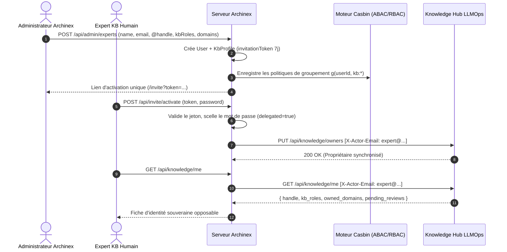
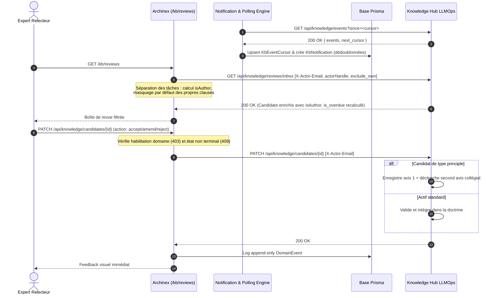

# Contrats d'Architecture par Lot & Sous-Système — Archinex

> **Spécifications techniques détaillées des lots de gouvernance Knowledge Hub (A6–A11), du moteur EDP/OPA, du raffinement KAOS (Phase 4), de la consolidation logique (Phase 5) et de la taxonomie TOGAF.**
> - Vue d'ensemble du système : [`ARCHITECTURE.md`](../ARCHITECTURE.md)
> - Modèle unique de parcours (5 phases) & glossaire : [`docs/concepts.md`](concepts.md)
> - Décisions structurantes (ADR) : [`docs/adr/README.md`](adr/README.md)
> - Feuille de route : [`docs/roadmap.md`](roadmap.md)

---

## 1. Gouvernance Knowledge Hub & Comptes Experts (Lot A6)

Archinex gère les comptes utilisateurs locaux et assure la propagation stricte de l'identité des experts vers LLMOps, qui demeure l'autorité sur le registre des propriétaires (`owners`) et la recevabilité doctrinale ([ADR-018](adr/ADR-018-knowledge-hub-souverain-decouplage-3-tiers.md)).

### Rôles KB Canoniques
- `kb:review` : droit de voter, d'approuver ou de rejeter les candidats de doctrine et amendements.
- `kb:evaluate` : droit d'exécuter et d'annoter les bancs d'évaluation et suites de tests.
- `kb:maintain` : droit de modifier et de mettre à jour directement les règles de doctrine et templates de prompt.
- `kb:admin` : droit de superviser les propriétaires, publier des releases doctrinales et administrer la gouvernance.

### Propagation d'Identité Souveraine (`X-Actor-Email`)
Tout appel expert émis vers LLMOps (`/api/knowledge/me`, `/api/knowledge/owners`, `/api/knowledge/candidates`...) propage l'en-tête HTTP `X-Actor-Email: <user_email>`. Aucun secret de service (`LLMOPS_AUTH_TOKEN`) n'est jamais exposé au navigateur client.

---

## 2. Boîte de Revue Experte, Actions d'Examen et Notifications (Lot A7 — Porte G5)

Archinex implémente la boîte de réception des revues (`/kb/reviews`) pour statuer sur les candidats de doctrine soumis via la Porte G4.

### Invariants & Règles de Gouvernance Clés (Porte G5)
1. **7 contrôles automatiques LLMOps** : `schema_validity`, `clarity_score`, `testability`, `non_duplication`, `sovereign_compliance`, `domain_alignment`, `architectural_impact`.
2. **Double-avis obligatoire pour les `principle`** : un second avis collégial est exigé avant intégration définitive.
3. **Contrôle d'autorisation par domaine (`403 Forbidden`)** : un expert ne statue que sur ses domaines déclarés (`ownedDomains`).
4. **Interdiction du rejet sans motif** : tout rejet exige un motif circonstancié.
5. **Idempotence du moteur d'événements** : le curseur persistant `KbEventCursor` garantit zéro doublon de notification.

---

## 3. Atelier de Doctrine, Templates d'Actifs et Simulation de Clauses (Lot A8)

L'Atelier de Doctrine (`/kb/workshop`) permet de concevoir, valider pré-vol et simuler des clauses de doctrine avant leur soumission en Porte G5 :
- **7 templates canoniques** : `principle`, `pattern`, `decision`, `control`, `glossary`, `rule`, `amendment` (`GET /api/knowledge/templates/{type}`).
- **Prédicats formels** : `when` (déclencheur), `expect` (condition d'admissibilité), `requires` (dépendances obligatoires) et `forbids` (anti-patrons proscrits).
- **Pré-vol live (`POST /api/knowledge/candidates/validate`)** : anticipe la notation des 7 contrôles automatiques LLMOps avant publication.
- **Simulation & détection de régression (`POST /api/knowledge/checks/simulate`)** : calcule Précision et Rappel sur cas historiques et alerte si `regression_detected: true`.

---

## 4. Ingestion des Référentiels Réglementaires & Déclaration de Couverture (Lot A10)

L'espace Référentiels Réglementaires (`/kb/frameworks`) assure l'ingestion multi-formats et l'attestation formelle de conformité :
1. **Téléversement multi-format sécurisé** : `.pdf`, `.html`, `.txt`, `.md`, `.docx` plafonné à 20 Mo (`HTTP 413`).
2. **Découpage & indexation d'exigences** : chaque clause réglementaire devient une entité atomique inspectable et rattachée à un domaine.
3. **Assistance IA étiquetée (`llm-derived`)** : les suggestions de liaisons doctrinales nécessitent une validation explicite par l'expert humain (Invariant II).
4. **Cloisonnement par domaine (`403`) et motif obligatoire de rejet (`400`)**.
5. **Déclaration de couverture opposable (`POST /api/frameworks/{fw}/coverage-declaration`)** : exige 100 % des exigences instruites (`409 Conflict` avec liste nominative des lacunes sinon).

---

## 5. Évaluation Doctrinale (Lot A9 — Porte G6) & Publication Scellée (Lot A11 — Porte G7)

### 5.1 Porte G6 : Benchmark `check_option_v1` & Boucle de Rétroaction (`/kb/evals`)
- **RBAC strict (`kb:evaluate`)** : seuls les évaluateurs habilités modifient la vérité terrain (`PATCH /api/knowledge/evals/:datasetId/cases/:caseId`).
- **Rappel réel sur cas vérifiés par l'humain** :
  $$\text{Rappel}_{\text{humain}} = \frac{\text{Vrais Positifs sur cas vérifiés}}{\text{Total des cas vérifiés conformes}} \ge 0{,}80$$
  avec zéro régression inexpliquée.
- **Boucle de rétroaction** : tout désaccord en délibération est signalé via `POST /api/knowledge/verdict-feedback` (`false_positive`, `false_negative`, `ambiguity`, `outdated_doctrine`).

### 5.2 Porte G7 : Tableau de Bord de Santé & Scellement SHA-256 (`/kb/dashboard`)
- **Habilitation (`kb:admin` ou `kb:maintain`)** requise pour `POST /api/knowledge/publications`.
- **Conditions bloquantes (`409 Conflict`)** : zéro revue critique en retard (Porte G5) et rappel humain $\ge 80\,\%$ (Porte G6).
- **Empreinte SHA-256 immuable** sur l'instantané, le changelog et l'horodatage.
- **Détection de stockage éphémère** : bannière d'alerte obligatoire si `storage.mode = "demo"`.

---

## 6. Paquet de Décision Exécutable (EDP) & Oracles OPA/Rego

> **Orientation ([ADR-017](adr/ADR-017-nautobot-point-unique-reconciliation.md) & [ADR-019](adr/ADR-019-edp-oracles-opa-rego-deterministes.md))** : les oracles de décision vivent dans Archinex ; toute écriture vers un outil d'implémentation passe par Nautobot.

1. **Séparation Intension (HLD) vs Extension (LLD)** : `src/lib/domain/edp/intentionPurity.ts` interdit les IPv4, IPv6, CIDR, MAC et noms d'hôtes dans `decision_context`.
2. **Prévention de la vacuité** : `validateRefinedInput` exige la présence de chaque source attendue et sa provenance (`tool`, `version`, `command`, `sha256`, `generated_at`). Toute entrée manquante ou vide renvoie `insufficient_input`.
3. **Moteur OPA & 4 verdicts** : binaire OPA v1.21.4 épinglé SHA-256 (`src/lib/server/edp/opaRunner.ts`) produisant `compliant`, `violated`, `not_applicable`, `insufficient_input` (ou `unavailable` si le binaire manque).
4. **Garde de mutation à 100 %** : `scripts/edp-mutation-gate.ts` applique `drop_rule` et exige 100 % de mutants tués.
5. **Projections `data.ontology` & persistance** : `src/lib/server/edp/ontologyClient.ts`, `src/lib/server/edp/projectionCompiler.ts` (SHA-256 + `detectDuplicateLiterals`) et modèle Prisma `ExecutableDecisionPackage` (Invariants II & VI).
6. **Évaluation `edp verify` & rédaction assistée** : `src/lib/server/edp/edpVerify.ts`, `src/lib/server/edp/edpDrafting.ts`, `src/lib/components/edp/EdpCard.svelte`.
7. **Promotion** : formalisée dans l'[ADR-016](adr/ADR-016-promotion-edp-experimental.md).

---

## 7. Phase 4 : Raffinement Ontologique Multi-Axes KAOS & Découpage Modulaire

| Module / Fichier | Responsabilité Architecturale |
| :--- | :--- |
| [`tests/fixtures/edp/ontology_export.json`](../tests/fixtures/edp/ontology_export.json) | Socle ontologique (concepts HLD, axes `kind: "axis"`, feuilles `kind: "leaf"`, triplets `requires_aspect`, `implemented_by`, `depends_on`, `constrains`, `conflicts_with`). |
| [`src/lib/server/edp/ontologyClient.ts`](../src/lib/server/edp/ontologyClient.ts) | Requêtage et édition de triplets `{ Sujet, Verbe, Complément }` ; consommation souveraine prioritaire du Knowledge Hub ([ADR-018](adr/ADR-018-knowledge-hub-souverain-decouplage-3-tiers.md), [ADR-020](adr/ADR-020-interdiction-repli-silencieux-production.md)). |
| [`src/lib/server/edp/refinementCoverage.ts`](../src/lib/server/edp/refinementCoverage.ts) | Moteur KAOS : `resolveSubjectConcepts`, `computeRefinementCoverage` (`covered_executable`, `covered_no_oracle`, `missing_refinement`), `composeMultiAxisHydration` (composition algébrique + graphe 7 classes), `evaluateMultiAxisOracle`. |
| [`src/lib/server/edp/projectionCompiler.ts`](../src/lib/server/edp/projectionCompiler.ts) | Compile les `projections` des feuilles liées en `data.ontology` (SHA-256) et vérifie l'absence de littéraux dupliqués dans Rego. |
| [`edp/policies/multi_axis_refinement.rego`](../edp/policies/multi_axis_refinement.rego) | Oracle Rego v1 multi-axes sans littéral codé en dur (substrat compute, OOB Redfish, zonage NIS2, parité environnements, énergie 2N, IPsec, médiation, réconciliation `tenant_ref`, chaînes de confiance). |
| [`src/lib/server/edp/nautobotSync.ts`](../src/lib/server/edp/nautobotSync.ts) | Synchroniseur SSoT idempotent vers Nautobot 2.x avec isolation logique multi-projets (`projectScope`) et marqueurs de traçabilité (`docs/edp/nautobot-trace-markers.md`). |
| [`src/lib/components/deliberation/Phase4RefinementHub.svelte`](../src/lib/components/deliberation/Phase4RefinementHub.svelte) | Atelier IHM Phase 4 : matrice de couverture KAOS, cumul/remplacement de variantes, graphe de réconciliation, liens Nautobot et simulation de dérive. |
| [`src/lib/components/knowledge/OntologyTripletsEditor.svelte`](../src/lib/components/knowledge/OntologyTripletsEditor.svelte) | Visualiseur et éditeur graphique de triplets ontologiques dans `/knowledge?view=ontology`. |

---

## 8. Fondements Scientifiques & Standards Industriels

### 8.1 Papiers Scientifiques Fondateurs
1. **Axel van Lamsweerde (2001, 2009) — KAOS** : *AND-Refinement* (`requires_aspect` vers axes obligatoires) et *OR-Refinement* (`implemented_by` exclusif ou cumulatif inclusif vers des feuilles munies d'oracles).
2. **Don Batory (2004) — FOSD / AHEAD** : composition algébrique multi-axes ($\text{Artefact} = f_n \circ \dots \circ f_1(\text{Base})$) mise en œuvre dans `composeMultiAxisHydration`.
3. **C. Maria Keet & Alessandro Artale (2008) / OntoClean** : relations méronomiques obligatoires (`requires_aspect`) et détection des dépendances inter-branches (`depends_on`, `conflicts_with`).
4. **Krzysztof Czarnecki, Simon Helsen & Ulrich Eisenecker (2005) — *Staged Configuration*** : séparation stricte entre l'intension (projections abstraites `data.ontology`) et l'extension (instanciation LLD vérifiée par OPA).

### 8.2 Standards Industriels
- **LF Europe Sylva** (`SylvaWorkloadCluster` `workloadclusteroperator.sylva/v1alpha1`, `sylva-units`, Cluster API `capm3` + `cabpr`).
- **FluxCD & Kustomize GitOps** (`workload-clusters/` et overlays multi-DC).
- **3GPP TS 28.620 / TS 28.541** (`ExternalFunction`, points de référence inter-opérateurs).
- **TM Forum ODA / SID (GB922)** (chaînage Party / Resource / Service / SLA).
- **Nautobot 2.x SSoT** (unique point de réconciliation bidirectionnel selon [ADR-017](adr/ADR-017-nautobot-point-unique-reconciliation.md)).

---

## 9. Validation Sylva, Règles d'Or OPA & Jumeau Numérique

### 9.1 Validation « Smart-Light » Sylva (`npm run check:sylva`)
1. **Schéma KRM & CRD** : `tests/fixtures/sylva/sylva-workload-cluster.schema.json` validé par Ajv.
2. **Règles d'or OPA** : `edp/policies/sylva_golden_rules.rego` vérifie les invariants de production telco (CNI Cilium, CAPI `capm3`+`cabpr`, image OS durcie, Kyverno, monitoring, MetalLB, Vault sous NIS2, Multus/SR-IOV, sélecteurs `host-group`, labels RKE2, CPU/Topology Manager statique NUMA, adresses BMC Redfish et MAC de boot).
3. **Lien fort & rétro-traçabilité (#262)** : `governed_by_clauses` / `satisfies_clause` dans `refinementCoverage.ts` ; `violated_clause_urn` / `violated_requirement_id` retournés par Rego ; annotations `archinex.io/satisfied-clauses` dans KRM et Nautobot.

### 9.2 Jumeau Numérique Pré-Déploiement (`sylvaTwin.ts`, `sushy-tools`, `KWOK`)
- **3 profils topologiques** : `3dc-active` (Gold, défaut), `2dc-witness` (Silver, 2 DCs + témoin), `2dc-split` (Bronze, 2 DCs sans témoin).
- **Double mode d'arbitrage (`TwinArbitrationMode`)** : `proposal` (comparaison sous 5 scénarios de panne) et `client-mandated` (confrontation via `edp/policies/twin_resilience.rego`).
- **CI Palier 1 & Palier 2** : génération `sushy-emulator.conf` et manifestes `KWOK` (`scripts/calibrate-twin-t1-t2.ts`, `.github/workflows/twin-ci.yml`).

---

## 10. Phase 5 : Catalogue Logique (`Base × Overlay × DC`) & Consolidation Projet

1. **Catalogue de Composants (`src/lib/domain/edp/componentCatalog.ts`, `src/lib/server/edp/componentCatalogRepository.ts`, `GET/POST /api/projects/[projectId]/catalog`)** :
   - Triade `LogicalComponent` (`Component → Module → Instance`), `1 Component = 1 Tenant`, Multi-NIC par classe, routage VRF ↔ DNS, adressage relatif (`offset`, `dhcp`, `reserved`), stockage tiers/S3, extensions IMP V2 (`OrganizationSpec`, `qosClasses`, `vlanPools`, `vniPools`, `firewalls`, `certificateProfiles` RGS, `drivers`).
   - Séparation stricte **Base** (vérifiée par `lintBaseComponentNoHardcodedEnv`) et **`EnvironmentOverlay`** (substitutions `param.*` et `datacenters`), éditables dans `ComponentCatalogEditor.svelte`.
2. **Résolveur `ref()`, Graphe d'Impact & Flux Implicites (`src/lib/domain/edp/refResolver.ts`)** :
   - Projette `Base × EnvironmentOverlay × Datacenter`, vérifie la continuité des `LogicalInterfaces`, génère les flux implicites (NFS, SIEM, PKI) et supporte la simulation What-If (2 vs 3 DCs).
3. **Consolidation Projet (`src/lib/domain/edp/logicalViews.ts`, `src/lib/components/deliberation/Phase5ConsolidationHub.svelte`)** :
   - Structurée autour des **4 piliers transverses** (Socle, Sécurité, Gouvernance, GitOps/Exploitation) et de **3 vues Mermaid synchronisées** (Vue Logique, Vue Déploiement, Vue Physique / CMDB).

---

## 11. Taxonomie Unifiée TOGAF, Emplacements de Décision & Chaîne de Confiance

1. **Taxonomie canonique à 7 domaines TOGAF (`src/lib/domain/edp/togafTaxonomy.ts`)** : `application-business`, `security-trust`, `network-connectivity`, `platform-compute`, `data-persistence`, `operations-observability`, `facilities-sovereignty`, 29 briques de référence (`TOGAF_REFERENCE_BUILDING_BLOCKS`) et détecteur d'angles morts `scanProjectArchitecturalBlindSpots()`.
2. **Routage des clauses « Commodité » (`src/lib/server/ingest/arckitRequirementsPipeline.ts`)** : évacuées du débat Type 1 mais rattachées à un emplacement de décision cible (`commoditySlotId`, `commodityAxisUrn`).
3. **Conscientisation, oracles fantômes & fermeture transitive (`src/lib/server/edp/refinementCoverage.ts`)** : distinction proposition par défaut vs ratification (`ratifyDefaultDecisionSlots`), détection d'oracles fantômes (`loadImplementedRegoRuleNames`) et propagation des prérequis (`computeTransitivePrerequisiteAxes`).
4. **Catalogue transverse & intégrité référentielle (`componentCatalog.ts`, `refResolver.ts`)** : `TRANSVERSE_COMPONENT_CATALOG` instancié via `instantiates_component`, contrôle `verifyCatalogDanglingReferences()` et vérification `input.trust_chain` (HSM, Vault/OpenBao PKCS#11, bastion PAM, proxy sortant).
5. **Registre projet & scellement `architecture.lock` (`src/lib/server/edp/decisionSlotRegistry.ts`)** : distinction file Type 1 vs Type 2 (`batchRatifyProjectType2Slots`, `promoteSlotToDeliberationSubject`) et manifeste `generateArchitectureLockManifest()` avec empreinte `integritySha256`.
6. **Continuité RFP → HLD → LLD *Planned* (#344–#348)** : préservation des exigences évacuées, capacités émergentes (`detectEmergentCapabilityNeed`), unicité IPv4 (`verifyResolvedIpUniqueness`), synchronisation `Planned` Nautobot et convergence Document Engine (`src/lib/server/projects/documentEngineBridge.ts`).
