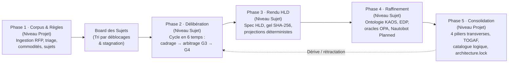

# Concepts Fondamentaux, Parcours & Glossaire — Archinex

> **Référence unique du modèle de parcours, des niveaux de maturité, des portes de gouvernance, des invariants et du vocabulaire d'Archinex.**
> Les autres documents (`README.md`, `ARCHITECTURE.md`, `docs/user-guide.md`, `docs/architecture-contracts.md`) renvoient vers cette page pour éviter toute divergence terminologique.

---

## 1. Un Seul Modèle de Parcours : Les 5 Phases d'un Engagement

Un projet (ou engagement) dans Archinex suit un **modèle unique en 5 phases**, directement reflété dans la barre de navigation de l'interface (`src/lib/components/deliberation/ProjectEngagementHeader.svelte`).

| Phase | Portée | Onglet IHM (`activePosture`) | Objectif & Livrable Principal |
| :--- | :--- | :--- | :--- |
| **Phase 1 · Corpus & Règles** | Projet | `appropriation` | Ingérer les pièces contractuelles (CCTP/RFP) et référentiels normatifs, trier les clauses en 4 compartiments (`deliberate`, `evacuate`, `clarify`, `transversal`), routage des commodités vers des emplacements de décision et factorisation en sujets d'architecture. |
| **Phase 2 · Délibération** | Sujet *(via Board)* | `deliberation` | Faire converger l'équipe sur chaque sujet par un **cycle interne en 6 temps** jusqu'à l'arbitrage humain opposable (**Porte G3 → `L3_decided`**) et la capitalisation souveraine vers le Knowledge Hub (**Porte G4**). |
| **Phase 3 · Rendu HLD** | Sujet | `rendu` | Formaliser la spécification HLD structurée (`L4_specified`), franchir la barrière d'homologation, sceller cryptographiquement (SHA-256) et régénérer de façon **100 % déterministe** les projections (Mermaid, C4X, Structurizr DSL, SysML v2, JSON, Petites Briques, Document Engine). |
| **Phase 4 · Raffinement** | Sujet | `refinement` | Spécialiser la décision HLD via l'ontologie KAOS multi-axes, produire le **Paquet de Décision Exécutable (EDP)**, évaluer les **oracles OPA/Rego**, pré-hydrater l'intention au statut *Planned* dans **Nautobot** (point unique de réconciliation, [ADR-017](adr/ADR-017-nautobot-point-unique-reconciliation.md)) et surveiller les dérives (`DriftFinding`). |
| **Phase 5 · Consolidation** | Projet | `consolidation` | Consolider l'architecture à l'échelle du projet entier : 4 piliers transverses (Socle, Sécurité, Gouvernance, GitOps/Exploitation), registre d'emplacements TOGAF (ratification Type 2 / promotion Type 1), catalogue logique (`Base × Overlay × DC`), graphe d'impact causal, 3 vues synchronisées et manifeste scellé `architecture.lock`. |

### 1.1 Le Cycle Interne de la Phase 2 (Délibération en 6 Temps)

À l'intérieur de la **Phase 2 · Délibération**, chaque sujet parcourt 6 temps opérationnels :

1. **Cadrage du sujet** : énonciation du `problemStatement` et ancrage des clauses RFP/normatives (`L0_named` → `L1_framed`).
2. **Critères & options contrastées** : au moins 2 critères pondérés et 2 options viables évaluées de `-2` à `+2` avec justification obligatoire.
3. **Débat multi-agents borné** : orchestration bornée (3 tours max) enchaînant **Proposer**, **Challenger**, **Verifier** (contrôle doctrinal Knowledge Hub) et **Synthesizer**. Toute objection ouverte doit être résolue (`answered` ou `accepted_risk`) par un expert humain habilité.
4. **Maturité calculée (`computeMaturity`)** : évaluation déterministe des 8 codes de blocage (`MISSING_PROBLEM_STATEMENT`, `MISSING_CRITERIA`, `INSUFFICIENT_OPTIONS`, `UNEVALUATED_OPTION`, `OPEN_OBJECTION`, `UNRESOLVED_VIOLATION`, `OPEN_BLOCKING_QUESTION`, `COVERAGE_INCOMPLETE`).
5. **Arbitrage humain opposable (Porte G3)** : sélection de l'option retenue, motifs d'écartement, réversibilité, dérogations et vérification réglementaire KB en échec fermé (*fail-closed*) → passage à `L3_decided`.
6. **Capitalisation souveraine (Porte G4)** : préparation de candidats anonymisés (`new_asset`, `amendment`, `rex`) relus et transmis explicitement par un humain vers le Knowledge Hub LLMOps.

### 1.2 Non-Linéarité et Asynchronisme

Les 5 phases ne constituent **pas un tunnel séquentiel bloquant** :
- **Granularité par sujet** : un sujet peut être en Phase 4 (Raffinement) pendant qu'un autre est encore en Phase 2 (Délibération).
- **Retour en Phase 1 à tout instant** : un nouvel arrivant ou un expert domaine peut consulter le corpus et les référentiels (Phase 1) sans bloquer le reste de l'équipe.
- **Boucle de retour** : une rétractation causale (DAG) ou une dérive détectée dans Nautobot (Phase 4) rouvre automatiquement le sujet en Phase 2.

---

## 2. Niveaux de Maturité d'un Sujet (`L0` → `L5`)

| Niveau | Signification | Condition d'atteinte |
| :--- | :--- | :--- |
| `L0_named` | Sujet identifié | Titre et périmètre initial créés. |
| `L1_framed` | Sujet cadré | `problemStatement` formulé et exigences sources rattachées. |
| `L2_debated` | Débat engagé | Critères, options et évaluations posés ; objections ou vérifications en cours. |
| `L3_decided` | Décision arbitrée | Porte G3 franchie par un arbitre habilité (`lead_architect` ou `domain_expert`), 0 code bloquant ouvert. |
| `L4_specified` | Spécifié & scellé HLD | Spécification HLD rédigée, barrière d'homologation franchie, condensat SHA-256 émis. |
| `L5_archived` | Archivé / Homologué | Section gelée définitivement pour référence d'audit. |

---

## 3. Portes de Gouvernance (`G3` → `G7`)

| Porte | Où | Rôle habilité | Objet |
| :--- | :--- | :--- | :--- |
| **G3 · Arbitrage** | Archinex (Phase 2) | `lead_architect` / `domain_expert` | Trancher entre les options, consigner dérogations et motifs, promouvoir à `L3_decided`. |
| **G4 · Capitalisation** | Archinex → LLMOps (Phase 2) | Architecte projet | Prévisualiser, anonymiser et soumettre explicitement les candidats (`new_asset`, `amendment`, `rex`) au Knowledge Hub. |
| **G5 · Revue Experte** | Archinex (`/kb/reviews`) & LLMOps | `kb:review` (propriétaire du domaine, hors auteur) | Examiner les candidats soumis avec les 7 contrôles automatiques et double-avis collégial pour les `principle`. |
| **G6 · Évaluation Doctrinale** | Archinex (`/kb/evals`) & LLMOps | `kb:evaluate` | Annoter la vérité terrain et valider un rappel réel vérifié par l'humain $\ge 80\,\%$ avec 0 régression. |
| **G7 · Publication & Scellement** | Archinex (`/kb/dashboard`) & LLMOps | `kb:maintain` / `kb:admin` | Sceller une version officielle de la doctrine sous empreinte SHA-256 après franchissement de G5 et G6. |

---

## 4. Invariants Constitutionnels Clés

La constitution complète réside dans [`openspec/constitution.md`](../openspec/constitution.md). Les invariants structurants sont :

1. **Énoncé à 5 facettes** : tout énoncé porte Contenu (triplet), Justification (`basedOn`), Autorité (auteur, rôle, mode de production), Maturité (niveau + confiance) et Révisabilité (antécédents).
2. **Interdiction absolue `verified × llm-derived`** : aucun énoncé ni argument généré par un LLM sans validation humaine ne peut porter le statut `verified` (verrouillé en validation, en domaine et en base Prisma).
3. **Règle du silence** : l'absence de contestation ou de réaction ne vaut jamais approbation.
4. **Brouillon télégraphique (anti-blabla)** : syntaxe dense orientée arbitrage (`retenu`, `supposé`, `conflit`, `manque`, chiffrage CAPEX/OPEX), sans formules creuses.
5. **Deux portes humaines infranchissables** : l'arbitrage (Porte G3) et la capitalisation en doctrine (Porte G4) exigent toujours une action humaine explicite.
6. **Rétractation causale par défaut (DAG)** : la contestation d'un antécédent rétrograde automatiquement tous ses descendants au statut `assumed` et marque les EDP affectés `stale`.
7. **Échec fermé (*fail-closed*) en production** : aucun repli silencieux vers des fixtures ou un statut « conforme » lorsque le Knowledge Hub, OPA ou Nautobot est indisponible ([ADR-020](adr/ADR-020-interdiction-repli-silencieux-production.md)).
8. **Séparation Intension (HLD) vs Extension (LLD)** : les décisions HLD et EDP ne contiennent aucune adresse IP/MAC ou nom d'hôte codé en dur ; toute réconciliation vers le réel passe par Nautobot ([ADR-017](adr/ADR-017-nautobot-point-unique-reconciliation.md), [ADR-019](adr/ADR-019-edp-oracles-opa-rego-deterministes.md)).

---

## 5. Glossaire

| Terme | Définition |
| :--- | :--- |
| **Board de Maturité** | Vue globale des sujets d'un projet triés par effet multiplicateur (`unlocks_count`) et alertes de stagnation (> 14 jours). |
| **Commodité (Type 2)** | Exigence standardisée ne nécessitant pas de débat contradictoire complet, routée vers un emplacement de décision TOGAF pour ratification rapide (promouvable en sujet Type 1 à tout moment). |
| **DriftFinding** | Écart persisté entre l'intention figée d'un EDP et l'état réel observé dans Nautobot (`missing`, `unexpected`, `attribute_mismatch`, `status_regression`, ou objet « hors décision »). |
| **EDP** (*Executable Decision Package*) | Paquet de Décision Exécutable liant une décision arbitrée G3 à des oracles OPA/Rego déterministes, des entrées attendues prouvées et un verdict à 4 états (`compliant`, `violated`, `not_applicable`, `insufficient_input`). |
| **Emplacement de Décision** (*Decision Slot*) | Point d'ancrage d'un axe ontologique ou d'une brique TOGAF permettant de suivre explicitement le statut de couverture (`open`, `default_proposed`, `bound_unverified`, `bound_verified`, `waived`). |
| **Énoncé** (*Statement*) | Atome épistémique à 5 facettes manipulé par Archinex. |
| **KAOS** | Méthode d'ingénierie des exigences orientée buts (*AND-Refinement* vers des axes obligatoires, *OR-Refinement* vers des feuilles d'implémentation vérifiables par oracle). |
| **Knowledge Hub (LLMOps)** | Service souverain séparé hébergeant la doctrine d'entreprise, les référentiels réglementaires, l'ontologie SI/Telco et le circuit de revue G5–G7 ([ADR-018](adr/ADR-018-knowledge-hub-souverain-decouplage-3-tiers.md)). |
| **Nautobot (SSoT)** | Unique point de réconciliation bidirectionnel entre Archinex (qui y écrit les objets *Planned*) et les connecteurs d'implémentation (qui y écrivent statut et preuves réalisées) ([ADR-017](adr/ADR-017-nautobot-point-unique-reconciliation.md)). |
| **Oracle OPA / Rego** | Règle déterministe évaluée par le binaire Open Policy Agent épinglé sur les projections `data.ontology` et l'inventaire réel ou pré-hydraté ([ADR-019](adr/ADR-019-edp-oracles-opa-rego-deterministes.md)). |
| **Projection Déterministe** | Transformation sans LLM d'une décision scellée vers un artefact technique cible (Mermaid, C4X, Structurizr DSL, SysML v2, JSON, Petites Briques, Document Engine) garantissant zéro dérive documentaire. |
| **Sujet** (*Subject*) | Unité de délibération regroupant un ensemble cohérent d'exigences porteuses d'un arbitrage d'architecture (Type 1). |
| **Triplet Ontologique** | Relation `{ Sujet, Prédicat, Objet }` reliant concepts HLD, axes obligatoires, feuilles techniques, clauses réglementaires et règles d'oracle. |
