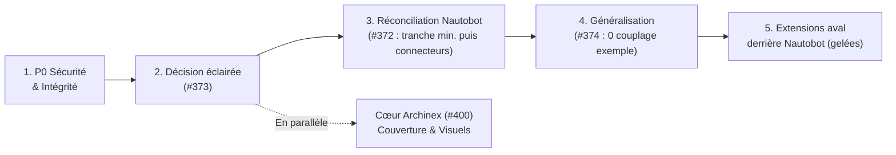

# Feuille de Route (Roadmap) & Gouvernance du Périmètre — Archinex

> **Décision de cadrage ([ADR-017](adr/ADR-017-nautobot-point-unique-reconciliation.md), issue #397)** : Archinex est une **couche d'assurance de décision** centrée sur la délibération, la complétude de la couverture des exigences et la justification visuelle. **Nautobot est l'unique point de réconciliation bidirectionnel** entre l'intention arbitrée dans Archinex et les systèmes réels ; les connecteurs d'implémentation vivent **derrière Nautobot**.
> Pour la vue d'ensemble du système, voir [`ARCHITECTURE.md`](../ARCHITECTURE.md) ; pour le modèle de parcours unifié, voir [`docs/concepts.md`](concepts.md).

---

## 1. Ordre de Réalisation

La feuille de route privilégie l'**amont de la décision** (sécurité, intégrité, fiabilité doctrinale) et la **boucle de dérive minimale** avant toute extension aval :

1. **Priorité 1 — Sécurité et intégrité (P0)** :
   - Durcissement du socle (authentification, autorisation Casbin par domaine/projet, étanchéité des secrets, signature HMAC des webhooks, application stricte des invariants constitutionnels `verified × llm-derived` en persistance).
2. **Priorité 2 — Épique « Décision éclairée » (#373)** :
   - Contraintes KB évaluées en **échec fermé (*fail-closed*)** lors de l'arbitrage (aucune décision réputée conforme si le Knowledge Hub est indisponible ou partiel, [ADR-020](adr/ADR-020-interdiction-repli-silencieux-production.md)).
   - Verdicts structurés (#384), gestion explicite des réserves au scellement (#385), source de vérité unique entre délibération et artefacts.
   - **Provenance explicite** sur chaque évaluation d'oracle (#380) : distinction obligatoire entre valeurs par **défaut** (`default`), issues du **catalogue** (`catalog`) ou observées dans le **réel** (`real`). Un verdict évalué sur des valeurs par défaut n'est jamais présenté comme opposable.
3. **Priorité 3 — Épique réconciliation Nautobot (#372)** :
   - **Phase 3a — Tranche minimale en production sur un projet réel** :
     - Périmètre strictement borné à 3 familles d'objets (**Tenant** ; **Device + statut** ; **Prefix / VLAN / IP**) et 4 types d'écart (`missing`, `unexpected`, `attribute_mismatch`, `status_regression`).
     - Statuts et propriété des champs intention / réalisé / opérationnel (#398, [`docs/edp/field-ownership.md`](edp/field-ownership.md)).
     - Marquage de traçabilité `archinex_*` et push idempotent au statut *Planned* (#376, [`docs/edp/nautobot-trace-markers.md`](edp/nautobot-trace-markers.md)).
     - Détection de dérive persistée (`DriftFinding`), webhook HMAC (#377), cycle de vie des écarts (#378) et réconciliation périodique (#379, [`docs/edp/reconciliation-and-drift.md`](edp/reconciliation-and-drift.md)).
     - Règle d'honnêteté : Nautobot injoignable, connecteur muet ou donnée périmée produisent l'état **non vérifié**, jamais « conforme ».
   - **Phase 3b — Cadre des connecteurs derrière Nautobot** :
     - Contrat de *write-back* des connecteurs (preuve d'exécution) et kit de conformité (#399) : un objet n'est affiché « réalisé » que si une preuve écrite par un connecteur est présente ; une annotation `archinex.io/satisfied-clauses` déclare une traçabilité vérifiable, **elle ne constitue pas une preuve**.
     - Relocalisation hors cœur des 6 adaptateurs Port/Adapter vers `connectors/` (#411, livré) avec leur tableau de classement ([`docs/edp/connectors-classification.md`](edp/connectors-classification.md)) et le contrat de *write-back* Nautobot (`connectors/writeBackContract.ts`) ; le cœur `src/` ne conserve que les modules neutres `src/lib/server/edp/manifestSanitizer.ts` et `src/lib/server/edp/nautobotPlannedExtract.ts`.
     - Cadre des connecteurs et connecteur de référence **Sylva GitOps** consommateur de Nautobot (#381), remplaçant l'ouverture directe de PR/MR depuis `sylvaGitopsExport.ts`.
4. **En parallèle — Cœur Archinex (#400) : Couverture & Justification Visuelle** :
   - Modèle unique de complétude de la couverture (#401), vue visuelle (#402), Carte de décision (#403), modèle unique de diagrammes (#404) et recentrage des Phases 4 et 5 (#405) — voir [`docs/concepts.md`](concepts.md) §3.
5. **Priorité 4 — Généralisation (#374)** :
   - Élimination complète de tout couplage scénario/exemple dans `src/`, prérequis du push générique multi-projets.
6. **Priorité 5 — Extensions aval derrière Nautobot (gelées)** :
   - Tous les outils aval (compilation GitOps multi-DC / Kustomize, analyse de routage Batfish, règles Prometheus/Alertmanager, orchestration Edge/Nephio, DNS/DDI, Vault/PKI, IdP, registre OCI/Trivy, ITSM) opèrent **derrière Nautobot** et remontent leurs verdicts via le contrat de *write-back*.

---

## 2. Politique de Gel des Connecteurs Directs

Tant que la **tranche minimale Nautobot** (Tenant ; Device + statut ; Prefix / VLAN / IP) n'est pas en production sur un projet réel :

- **Gel des écritures directes** : aucun nouvel appel d'écriture d'Archinex vers un outil d'implémentation.
- **Gel des connecteurs directs** : aucun nouveau connecteur direct ajouté dans le cœur d'Archinex.
- **Gel des extensions hors tranche minimale** : les capacités déjà présentes (ex. synchronisation de circuits/tunnels VPN dans `nautobotSync.ts`, jumeau numérique Sylva hors ligne en CI) sont **conservées mais gelées** (non étendues).
- **Re-cadrage des issues #351–#358** : suivi par les mainteneurs selon [ADR-017 §8](adr/ADR-017-nautobot-point-unique-reconciliation.md#8-sort-des-issues-de-connecteurs) (#375) :
  - `#352`–`#357` (adaptateurs livrés en PR #363) : relocalisés hors cœur vers `connectors/` avec retrait des chemins d'écriture directe (#411, [`docs/edp/connectors-classification.md`](edp/connectors-classification.md)).
  - `#351` (allocation IP) : re-cadrée sur l'IPAM natif de Nautobot.
  - `#358` : scindée entre connecteur ITSM (derrière Nautobot) et chiffrage FinOps (délibération, côté Archinex).

---

## 3. Revue Trimestrielle du Périmètre (Liste Fermée)

Le périmètre d'Archinex fait l'objet d'une **revue trimestrielle** par les mainteneurs autour d'une **liste fermée** « Dans le périmètre / Hors périmètre ». Aucune nouvelle brique n'entre dans le périmètre sans passage en revue trimestrielle et sans satisfaction du critère de sortie du gel (tranche minimale Nautobot en production sur un projet réel + au moins un connecteur de référence conforme à #399).

| Statut | Capacités |
| :--- | :--- |
| **Dans le périmètre (cœur Archinex)** | Appropriation RFP et couverture des exigences ; délibération contradictoire et arbitrage humain opposable (G3) ; vérification doctrinale KB en échec fermé et capitalisation (G4–G7) ; justification visuelle déterministe (diagrammes, fiches de décision, exports scellés) ; interface d'hydratation *Planned* vers Nautobot avec provenance explicite (`default` / `catalog` / `real`) ; détection et suivi de dérive (`DriftFinding`) depuis Nautobot ; oracles Rego de décision sur l'intention et les instantanés Nautobot. |
| **Hors périmètre (derrière Nautobot ou gelé)** | Écriture directe vers une forge Git, un cluster Kubernetes, un DDI/DNS, un coffre Vault/PKI, un IdP, un registre OCI ou un outil ITSM ; compilation GitOps CNF multi-DC / overlays Kustomize ; analyse de routage Batfish comme étape bloquante directe ; génération de règles Prometheus / Alertmanager ; orchestration de flotte Edge par Nephio / Porch ; extension des objets Nautobot hors tranche minimale (circuits, tunnels VPN, pare-feu) ; second registre d'état concurrent de Nautobot. |

---

## 4. Historique et Devenir des Anciens Horizons 1 à 3

Les éléments issus de l'ancienne feuille de route sont reclassés comme suit :

- **Déjà livrés et conservés dans le socle** : collecte live et webhook HMAC Nautobot, détection de dérive persistée `DriftFinding` (#239 / #377), réconciliation périodique (#379), synchronisation idempotente Nautobot (`nautobotSync.ts`, étendue uniquement sur la tranche minimale).
- **Livrés et gelés / en cours de migration** : export GitOps Sylva (`sylvaGitopsExport.ts`, #238 — mode `local_bundle` conservé, ouverture directe de PR/MR à déplacer derrière Nautobot via #381) ; modélisation des tunnels IPsec Nautobot (`#240`, conservée et gelée).
- **Anciens Horizons 2 et 3 (gelés et re-cadrés derrière Nautobot)** : compilation d'overlays Kustomize multi-DC, analyse symbolique du plan de routage par Batfish (vérification de joignabilité remontée via *write-back*, jamais vendue comme « preuve mathématique » globale de conformité), génération de règles `PrometheusRule` / Alertmanager et délégation *Blueprint* / `PackageVariantSet` vers Nephio pour les flottes Edge hétérogènes à grande échelle. Ces pistes ne seront réévaluées qu'en **Priorité 5**, lors d'une revue trimestrielle post-mise en production de la tranche minimale.
