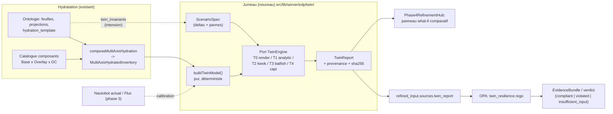

# Design : Jumeau numérique de Sylva

## 1. Principe directeur : une échelle de fidélité, pas un simulateur unique

Aucun moteur n'est à la fois rapide (what-if interactif), fidèle (vrai scheduler, vrai CAPI) et déterministe. On
expose donc **cinq niveaux** derrière un même port ; chaque rapport déclare le niveau atteint et ses hypothèses, et
l'ontologie exige un `min_fidelity` par invariant.

| Niveau | Moteur | Ce qu'il modélise | Coût | Déterminisme |
|---|---|---|---|---|
| **T0 Render** | `helm template` de `sylva-units` à version épinglée | DAG des unités (`dependsOn`), valeurs effectives, schéma + 15 règles d'or (existantes) | secondes | total |
| **T1 Analytique** | fonctions pures TS | placement par domaine de défaillance, quorum etcd/stockage, packing de capacité, disponibilité | ms | total (graine fixe) |
| **T2 Scheduler** | KWOK + kube-apiserver/scheduler réels (kind) | nœuds fictifs issus des devices Nautobot (labels/taints/allocatable/zone), manifestes **réellement rendus** : Pending, topologySpread, PDB, anti-affinité sous panne de zone | minutes (job) | quasi (scheduler déterministe à entrée égale) |
| **T3 Réseau** | Batfish (déjà dans `deploy/integrator-tools`) | joignabilité des flux de médiation (`service_mediation_flows`), VRF, absence de bypass `s6a→dea` | minutes | total |
| **T4 Contrôle** | CAPI + provider de substitution dans kind (CAPD), ou Metal3 + émulateur Redfish | bootstrap réel de Sylva ; sert d'**étalon** de calibration de T1/T2, pas de moteur interactif | dizaines de min (nightly) | non |

> [!IMPORTANT]
> Tranche 1 = **T0 + T1** uniquement. T2/T3/T4 sont des paliers ultérieurs ; le port est conçu pour les accueillir sans
> changer le contrat des rapports. À vérifier avant T4 : la disponibilité effective d'un provider CAPI de substitution
> sur la version de `sylva-core` épinglée (la règle d'or 2 impose `capm3` en production : l'écart est un delta de
> fidélité à déclarer, pas à masquer).

## 2. Architecture



### 2.1 Modèle du jumeau (`twin/model.ts`)

Compilé **uniquement** depuis `MultiAxisHydratedInventory` + `ComponentCatalogBundle` + overlay actif :

- `FailureDomain { id, kind: 'datacenter'|'rack'|'power_feed', parent? }` (DC = `DatacenterCatalogEntry`, `drRole` conservé) ;
- `Host { id, device_type, domain, cpu, mem, hugepages, sriovVfs, nics[], powerFeeds[], bmc }` (depuis `nautobot_planned_devices`) ;
- `Pool { name, hosts[], dataplaneProfile }` (`cluster_pool` des feuilles compute) ;
- `Cluster { role: 'management'|'workload', controlPlane{replicas, placement}, machineDeployments[], units: UnitDag }` (depuis `sylva_workload_cluster_values`) ;
- `Workload { component, module, replicas, requests, spread, antiAffinity, storage{tier, rf}, pdb? }` (depuis `resolved_components`) ;
- `Link { from, to, kind: 'underlay'|'ipsec'|'oob', domainPair }` (depuis `reconciliation_graph`).

Le builder émet `assumptions[]` pour tout champ absent (ex. capacité hôte par défaut du `device_type`) : une
hypothèse non déclarée est interdite, une hypothèse déclarée est visible dans le rapport.

### 2.2 Scénarios (`twin/scenarios.ts`)

```ts
type ScenarioSpec = {
  id: string;
  deltas?: TopologyDelta[];      // what-if d'intention : datacenters, hosts/pool, storage rf, version Sylva…
  faults?: FaultInjection[];     // dc_loss(id) | host_loss(n,domain) | link_partition(a,b) | feed_loss(A|B) | bmc_down(host)
  rollout?: UpgradeRollout;      // montée de version rolling (maxUnavailable, ordre des pools)
  seed: number;
};
```

Le what-if « 2 vs 3 DCs » = `deltas:[{kind:'datacenters', count:2|3}]` **croisé** avec `faults:[dc_loss(*)]`. C'est la
combinaison qui produit une information (« 2 DCs ⇒ perte de quorum etcd si la répartition est 2+1 »), pas le comptage.

### 2.3 Port moteur (`twin/engine.ts`)

```ts
interface TwinEngine {
  id: 'render'|'analytic'|'kwok'|'batfish'|'capi';
  fidelity: 0|1|2|3|4;
  available(): Promise<{ ok: boolean; version?: string; reason?: string }>;  // modèle opaRunner : 'unavailable' explicite
  run(model: TwinModel, scenario: ScenarioSpec): Promise<TwinRun>;
}
```

Même discipline que [`opaRunner.ts`](../../../src/lib/server/edp/opaRunner.ts) : timeout, typage strict, statut
`unavailable` explicite. **Dégradation de fidélité jamais silencieuse** : si T2 est indisponible, le rapport le dit et
tout invariant à `min_fidelity: 2` passe en `insufficient_input`.

### 2.4 Rapport (`TwinReport`)

Par scénario : `survives: boolean`, métriques (`etcd_quorum`, `storage_writable`, `unschedulable_pods[]`,
`capacity_headroom{cpu,mem,vf}`, `unreachable_flows[]`, `availability_estimate` avec hypothèses), `assumptions[]`,
`engine{id,version,fidelity}`, `model_sha256`, `scenario_sha256`, `seed`. Le tout est **canonisé** (clés triées,
sans horodatage dans le hash) puis scellé : même modèle + même scénario + même version de moteur ⇒ même hash ⇒ cache
valide (clé de cache = ces trois valeurs).

## 3. Branchement à l'hydratation

Le point d'accroche est la sortie de `composeMultiAxisHydration` (qui reste **pure et synchrone**) ; l'orchestration
vit côté `edpDrafting`/`edpVerify` :

1. hydrater → `inventory` (existant) ;
2. `buildTwinModel(inventory, bundle, overlay)` ;
3. déduire la suite de scénarios **depuis l'ontologie** : les feuilles liées portent `projections.twin_invariants`
   (ex. feuille `resilience_drp_continuity` : `{ scenario: 'dc_loss', require: { etcd_quorum: true, storage_writable: true }, min_fidelity: 1 }`) ;
4. exécuter les moteurs disponibles, produire `TwinReport` ;
5. injecter `sources.twin_report = { provenance:{tool:'archinex-twin', version, command, sha256, generated_at}, content }`
   — **aucun changement** de `refined_input.schema.json` (les noms de sources sont libres, la provenance est déjà
   imposée) ;
6. OPA évalue `edp/policies/twin_resilience.rego` contre `data.ontology` (aucun littéral métier en dur dans le Rego).

Esquisse du Rego :

```rego
violations contains v if {
  some inv in data.ontology.twin_invariants
  run := input.sources.twin_report.content.runs[inv.scenario]
  some metric, want in inv.require
  run.metrics[metric] != want
  v := {"rule": sprintf("twin_%s_%s", [inv.scenario, metric]), "axis": inv.axis, "message": ...}
}
insufficient contains inv.scenario if {      # jamais vert par vacuité
  some inv in data.ontology.twin_invariants
  not input.sources.twin_report.content.runs[inv.scenario]
}
```

## 4. Valeur pour la délibération

Les `TwinReport` de plusieurs options (2 DCs / 3 DCs / 2 DCs + témoin) alimentent **de manière déterministe** les
critères du lot A2 (résilience, marge de capacité, nombre d'hôtes) avec provenance : l'arbitrage G3 se fait sur des
mesures rejouables, plus sur des compteurs. Le panneau `Phase4RefinementHub` remplace le basculeur `whatIfDcCount` par
une comparaison base/variante (tableau de deltas + liste des invariants violés par option).

## 5. API & persistance

- `POST /api/projects/[projectId]/twin/runs` (corps : `subjectId`, `scenarios[]`, `engines?`) → 202 + `runId` pour T2+, 200 pour T0/T1 ;
- `GET /api/projects/[projectId]/twin/runs/[runId]` ;
- accès protégé par `authorizeProjectAccess` (comme la route catalogue) ;
- Prisma `TwinRun { id, projectId, subjectId, modelSha, scenarioSha, engine, engineVersion, fidelity, status, report Json, createdAt }`, unique `(modelSha, scenarioSha, engine, engineVersion)`.

## 6. Sécurité & hygiène

- réutilisation de `sanitizeManifests` avant tout traitement ; aucun secret en entrée de moteur ;
- adresses RFC 5737 uniquement (cohérent avec `intentionPurity`) ;
- outils externes (helm, kind, kwok, batfish) exécutés en conteneurs via `deploy/integrator-tools`, sans réseau
  sortant, limites CPU/mémoire/temps ; le jumeau est en **lecture seule** vis-à-vis de Nautobot/Flux.

## 7. Stratégie de test (la crédibilité du jumeau)

1. **Tables de vérité analytiques** : quorum 3 membres en 2+1 / 1+1+1 / 2 DCs + témoin ; stockage RF=3 en 2 vs 3 DCs ;
2. **Snapshots canoniques** du `TwinReport` (hash stable) ;
3. **Mutation de l'oracle** (déjà pratiquée en A12) : muter `twin_resilience.rego` doit rougir ≥ 1 fixture ;
4. **Calibration** : sur un jeu de scénarios de référence, T1 doit prédire la même issue que T2 (puis T4 nightly) ;
   divergence ⇒ test rouge, le modèle T1 est corrigé (le moteur plus fidèle fait foi) ;
5. **Compatibilité** : le what-if 2/3 DCs existant reste vert via l'adaptateur.

## 8. Risques

| Risque | Mitigation |
|---|---|
| Fausse confiance (« vert T1 » prise pour une preuve de production) | `fidelity` et `assumptions` toujours affichés ; extension de la section « Ce qu'un vert ne prouve pas » du guide intégrateur |
| Dérive du modèle T1 vs Sylva réelle | calibration T2/T4 en CI ; version `sylva-core` épinglée dans la provenance |
| Coût de maintenance multi-moteurs | tranche 1 limitée à T0+T1 ; ports pour le reste |
| DAG des unités dépendant de la version de chart | hypothèse à valider sur la version épinglée (T0 lit le rendu réel, ne code rien en dur) |

## 9. Questions ouvertes

1. Versions cibles de `sylva-core` et topologie de référence (management + N workload clusters, 1 ou 2 clusters de stockage) ?
2. Les invariants de résilience (RTO/RPO, nombre de pertes tolérées) existent-ils déjà dans les exigences du lot, ou faut-il les créer dans l'ontologie ?
3. Dépendances acceptables en CI : `helm`, `kind`/`kwok`, Batfish (déjà en intégrateur) ?
4. Persistance : `TwinRun` en base, ou artefacts de fichiers à la manière de l'export GitOps ?
