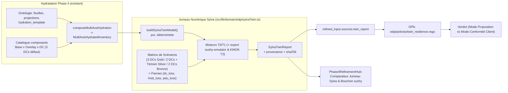

# Design : Jumeau numérique de Sylva (#292, #293, #294)

## 1. Principe directeur : une échelle de fidélité graduée exécutable en CI

Nous exposons **quatre niveaux opérationnels** (+ étalon T4) derrière un même contrat ; chaque rapport déclare le niveau atteint (`fidelity`), la cible Sylva (`sylva-core: latest`) et ses hypothèses explicites (`assumptions[]`).

| Niveau | Moteur | Exécutable en CI ? | Ce qu'il modélise | Coût |
|---|---|---|---|---|
| **T0 · Render** | `helm template` (`sylva-units` `latest`) + JSON Schema + 15 règles d'or | **Oui (CI PR)** | DAG des unités (`dependsOn`), valeurs effectives `SylvaWorkloadCluster`, conformité `capm3`/`cabpr` | ~1 s |
| **T1 · Analytique** | Fonctions pures TypeScript (`sylvaTwin.ts`) | **Oui (CI PR & UI temps réel)** | Placement par domaine de défaillance (3 DCs / 2 DCs + Témoin / 2 DCs), quorum `etcd` RKE2, quorum d'écriture stockage (RF=3), bin-packing CPU/RAM/Hugepages/SR-IOV sous panne (`dc_loss`, `host_loss`, `power_feed_loss`), continuité des flux de médiation | < 50 ms |
| **T2 · Scheduler & Redfish Mock** | `kwok` (scheduler K8s réel) + `sushy-tools` (`sushy-emulator` *in-memory*) | **Oui (CI Docker / integrator-tools)** | Bouchon Redfish BMC auto-généré depuis `nautobot_planned_devices` (respecte `infra_provider: capm3`), inspection `BareMetalHost`, re-scheduling K8s réel (`topologySpreadConstraints`, `PodDisruptionBudget`, anti-affinité) | ~15-30 s |
| **T3 · Réseau** | `Batfish` (déjà dans `deploy/integrator-tools`) | **Job CI / Intégrateur** | Joignabilité des flux de médiation (`service_mediation_flows`), VRFs, absence de bypass `s6a → dea` | ~1 min |
| **T4 · Contrôle** | CAPI + Metal3 BMO/Ironic face à `sushy-emulator` | **Nightly** | Étalon de calibration de T1/T2 sur le cycle de vie complet des `BareMetalHost` | ~15 min |

## 2. Architecture

### 2.1 Topologies modélisées (Baseline = 3 DCs)

Le jumeau modélise explicitement trois architectures de déploiement à partir du même catalogue Base × Overlay :

1. **`3dc-active` (3 DCs Actif/Actif/Actif — Défaut / Profil Gold)** :
   - Datacenters : `dc1` (`primary`), `dc2` (`secondary`), `dc3` (`tertiary`).
   - Control-plane RKE2 / `etcd` : 3 nœuds répartis `1 + 1 + 1`.
   - Stockage (Longhorn/Ceph) : `RF = 3` réparti `1 + 1 + 1`.
   - Management cluster : étiré `1 + 1 + 1` (survit à la perte de n'importe quel DC).
   - En cas de panne `dc_loss(dc1)` : `etcd` conserve `2/3` membres (**quorum OK**), le stockage conserve `2/3` réplicas (**écriture OK**), les workloads de `dc1` basculent sur `dc2` + `dc3` si la réserve de capacité (`headroom`) des pools `sylva-cnf-sriov-dpdk` et `sylva-general-compute` est suffisante.
2. **`2dc-witness` (2 DCs + Site Témoin / Arbiter — Profil Silver)** :
   - Datacenters : `dc1` (`primary`), `dc2` (`secondary`) pour les charges utiles + `dc3` configuré en mode `witness` (1 seul nœud léger d'arbitrage, zéro workload métier).
   - Control-plane RKE2 / `etcd` : `1 (dc1) + 1 (dc2) + 1 (dc3-witness)`.
   - Stockage : `1 (dc1) + 1 (dc2) + 1 tie-breaker (dc3-witness)`.
   - En cas de panne `dc_loss(dc1)` : le quorum `etcd` (`2/3`) et le quorum stockage restent **maintenus automatiquement** sans payer un 3e DC complet de calcul/SR-IOV, mais toute la charge de `dc1` doit tenir sur le seul `dc2` (exige ≥ 50 % de réserve de capacité sur `dc1`/`dc2`).
3. **`2dc-split` (2 DCs secs sans témoin — Profil Bronze)** :
   - Datacenters : `dc1` (`primary`), `dc2` (`secondary`).
   - Control-plane RKE2 / `etcd` : répartition asymétrique `2 (dc1) + 1 (dc2)`.
   - En cas de panne `dc_loss(dc1)` : seul `1/3` membre `etcd` survit sur `dc2` ⇒ **perte de quorum `etcd`** (`etcdQuorumSurvives = false`) et perte de quorum d'écriture stockage `RF=3` ⇒ bascule automatique impossible sans intervention humaine (`RTO > 0`).

### 2.2 Double mode d'arbitrage : Proposition d'équipe vs Fixé par le client

Le jumeau accepte une politique d'évaluation (`TwinGovernancePolicy`) fonctionnant selon deux modes :

- **`mode: 'proposal'` (À la main de l'équipe d'architecture)** :
  - Évalue les 3 profils (`3dc-active`, `2dc-witness`, `2dc-split`) sous toutes les pannes élémentaires (`dc_loss(dc1)`, `dc_loss(dc2)`, `host_loss`, `power_feed_loss(PDU-A)`).
  - Classe les profils et produit une **recommandation argumentée** (ex. recommande `3dc-active` pour une résilience Gold sans point de défaillance unique, ou `2dc-witness` si le client n'a que 2 salles informatiques lourdes mais dispose d'un local tiers pour un témoin).
- **`mode: 'client-mandated'` (Imposé par le client / CCTP)** :
  - Confronte la topologie imposée par le client (ex. `mandatedProfile: '2dc-split'`) aux invariants exigés (`requireZeroTouchDcFailover: true`, `requireEtcdQuorumOnDcLoss: true`, `requireStorageWritableOnDcLoss: true`).
  - Produit la liste exacte des violations pour l'oracle OPA (`edp/policies/twin_resilience.rego`) afin de documenter une réserve formelle au CCTP.

### 2.3 Bouchonnage Bare-Metal Redfish avec `sushy-tools` (`sushy-emulator`)

Pour éviter que les URLs Redfish (`bmc.address`) des `BareMetalHost` CAPI `capm3` ne restent de simples chaînes inertes, le jumeau inclut un générateur déterministe `generateSushyEmulatorConfig(model)` qui produit :
- Le fichier de configuration `sushy-emulator.conf` (Python/Flask compatible `quay.io/metal3-io/sushy-tools`) contenant les entrées `SUSHY_EMULATOR_FAKE_SYSTEMS` calquées sur chaque équipement de `nautobot_planned_devices` (UUID déterministe dérivé du hostname, `bootMACAddress`, CPU, RAM GiB, `PowerState`, adresse OOB RFC 5737).
- Les manifestes `KWOK` (`Node` Kubernetes annotés `kwok.x-k8s.io/node: fake` avec labels `topology.kubernetes.io/zone`, `sylva.org/pool`, `sylva.org/dataplane` et ressources `allocatable` `hugepages-1Gi` / `intel.com/sriov_netdevice`) permettant d'exécuter le vrai `kube-scheduler` en CI sans VMs lourdes.
